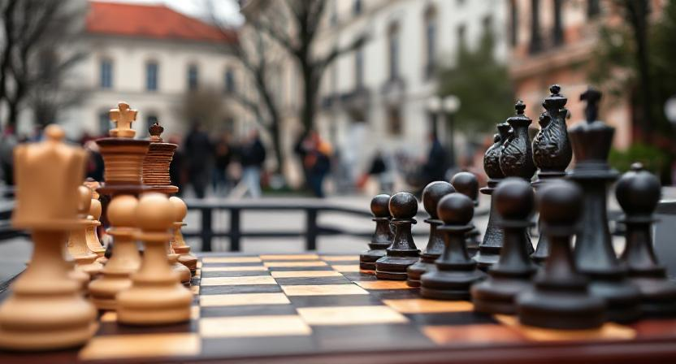

###### Seniori – II. ekipa, 7.kolo



Protekle nedjelje ŠK Odra II gostovala je kod ekipe ŠK Travno II. Nažalost, iako su naši šahisti krenuli puni volje i borbenog duha, rezultat nije bio na njihovoj strani – domaćini su slavili s uvjerljivih **5:1**.

Ekipa je nastupila u sastavu: Božo, Luka Fiolić, Nikola Pischiutta, Ivana Fiolić, Lucija Fiolić i Slavko.

Kapetan Božo pokazao je svoju borbenost na prvoj ploči. U složenoj topovskoj završnici protivnik je uspio doći do prednosti, a Božo, iako nije uspio osvojiti bod, pokazao je koliko mu srce kuca za ekipu. Njegovu partiju donosimo u prilogu.

Luka je odlučio pješake provesti u marš ispred kralja, no kralj je ostao nezaštićen i partija je otišla na stranu protivnika.

Nikola je solidno otvorio partiju, ali zbog previše vezivanja figura ubrzo gubi kvalitetu, a zatim i partiju.

Ivana je pokazala solidnu igru, nadigrala protivnika, ali jedan previd i pasivna igra na kraju koštali su je partije.

Lucija je pružila dobar otpor, ali joj još fali iskustva i vježbe da partije privodi do pobjede.

Slavko je, pak, odlučio pokazati kako se to radi – strpljivo je nadigrao protivnika i donio **jedinu pobjedu Odre**. Herojski!🏆 Njegovu partiju također donosimo u prilogu.

Sve u svemu – teška nedjelja za ŠK Odra II, ali glave gore! Idemo dalje i pripremamo se za sljedeće kolo, kada ekipa Zaprešić II dolazi u goste. Sigurni smo da će naši šahisti pokušati okrenuti situaciju i donijeti bodove kući.

<table><tbody><tr><td>Pl.</td><td></td><td><strong>KŠK Travno II</strong></td><td>–</td><td></td><td><strong>ŠK Odra II</strong></td><td><b>5-1</b></td></tr><tr><td>1.</td><td>&nbsp;MK</td><td>Mitrović, Milivoj</td><td>–</td><td>III</td><td>Cvetković, Božo</td><td>1-0</td></tr><tr><td>2.</td><td>&nbsp;III</td><td>Muha, Martin</td><td>–</td><td>IV</td><td>Fiolić, Luka</td><td>1-0</td></tr><tr><td>3.</td><td>&nbsp;III</td><td>Benković, Duje</td><td>–</td><td></td><td>Pischiutta, Nikola</td><td>1-0</td></tr><tr><td>4.</td><td>&nbsp;IV</td><td>Jagušt, Luka</td><td>–</td><td>II</td><td>&nbsp;Fiolić, Ivana</td><td>1-0</td></tr><tr><td>5.</td><td>&nbsp;IV</td><td>Kelava, Josip</td><td>–</td><td>III</td><td>Fiolić, Lucija</td><td>1-0</td></tr><tr><td>6.</td><td></td><td>Šagovac, Zoran</td><td>–</td><td></td><td>Biondić, Slavko</td><td>0-1</td></tr></tbody></table>

```pgn
[Event "5. Liga ŠZŽ Centar 2025"]

[Site "Travno"]
[Date "2025.09.14"]
[Round "7"]
[White "MK Mitrović, Milivoj (1912)"]
[Black "III Cvetković Božo (1688)"]
[Result "1-0"]

1. Nf3 d5 2. b4 e6 3. Bb2 c6 4. g3 f5 5. Bg2 Nf6 6. a3 Bd6 7. O-O O-O 8. d3 Qc7 9. c4 b6 10. Qc2 c5 11. Qb3 Bb7 12. Nc3 a6 13. Ng5 Qe7 14. cxd5 e5 15. bxc5 bxc5 16. Ne6 Rc8 17. Na4 Ra7 18. Nexc5 Bxc5 19. Nxc5 Rxc5 20. Qb6 Bxd5 21. Qxb8+ Kf7 22. Qxe5 Bxg2 23. Qxe7+ Rxe7 24. Kxg2 Rxe2 25. Bd4 Rd5 26. Bxf6 Kxf6 27. Rfd1 Rd6 28. Rac1 Ra2 29. Rc3 g5 30. d4 g4 31. d5 Re2 32. Kf1 Re4 33. f4 gxf3 34. Rxf3 Ke5 35. Kf2 h5 36. h4 Kf6 37. Rf4 Ke5 38. Rf3 Kf6 39. Rc3 Ke5 40. Rc5 f4 41. gxf4+ Rxf4+ 42. Kg3 Rg6+ 43. Kh3 Rf3+ 44. Kh2 Rf4 45. d6+ Ke6 46. Rxh5 Rf2+ 47. Kh1 Rf3 48. Rg5 Rxg5 49. hxg5 Kd7 50. Rd5 Rxa3 51. Kg2 Re3 52. g6 Re6 53. Rg5 Re8 54. Kf3 Kxd6 55. Kg4 Rg8 56. g7 Ke6 57. Kh5 a5 58. Kh6 a4 59. Kh7 Kf6 60. Rg3 1-0
```

```pgn
[Event "5. Liga ŠZŽ Centar 2025"]

[Site "Travno"]
[Date "2025.09.14"]
[Round "7"]
[White "Biondić, Slavko (1619)"]
[Black "Šagovac, Zoran"]
[Result "1-0"]

1. d4 c6 2. c4 d5 3. Nc3 Bf5 4. Nf3 e6 5. Bf4 Nd7 6. e3 Ngf6 7. cxd5 cxd5 8. Bd3 Bg4 9. O-O Bb4 10. Rc1 O-O 11. a3 Ba5 12. b4 Bc7 13. Bxc7 Qxc7 14. Nxd5 Qd6 15. Nxf6+ Nxf6 16. Be2 Rac8 17. Ne5 Bf5 18. Qb3 Ne4 19. Nc4 Qe7 20. f3 Nf6 21. e4 Bg6 22. Rfd1 b5 23. Ne5 Nh5 24. Nxg6 hxg6 25. Bxb5 Qg5 26. Rc5 Rxc5 27. dxc5 Nf4 28. Qc2 f5 29. exf5 exf5 30. g3 Re8 31. Bxe8 1-0
```
