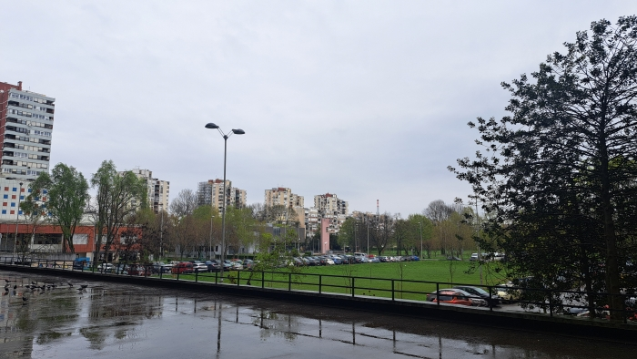

**Seniori – I. ekipa, 2.kolo  
  
**  
Ove nedjelje smo odigrali dobar [meč](https://chess-results.com/tnr1127780.aspx?lan=13&art=3&rd=2) u Travnom te uzeli puni plijen. Mladen je prijateljski remizirao, a Ivana zapala u probleme vrlo rano jer nije uspjela rokirati te njen protivnik Meštrović brzo partiju privodi kraju. Ubrzo nakon pobjeđuje Ivan Maravić zbog nerokiranog protivničkog kralja i nerazvijenih protivničkih figura. Vraneša je imao stabilnu malu prednost od početka partije. Pri prelasku u završnicu njegov protivnik se preračunava u žrtvenome nastavku te ostaje s topom manje i tu je partiji kraj. Ivo je odigrao, kao i prošli tjedan, jednu vrhunsku partiju te je praktički bez greške doveo svoga protivnika do kapitulacije. Ova prva dva kola je odigrao daleko najbolje od nas, nadamo se da će tako nastaviti! Zvjezdan je ostao zadnji igrati, nakon otvaranja nije stajao bajno, da bi kasnije uspio uzeti figuru. Nažalost, Zvjezdan je već tradicionalno poznat kao kasnioc te mu je ovdje tih 20 minuta kojih je kasnio falilo da realizira materijalnu prednost te je na kraju došao i u lošiju poziciju. Nasreću, njegov protivnik također nema vremena te partija završava ponavljanjem poteza. Tu partiju donosimo u prilogu. Sve u svemu, možemo biti zadovoljni našom igrom u ovom kolu. Ovo je naš najbolji ulazak u sezonu otkad smo se vratili u treću ligu. Nadamo se da ćemo nastaviti ovako idući vikend kad ugošćujemo Goričane.

<table><tbody><tr><td>Pl.</td><td></td><td><strong>ŠK Travno</strong></td><td>–</td><td></td><td><strong>ŠK Odra</strong></td><td><strong>2-4</strong></td></tr><tr><td>1.</td><td>MK</td><td>Šagovac, Kristijan 2139</td><td>–</td><td>MK</td><td>Karlić, Zvjezdan 2093</td><td>½–½</td></tr><tr><td>2.</td><td>MK</td><td>Portada, Maroje 2094</td><td>–</td><td>MK</td><td>Maravić, Ivan 2097</td><td>0-1</td></tr><tr><td>3.</td><td>MK</td><td>Nagl, Mladen 2063</td><td>–</td><td>MK</td><td>Sliepčević, Mladen 2092</td><td>½–½</td></tr><tr><td>4.</td><td>MK</td><td>Meštrović, Toni 2034</td><td>–</td><td></td><td>Mikić, Ivana 1901</td><td>1-0</td></tr><tr><td>5.</td><td>I</td><td>Šimrak, Tomislav 1992</td><td>–</td><td>II</td><td>Pahljina, Ivo 1951</td><td>0-1</td></tr><tr><td>6.</td><td>I</td><td>Mudrinić, Nenad 1987</td><td>–</td><td>II</td><td>Vraneša, Ivan 1898</td><td>0-1</td></tr></tbody></table>

```pgn
[Event "III A liga - Travno : Odra"]
[Site "sahovski-klub.com"]
[Date "2025.03.30"]
[Round "2"]
[White "MK Šagovac, Kristijan"]
[Black "MK Karlić, Zvjezdan"]
[Result "1/2-1/2"]
[ECO "B84"]
[WhiteElo "2139"]
[BlackElo "2093"]
[PlyCount "110"]
1. e4 c5 2. Nf3 d6 3. d4 cxd4 4. Nxd4 Nf6 5. Nc3 a6 6. Be2 e6 7. O-O Be7 8. a4 Nbd7 9. a5 Qc7 10. f4 b5 11. axb6 Nxb6 12. Qd3 Bb7 13. Bf3 d5 14. e5 Nfd7 15. Bg4 Qc4 16. Qd1 O-O 17. Kh1 Rfe8 18. Nce2 Bf8 19. Rf3 Qc7 20. Rh3 Nc5 21. b3 Ne4 22. Qe1 Qe7 23. Be3 Nd7 24. Ng1 f5 25. exf6 Qxf6 26. f5 e5 27. Ne6 d4 28. Bc1 Rxe6 29. Nf3 Ree8 30. Nh4 a5 31. Be2 Bb4 32. Bc4+ Kf8 33. Qe2 Nb6 34. Bd3 Nc5 35. Bb5 Ba6 36. Qh5 Bxb5 37. Bg5 Qxg5 38. Qxg5 Ne4 39. Ng6+ Kg8 40. Qh4 Nf6 41. g4 Bc6+ 42. Kg1 Be4 43. Rf1 Bc5 44. Re1 d3+ 45. Kf1 hxg6 46. Rxe4 Nxe4 47. Qh7+ Kf8 48. Rxd3 Ng5 49. Qxg6 e4 50. f6 gxf6 51. Qxf6+ Nf7 52. Rh3 Kg8 53. Qg6+ Kf8 54. Qf6 Kg8 55. Qg6+ Kf8 1/2-1/2
```

  
*IvanM*
