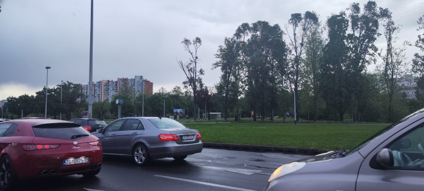

**Seniori, 3.kolo  
  
**  
Još jedna nedjelja, još jedan zaslužen poraz. Iz Travnog izlazimo s dva pojedinačna boda, a po prikazanome, možemo i s time biti sretni. Stjepko je prvi brzo remizirao. Zvjezdan je korektno žrtvovao, ali u oskudici vremena ne pronalazi prave poteze te gubi. Darko je odigrao jako lošu partiju u kojoj je previdio previše toga da bi osvojio ikakav bod. Vraneša je imao jednaku poziciju dok nije previdio taktiku u završnici nakon koje nije bilo spasa. Najsvjetlija točka dana je nastup našega novoga člana Ive Pahljine. Bio je u problemima u otvaranju, ali je pokazao iznimnu borbenost te se izvukao, čak je imao i dobitak u jednome potezu u cajtnotu, ali je partija na kraju otišla u remi. Sve pohvale za prvi nastup, vidi se već sada da smo dobili dobroga igrača! Zadnji je ostao Ivan koji je još jednom pokazao svu svoju raskoš realizacije i iz pozicije +5.7 došao do 0. Međutim, u jednakoj završnici je njegov protivnik počeo preambiciozno igrati i zbog toga izgubio. Čestitke Travnom, a nama jedino što preostaje je probati igrati bolje. Sada slijedi pauza, pa 14. travnja ugošćujemo Zaprešićane.

<table><tbody><tr><td>Pl.</td><td></td><td><strong>ŠK Travno</strong></td><td>–</td><td></td><td><strong>ŠK Odra</strong></td><td><strong>4-2</strong></td></tr><tr><td>1.</td><td>MK</td><td>Šagovac, Kristijan 2112</td><td>–</td><td>MK</td><td>Karlić, Zvjezdan 2099</td><td>1-0</td></tr><tr><td>2.</td><td>MK</td><td>Portada, Maroje 2092</td><td>–</td><td>MK</td><td>Maravić, Ivan 2079</td><td>0-1</td></tr><tr><td>3.</td><td>MK</td><td>Nagl, Mladen 2062</td><td>–</td><td>MK</td><td>Maravić, Stjepan 2107</td><td>½–½</td></tr><tr><td>4.</td><td>MK</td><td>Meštrović, Toni 2019</td><td>–</td><td>MK</td><td>Vidaković, Darko 2127</td><td>1-0</td></tr><tr><td>5.</td><td>I</td><td>Vukovojac, Vedran 1982</td><td>–</td><td>II</td><td>Pahljina, Ivo 1969</td><td>½–½</td></tr><tr><td>6.</td><td>I</td><td>Mudrinić, Nenad 2021</td><td>–</td><td>II</td><td>Vraneša, Ivan 1885</td><td>1-0</td></tr></tbody></table>

*IvanM*
