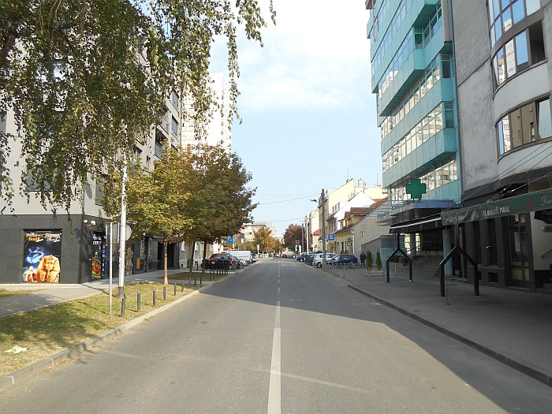
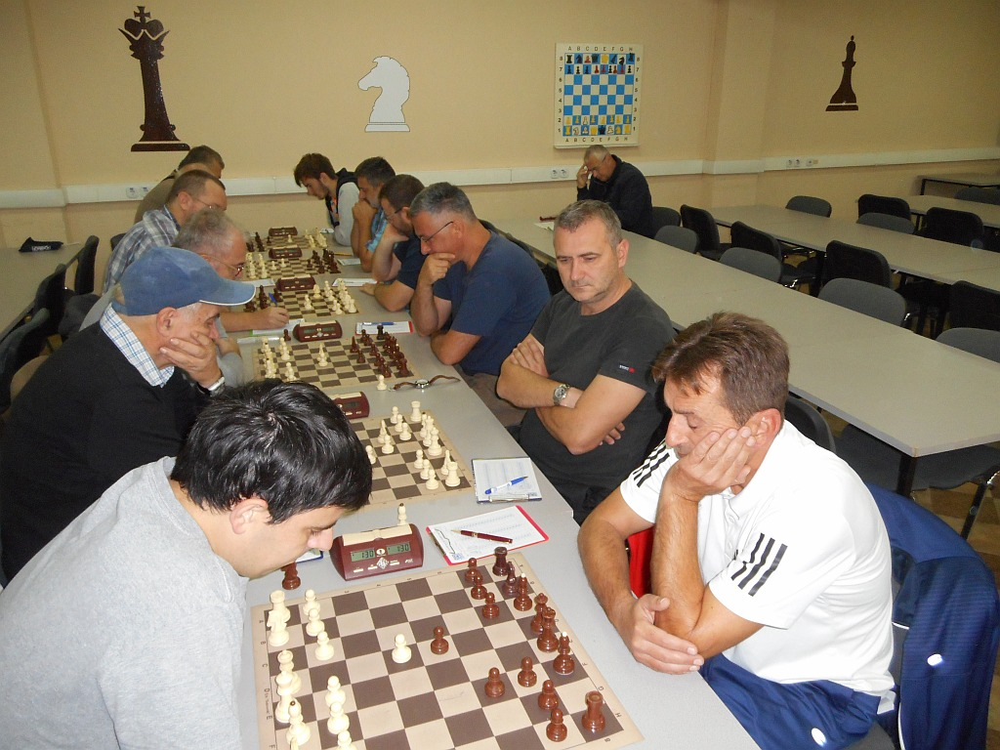

**Seniori, 6. kolo  
**

I seniori ŠK Odra dočekali su prvu ligašku pobjedu. Uvjerljivo i zasluženo pobijedili su ekipu ŠK Vladimir Ivetić. Mali nesporazum nastao je prije početka meča jer se meč igrao u Domu sportova, a ne u Sopotu kako je bilo najavljeno u biltenu natjecanja. Sve partije bile su prilično kvalitetne za ovaj rang natjecanja. Prvi je završio Cvetko koji je simpatičnom taktikom osvojio damu. Nakon njega Stipe je prihvatio remi u izjednačenoj poziciji. Mladi Ivan je odigrao solidnu partiju, ali se doveo u vremensku oskudicu te iz potpuno dobivene pozicije ušao u borbu za remi. Remizirao je završnicu top protiv topa i skakača. Darko je ušao u završnicu raznobojaca i dama, a protivnik mu je neoprezno dopustio matni napad. Jura je također ušao u završnicu raznobojaca te remizirao. Zvjezdan je osvojio kvalitet i ušao u nadmoćnu poziciju te lako realizirao materijalnu prednost. Ovom pobjedom pojavila se i mala nada za opstanak u ligi. Sljedeće kolo igra se za tjedan dana, a u goste nam dolazi ekipa ŠK UHBDR 99. brigade.

<table><tbody><tr><td></td><td></td><td>&nbsp;&nbsp;<strong>ŠK Vladimir Ivetić, Zagreb</strong></td><td>–</td><td></td><td>&nbsp;&nbsp;<strong>ŠK Odra, Zagreb</strong></td><td><strong>1,5 : 4,5</strong></td></tr><tr><td>1.</td><td>FM</td><td><table><tbody><tr><td></td><td>Malada, Vinko 2317</td></tr></tbody></table></td><td>–</td><td>MK</td><td><table><tbody><tr><td></td><td>Bačurin, Juraj 2040</td></tr></tbody></table></td><td>½ – ½</td></tr><tr><td>2.</td><td>MK</td><td><table><tbody><tr><td></td><td>Vitaljić, Nebojša 1947</td></tr></tbody></table></td><td>–</td><td>MK</td><td><table><tbody><tr><td></td><td>Maravić, Stjepan 2108</td></tr></tbody></table></td><td>½ – ½</td></tr><tr><td>3.</td><td>I</td><td><table><tbody><tr><td></td><td>Fiamengo, Joško 2051</td></tr></tbody></table></td><td>–</td><td>MK</td><td><table><tbody><tr><td></td><td>Vidaković, Darko 2116</td></tr></tbody></table></td><td>0 – 1</td></tr><tr><td>4.</td><td>II</td><td><table><tbody><tr><td></td><td>Karlušić, Marko 1910</td></tr></tbody></table></td><td>–</td><td>MK</td><td><table><tbody><tr><td></td><td>Karlić, Zvjezdan 2103</td></tr></tbody></table></td><td>0 – 1</td></tr><tr><td>5.</td><td>III</td><td><table><tbody><tr><td></td><td>Belicki, Antonijo 1882</td></tr></tbody></table></td><td>–</td><td>MK</td><td><table><tbody><tr><td></td><td>Cvetković, Ivan 1942</td></tr></tbody></table></td><td>0 – 1</td></tr><tr><td>6.</td><td>III</td><td><table><tbody><tr><td></td><td>Horvat, Tihomir 1829</td></tr></tbody></table></td><td>–</td><td>II</td><td><table><tbody><tr><td></td><td>Maravić, Ivan 1721</td></tr></tbody></table></td><td>½ – ½</td></tr></tbody></table>
