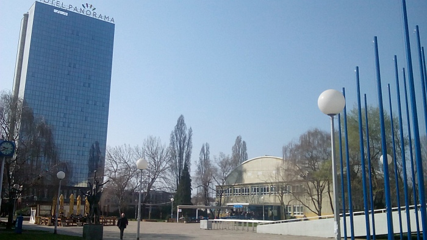

**Seniori, 2. kolo******

U nedjelju 13. ožujka odigrano je drugo kolo IV. A seniorske lige. ŠK Odra bio je gost kod ŠK Vladimir Ivetić (bivši ŠK HRT), a meč se igrao u Domu sportova. Goran je ovo kolo prepustio svoje mjesto mlađim snagama, tj. Ivanu, ali je i dalje na raspolaganju. Ekipi se pridružio i Tin, koji je u prošlom kolu sudio. Nažalost, propuštena je velika prilika za prvu pobjedu. Darko i Jura pritisnuli su i nadigrali protivnike žrtvama kvalitete, a mladi Ivan je nažalost promašio već u četvrtom potezu i brzo izgubio. Stipe je stajao mrvicu bolje, ali je nakon duge igre u izjednačenoj poziciji previdio neobranjivu matnu prijetnju. Cvetko je forsirao i na kraju remizirao ponavljanjem poteza kako ne bi izgubio pješaka, ali u poziciji u kojoj je pristao na remi, nije vidio (kao ni itko od nas) žrtvu topa s neobranjivim matnim napadom. Igrom je ugodno iznenadio Tin, koji je protivnika doveo u izgubljenu poziciju. Imao je dva pješaka više i besplatnu figuru, ali je došao u vremensku oskudicu, uspaničio se i previdio cijeli top. Tako je na kraju rezultat prevagnuo na stranu domaćina, a ŠK Odra zasjeo na pretposljednje mjesto na tablici. Sljedeće kolo igra se 10. travnja, a u goste nam dolazi ŠK INA.

**ŠK VLADIMIR IVETIĆ – ŠK ODRA 3,5:2,5**

1\. Mikec, Darko – Vidaković, Darko 0:1  
2\. Božičević, Ivan – Maravić, Stjepan 1:0  
3\. Fiamengo, Joško – Bačurin, Juraj 0:1  
4\. Fiamengo, Andrija – Cvetković, Ivan 1/2  
5\. Horvat, Tihomir – Maravić, Ivan 1:0  
6\. Gverić, Tvrtko – Furčić, Tin 1:0
