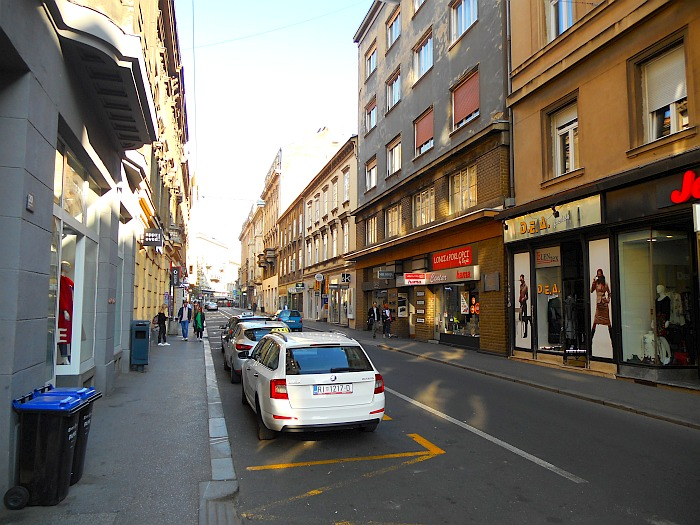
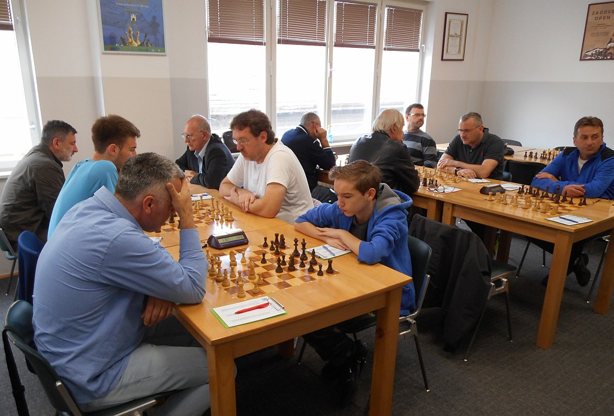
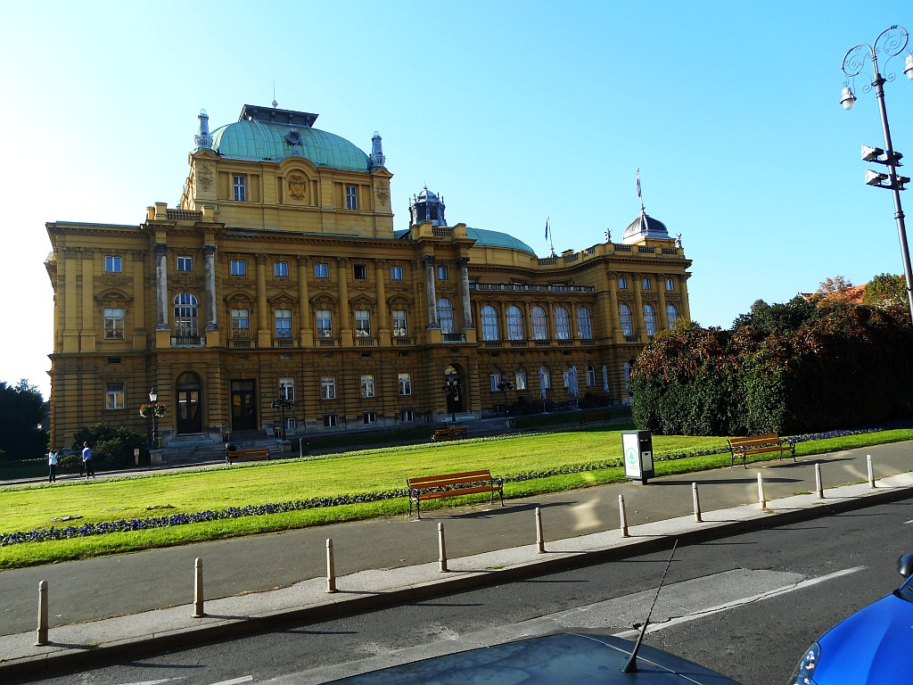

**Seniori, 11. kolo  
**U nedjelju, 27. listopada završila je ovogodišnja [seniorska liga](http://chess-results.com/tnr414083.aspx?lan=13&art=0). Na gostovanju kod ŠK Vladimir Ivetić seniori su pokazali dobru igru i ostvarili lijepu pobjedu u posljednjem kolu. Meč se igrao u prostorijama ZŠS-a u Masarykovoj 22. Stjecajem okolnosti, ovo kolo nastupili smo, možda ne u najjačem, ali zato u najiskusnijem sastavu. Posebno veseli Zvjezdanov povratak u formu. I ovo kolo odigrao je jako lijepu partiju. Ivan je pak (zbog neznanja) propustio prednost u otvaranju, ali je dalje igrao vrlo dobro. Srećom, zato i služe ove partije da bi mlađi igrači učili i napredovali. Jura je bio neoprezan u otvaranju i ostao bez pješaka, Cvetko je efektno završio partiju matom, Darko je osvojio pješaka i dobio završnicu, Stipe odigrao rutinski… Cijelu godinu dobro su igrali Stipe, Cvetko i mladi Ivan, a posljednja dvojica su godinu završili bez poraza. Jura je pomalo ispao iz forme, ali zato mlađi igrači napreduju. Od kadeta (i kadetkinja) koji su ove godine igrali za seniore, posebno je ugodno iznenadila Ana (2/4). Nasreću, ove godine smo puno ranije osigurali opstanak pa su mlađi igrači dobili više šansi, iako zadnje kolo djevojke nisu nastupile zbog privatnih obaveza. Vraneša je zakazao brojem odigranih partija jer nedjeljom igra nogomet, ali je zato igrao sva kola juniorske lige. Imamo već pet mladih igrača koji se mogu nositi s protivnicima u ovoj konkurenciji, barem na nižim pločama. Ana, Vraneša, Ivan, Monika i Samanta će, nadam se, sljedeće godine još više se angažirati u seniorskoj ligi, a za koju godinu već možemo razmišljati o ulasku u viši rang natjecanja.  
U viši rang natjecanja plasirali su se ŠK Prigorje Markuševac i Karlovački šahovski klub.

<table><tbody><tr><td></td><td></td><td>&nbsp;<strong> ŠK Vladimir Ivetić</strong></td><td><strong>–</strong></td><td><strong>&nbsp;</strong></td><td><strong>&nbsp; ŠK Odra</strong></td><td><strong>1,5 :</strong> <strong>4,5</strong></td></tr><tr><td>1.</td><td>FM</td><td><table><tbody><tr><td></td><td>Malada, Vinko 2283</td></tr></tbody></table></td><td>–</td><td>MK</td><td><table><tbody><tr><td></td><td>Bačurin, Juraj 2022</td></tr></tbody></table></td><td>1 – 0</td></tr><tr><td>2.</td><td>MK</td><td><table><tbody><tr><td></td><td>Vitaljić, Nebojša 1939</td></tr></tbody></table></td><td>–</td><td>MK</td><td><table><tbody><tr><td></td><td>Maravić, Stjepan 2121</td></tr></tbody></table></td><td>0 – 1</td></tr><tr><td>3.</td><td>I</td><td><table><tbody><tr><td></td><td>Fiamengo, Andrija 1921</td></tr></tbody></table></td><td>–</td><td>MK</td><td><table><tbody><tr><td></td><td>Karlić, Zvjezdan 2093</td></tr></tbody></table></td><td>0 – 1</td></tr><tr><td>4.</td><td>I</td><td><table><tbody><tr><td></td><td>Karlušić, Luka 1918</td></tr></tbody></table></td><td>–</td><td>MK</td><td><table><tbody><tr><td></td><td>Vidaković, Darko 2098</td></tr></tbody></table></td><td>0 – 1</td></tr><tr><td>5.</td><td>II</td><td><table><tbody><tr><td></td><td>Karlušić, Marko 1886</td></tr></tbody></table></td><td>–</td><td>I</td><td><table><tbody><tr><td></td><td>Maravić, Ivan 1942</td></tr></tbody></table></td><td>½ – ½</td></tr><tr><td>6.</td><td>III</td><td><table><tbody><tr><td></td><td>Belicki, Antonijo 1809</td></tr></tbody></table></td><td>–</td><td>MK</td><td><table><tbody><tr><td></td><td>Cvetković, Ivan 1953</td></tr></tbody></table></td><td>0 – 1</td></tr></tbody></table>

---

```pgn
[Event "I. Cvetković vs A. Belicki"]
[Date "2019.11.27"]
[Round "11"]
[SetUp "3"]
[FEN "3r1r2/2p1npN1/pp5p/4P1k1/2Q2pq1/2PB1R2/PP2K3/4R3 b - - 0 35"]35... Rd5 36. Rg1 Qxg1 37. Qxf4 1-0
```

---

   
Poredak:

<table><tbody><tr><td><strong>Mj.</strong></td><td><strong>Momčad</strong></td><td><strong>1</strong></td><td><strong>2</strong></td><td><strong>3</strong></td><td><strong>4</strong></td><td><strong>5</strong></td><td><strong>6</strong></td><td><strong>7</strong></td><td><strong>8</strong></td><td><strong>9</strong></td><td><strong>10</strong></td><td><strong>11</strong></td><td><strong>12</strong></td><td><strong>&nbsp;TB1&nbsp;</strong></td><td><strong>&nbsp;TB2&nbsp;</strong></td></tr><tr><td>1.</td><td>ŠK Prigorje Markuševec</td><td>&nbsp;*</td><td>3</td><td>2½</td><td>3</td><td>5</td><td>6</td><td>4</td><td>4</td><td>3</td><td>5</td><td>3</td><td>3½</td><td>16</td><td>42,0</td></tr><tr><td>2.</td><td>Karlovački šahovski klub</td><td>3</td><td>&nbsp;*</td><td>2½</td><td>4</td><td>4½</td><td>3½</td><td>3</td><td>4</td><td>3</td><td>3</td><td>4</td><td>4</td><td>16</td><td>38,5</td></tr><tr><td>3.</td><td>ŠK Špansko</td><td>3½</td><td>3½</td><td>&nbsp;*</td><td>3</td><td>3</td><td>3</td><td>3½</td><td>4</td><td>2</td><td>3½</td><td>4</td><td>3</td><td>16</td><td>36,0</td></tr><tr><td>4.</td><td>ŠK Podsused</td><td>3</td><td>2</td><td>3</td><td>&nbsp;*</td><td>3</td><td>3</td><td>3</td><td>3</td><td>4½</td><td>4</td><td>3</td><td>4½</td><td>13</td><td>36,0</td></tr><tr><td><strong>5.</strong></td><td><strong>ŠK Odra</strong></td><td>1</td><td>1½</td><td>3</td><td>3</td><td>&nbsp;*</td><td>4½</td><td>3½</td><td>2½</td><td>3½</td><td>3</td><td>4½</td><td>4</td><td><strong>13</strong></td><td><strong>34,0</strong></td></tr><tr><td>6.</td><td>HAŠK Mladost II</td><td>0</td><td>2½</td><td>3</td><td>3</td><td>1½</td><td>&nbsp;*</td><td>2½</td><td>2½</td><td>5</td><td>4½</td><td>4</td><td>4</td><td>10</td><td>32,5</td></tr><tr><td>7.</td><td>ŠK Polet II, Buševec</td><td>2</td><td>3</td><td>2½</td><td>3</td><td>2½</td><td>3½</td><td>&nbsp;*</td><td>2½</td><td>3½</td><td>2</td><td>3½</td><td>3½</td><td>10</td><td>31,5</td></tr><tr><td>8.</td><td>ŠK UHBDR 99. brigade</td><td>2</td><td>2</td><td>2</td><td>3</td><td>3½</td><td>3½</td><td>3½</td><td>&nbsp;*</td><td>3</td><td>4</td><td>2</td><td>2½</td><td>10</td><td>31,0</td></tr><tr><td>9.</td><td>ŠK Dubrava</td><td>3</td><td>3</td><td>4</td><td>1½</td><td>2½</td><td>1</td><td>2½</td><td>3</td><td>&nbsp;*</td><td>3</td><td>4</td><td>2½</td><td>8</td><td>30,0</td></tr><tr><td>10.</td><td>ŠK Silent</td><td>1</td><td>3</td><td>2½</td><td>2</td><td>3</td><td>1½</td><td>4</td><td>2</td><td>3</td><td>&nbsp;*</td><td>3</td><td>4</td><td>8</td><td>29,0</td></tr><tr><td>11.</td><td>ŠK Vladimir Ivetić-Sopot</td><td>3</td><td>2</td><td>2</td><td>3</td><td>1½</td><td>2</td><td>2½</td><td>4</td><td>2</td><td>3</td><td>&nbsp;*</td><td>3½</td><td>7</td><td>28,5</td></tr><tr><td>12.</td><td>ŠK Rugvica-Vrbani</td><td>2½</td><td>2</td><td>3</td><td>1½</td><td>2</td><td>2</td><td>2½</td><td>3½</td><td>3½</td><td>2</td><td>2½</td><td>&nbsp;*</td><td>5</td><td>27,0</td></tr></tbody></table>

Statistika:

<table><tbody><tr><td><strong>Bo.</strong></td><td></td><td><strong>Ime</strong></td><td><strong>RtgI</strong></td><td><strong>RtgN</strong></td><td><strong>1</strong></td><td><strong>2</strong></td><td><strong>3</strong></td><td><strong>4</strong></td><td><strong>5</strong></td><td><strong>6</strong></td><td><strong>7</strong></td><td><strong>8</strong></td><td><strong>9</strong></td><td><strong>10</strong></td><td><strong>11</strong></td><td><strong>Bod.</strong></td><td><strong>Par<br>tije</strong></td><td><strong>Rp</strong></td></tr><tr><td>1.</td><td>MK</td><td>Bačurin Juraj</td><td>2033</td><td>2024</td><td>0</td><td>0</td><td>0</td><td>0</td><td>1</td><td></td><td>½</td><td>0</td><td></td><td></td><td>0</td><td><strong>1,5</strong></td><td><strong>8</strong></td><td>1879</td></tr><tr><td>2.</td><td>MK</td><td>Maravić Stjepan</td><td>2117</td><td>2108</td><td>0</td><td>1</td><td>0</td><td>1</td><td>½</td><td>1</td><td></td><td>1</td><td>0</td><td>½</td><td>1</td><td><strong>6,0</strong></td><td><strong>10</strong></td><td>2128</td></tr><tr><td>3.</td><td>MK</td><td>Karlić Zvjezdan</td><td>2096</td><td>2113</td><td>½</td><td>½</td><td></td><td>1</td><td>0</td><td>0</td><td>1</td><td>½</td><td>½</td><td></td><td>1</td><td><strong>5,0</strong></td><td><strong>9</strong></td><td>2014</td></tr><tr><td>4.</td><td>MK</td><td>Vidaković Darko</td><td>2098</td><td>2100</td><td>½</td><td></td><td>½</td><td>0</td><td></td><td>1</td><td></td><td></td><td></td><td></td><td>1</td><td><strong>3,0</strong></td><td><strong>5</strong></td><td>2032</td></tr><tr><td>5.</td><td>II</td><td>Maravić Ivan</td><td>1947</td><td>2047</td><td></td><td></td><td>1</td><td>1</td><td>½</td><td>1</td><td>½</td><td>1</td><td>½</td><td>½</td><td>½</td><td><strong>6,5</strong></td><td><strong>9</strong></td><td>2036</td></tr><tr><td>6.</td><td>MK</td><td>Cvetković Ivan</td><td>1944</td><td>1944</td><td>½</td><td>½</td><td>1</td><td></td><td>1</td><td>½</td><td>1</td><td></td><td></td><td>½</td><td>1</td><td><strong>6,0</strong></td><td><strong>8</strong></td><td>2044</td></tr><tr><td>7.</td><td>III</td><td>Vraneša Ivan</td><td>1601</td><td>1826</td><td></td><td></td><td></td><td></td><td></td><td>0</td><td>½</td><td></td><td>0</td><td></td><td></td><td><strong>0,5</strong></td><td><strong>3</strong></td><td>1561</td></tr><tr><td>8.</td><td>IV</td><td>Kobali Borislav</td><td>1650</td><td>1743</td><td>0</td><td>0</td><td>½</td><td></td><td></td><td></td><td></td><td></td><td></td><td>½</td><td></td><td><strong>1,0</strong></td><td><strong>4</strong></td><td>1605</td></tr><tr><td>9.</td><td>VK</td><td>Furčić Tin</td><td>1635</td><td>1680</td><td></td><td>1</td><td></td><td>½</td><td></td><td></td><td></td><td></td><td></td><td></td><td></td><td><strong>1,5</strong></td><td><strong>2</strong></td><td>0</td></tr><tr><td>12.</td><td>II</td><td>Kolovrat Ana</td><td>1179</td><td>1639</td><td></td><td></td><td></td><td></td><td></td><td></td><td>½</td><td>1</td><td>0</td><td>½</td><td></td><td><strong>2,0</strong></td><td><strong>4</strong></td><td>1721</td></tr><tr><td>13.</td><td>VK</td><td>Halužan Samanta</td><td>1185</td><td>1660</td><td></td><td></td><td></td><td></td><td></td><td></td><td></td><td>+</td><td>0</td><td>0</td><td></td><td><strong>1,0</strong></td><td><strong>3</strong></td><td>0</td></tr><tr><td>15.</td><td>III</td><td>Kolovrat Monika</td><td>1168</td><td>1763</td><td></td><td></td><td></td><td></td><td>0</td><td></td><td></td><td></td><td></td><td></td><td></td><td><strong>0,0</strong></td><td><strong>1</strong></td><td>0</td></tr></tbody></table>
