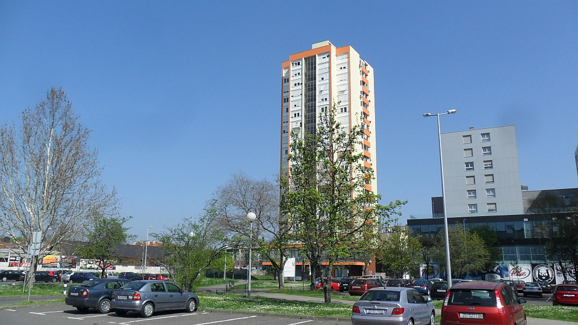

#### Seniori, 3. kolo

Uz dobru dozu sportske sreće, seniorska ekipa ubilježila je još jednu pobjedu u meču protiv ravnopravne ekipe ŠK Vrbani. Od početka su se gotovo sve pozicije doimale obećavajuće. Stipetov protivnik ostao je rano u materijalnim gubicima, Danko je osvojio pješaka i sve je vodilo k lakoj realizaciji, a Zvjezdan je lijepo žrtvovao i napravio dva uznapredovala pješaka te se činilo kao još jedan lako osvojen bod. Na četvrtoj i petoj ploči situacija i nije bila toliko bajna. Cvetko je pogrešno izračunao kombinaciju i zakomplicirao si poziciju s bijelim figurama. Nasreću, prilikom sljedeće kombinacije njegov protivnik griješi i Cvetko ostaje s vezanim slobodnjakom. Tada opet uspijeva zakomplicirati poziciju i ulazi u topovsku završnicu, ovaj put s pješakom manje! Ipak, uspijeva remizirati i donosi presudnih pola boda za momčad. Na petoj ploči Vukalović je potpuno nadigrao Darka i u rohadnom napadu efektno riješio partiju. Na šestoj ploči Jura je od početka pokazao tko vodi glavnu riječ te je hrabrom i otvorenom igrom razbio protivnički gard i završio partiju matom!  
U međuvremenu Zvjezdan previđa taktiku i ulazi u neizvjesnu poluzavršnicu, a Danko iz neobjašnjivih razloga prepušta inicijativu protivniku te na kraju mora žrtvovati figuru u borbi za remi. Nažalost, u vremenskoj oskudici ne uspijeva se do kraja precizno braniti i gubi partiju. Zvjezdanov protivnik u međuvremenu dokazuje teoriju da gubi onaj tko posljednji pogriješi i previđa figuru, a Zvjezdan upisuje veliki bod za ekipu.

ŠK VRBANI – ŠK ODRA    2,5 :  3,5

1\. Ivanda Živko – Maravić Stjepan 0:1  
2\. Šimić Ivica – Brajdić Danko 1:0  
3\. Mišković Stevo – Karlić Zvjezdan 0:1  
4\. Benamatić Krešimir – Cvetković Ivan 1/2  
5\. Vukalović Željko – Vidaković Darko 1:0  
6\. Babaja Mladen – Bačurin Juraj 0:1

#### Kadeti, drugi krug

Jučer su ligu igrale i kadetske ekipe. Zasad je pristigao izvještaj samo s lige kadeta. (Iako su neki roditelji obećali poslati i slike!) Ekipa kadeta ostvarila je dvije pobjede i jedan poraz. Posebno dobar rezultat ostvarili su Vraneša, koji je upisao tri pobjede iz tri partije, te Bruno, koji je upisao dvije pobjede, usput se počastivši pobjedom nad protivnikom II. kategorije, rejtinga 1913! Valjda zato što mu je jučer bio rođendan? 🙂 Bruno, sretan ti rođendan! Kadetkinje su izgubile sva tri meča, ali su nastavile sa skupljanjem pojedinačnih bodova. U prvom krugu jednu pobjedu ostvarila je Ana, a sada je to pošlo za rukom i Franki. Franka, čestitamo na prvoj ligaškoj pobjedi! Samo neka nastave sa skupljanjem iskustva i vjerujem da će prve ekipne pobjede doći već sljedeće sezone!

Posljednji krug obje kadetske ekipe igraju u Varaždinskim toplicama 12. travnja. Zainteresirani roditelji mogu pogledati i akcijsku ponudu hotela Minerva za subotu/nedjelju, saune, kupke itd., a za kadete preporučujem da se izbore za jedan makar i kratak kupanac u bazenima Toplica nakon napornih mečeva. Naravno, ako ne zaborave kupaće. 🙂
