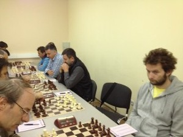
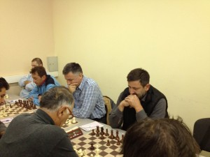

**6\. kolo, seniori**

Danas je u Domu sportova ekipa ŠK Odra odigrala šesto kolo protiv solidne ekipe Vrbana. Prema prikazanoj igri, ekipe su pravedno podijelile bodove. Igralo se nadasve borbeno gotovo na svim pločama. Samo je Ivan miroljubivo remizirao s Miškovićem.  
Zvjezdan je odigrao meč pun preokreta i prilično je čudno da u poziciji nije našao nešto više. Darko je mirno pozicijski priveo partiju kraju, dok je Jura sasvim nadigrao svog protivnika, da bi na kraju umjesto mirne realizacije krenuo u (ispostavilo se) samoubilački napad. Vjeko je opet (pre?)hrabro ušao u komplikacije koje se nisu dobro završile po njega.  
Danko je danas igrao na prvoj ploči. “Jel sad vidite da sam zaslužio igrati na prvoj ploči?! Najjači sam. Ne mogu izgubit’ partiju!  Ali ne mogu sam protiv svih, treba mi nečija pomoć! Ako zatrebate moju pomoć i sljedeće kolo, samo stavite znak na nebo!” skromno je izjavio nakon partije u kojoj je matirao protivnika u točno šezdesetom potezu. “Planirao sam mat u točno šezdesetom potezu da ne bih morao pisati po dodatnom formularu. A najavio sam mat četiri poteza prije!” skromnosti nije bilo kraja.

REZULTATI:

ŠK VRBANI – ŠK ODRA    3 : 3

1. Ivanda Živko II  – Brajdić Danko MK                     0:1

2. Šimić Ivica  I –  Karlić Zvjezdan MK                       1/2

3. Mišković Stevo MK  – Cvetković Ivan MK             1/2

4. Benamatić Krešimir II – Vidaković Darko MK     0:1

5. Vukalović Željko I – Bačurin Juraj MK                   1:0

6. Babaja Mladen II  – Novak Vjekoslav II                 1:0
