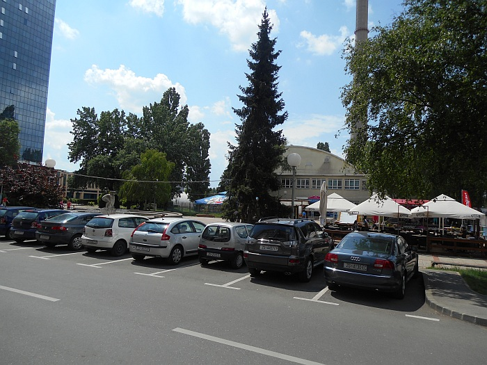
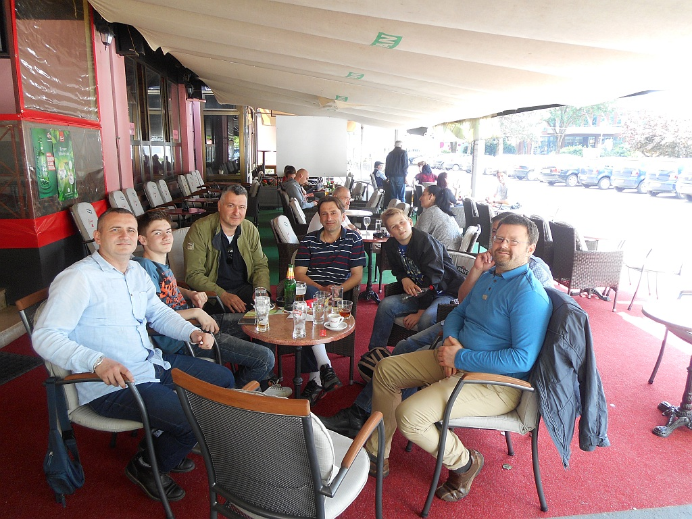
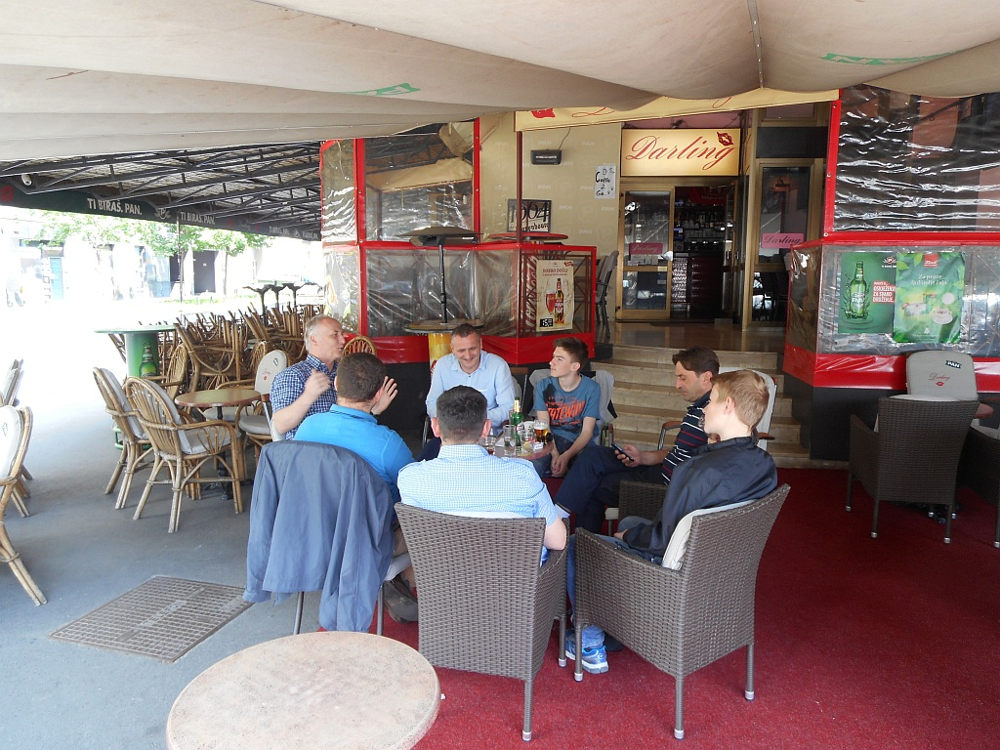
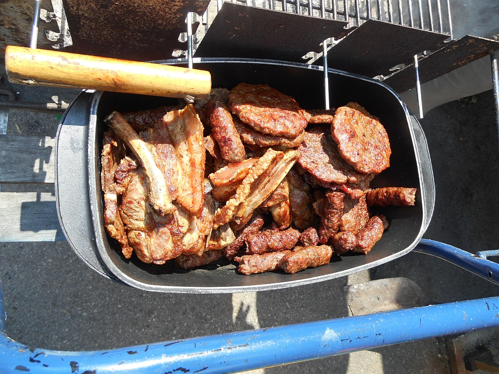
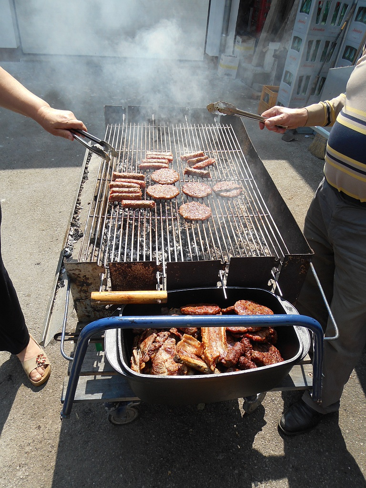
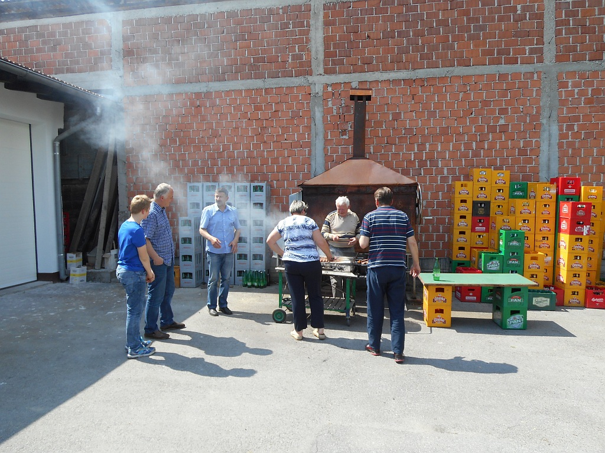
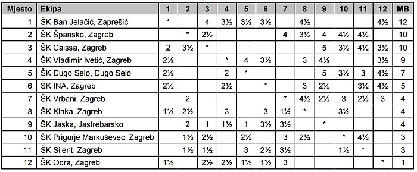

**Seniori, 6. kolo  
  
**Prvi bod! I prvi nastup našega kadeta Ivana Vraneše u seniorskoj konkurenciji. S obzirom na dosadašnje rezultate, i više nego dobro. Danas je ŠK Odra gostovao kod ŠK Vrbani, a meč se odigrao u Domu sportova. Najvažnijim događajem čini mi se prvi nastup našeg kadeta Ivana Vraneše. Izdržao je nešto više od trideset poteza protiv vrlo dobrog protivnika. Potpuno je pogrešno odigrao otvaranje (obrana dva skakača), igrao je prebrzo i zaboravio rokirati. Ako nakon ove partije uspije barem jednu od tih stvari dovesti u red, onda je partija poslužila svrsi. Cvetko je postigao nadmoćnu poziciju i onda sklopio remi. Stipe je također kao crni uspio izjednačiti i brzo sklopio remi uzdajući se u ostale povoljne pozicije. Jurin protivnik je, baš kao i Vraneša, zaboravio rokirati, što je Jura iskoristio i maestralnom žrtvom pješaka otvorio poziciju, doveo protivnika pred goleme materijalne gubitke te brzo završio partiju. Zvjezdan je postigao nadmoćnu završnicu i onda previdio figuru u dvopotezu. Darko je cijelu partiju grčevito branio pješaka više, a onda je u jednom trenutku njegov protivnik odigrao neshvatljiv potez i ispustio inicijativu te zatim nekorektno počeo žrtvovati materijal. Uz opreznu igru, Darko, koji je danas postao stric, lako je realizirao materijalnu prednost. Ovim remijem završen je proljetni dio natjecanja koji smo zaključili laganom mezom uz dosta mesine i pive. Jesenski se dio nastavlja 18. rujna, kada nam u goste dolazi ekipa iz Španskoga. Nadam se da će dotad  i preostala dva kadeta iz prve ekipe, Bruno i Kljujev, osvojiti IV. kategoriju jer po igri to već zaslužuju pa možda i oni dobiju priliku zaigrati već ove godine u seniorskoj konkurenciji.

**ŠK Vrbani – ŠK Odra 3:3**  
1\. I Ivanda, Živko 1954 – MK Vidaković, Darko 2118               0:1  
2\. I Benamatić, Krešimir 2060 – MK Karlić, Zvjezdan 2179     1:0  
3\. I Blažeka, Đuro 1910 – MK Maravić, Stjepan 2098             1/2  
4\. II Babaja, Mladen 1900 – MK Bačurin, Juraj 2049               0:1  
5\. MK Mišković, Stevo 1908 – MK Cvetković, Ivan 1961         1/2  
6\. I Vukalović, Željko 1921 – IV Vraneša, Ivan 1708                1:0

.   

