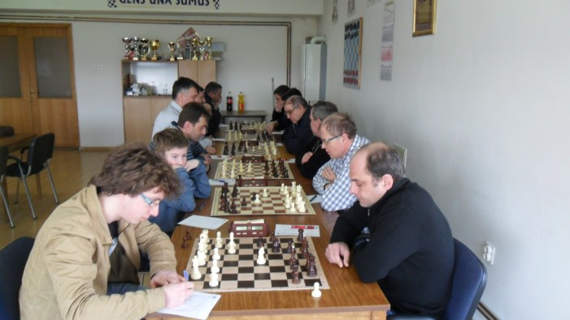

## 1\. kolo, seniori

Seniorska ekipa ŠK Odra ostvarila je vrijednu pobjedu i 2 meč-boda na otvaranju ligaškog natjecanja za 2013.

U prvom kolu ekipa je gostovala u Vrbovcu, pomlađena jednim juniorom i jednim kadetom. Naš najbolji kadet

Ivan Maravić pokazao je veliku borbenost te se i nakon pogreške u otvaranju hrabro borio, ali je kasniji previd

pješaka ipak bio  presudan.  “Svojim nastupom zaslužio je još poneku priliku”, po završetku meča izjavio je

kapetan ekipe Bačurin.

Najvredniji bod donio je junior Tin Furčić u svom prvom službenom nastupu za Klub. Lukavom igrom u

završnici pobijedio je iskusnijeg protivnika i donio važne meč-bodove.

REZULTATI:

ŠK PIK VRBOVEC II     –     ŠK ODRA  2,5:3,5

1\. Matić Antonio II          –  Maravić Stjepan MK      1/2

2\. Turčin Lovro  I             –  Cvetković Ivan  MK       1:0

3\. Loborec Stjepan MK   –  Vidaković Darko  MK    0:1

4\. Britvić Darko   II          –  Bačurin Juraj  MK         0:1

5\. Lanović Žaljko  III       –  Maravić Ivan VK            1:0

6\. Kolmanić Vladimir  II –  Furčić Tin  VK                0:1
