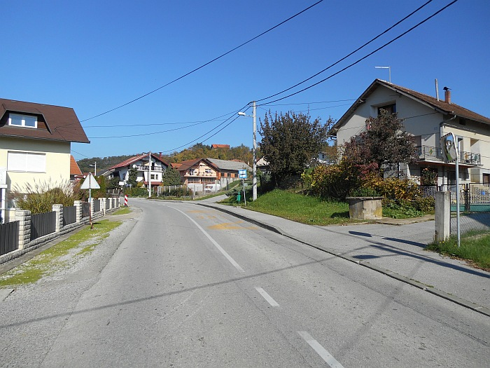
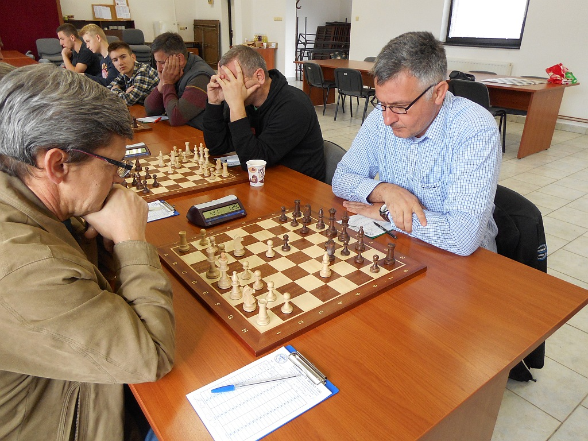

**Seniori, 8. kolo  
  
**Sreća nas mazi. Današnjom važnom pobjedom nad direktnim konkurentom za ulazak u višu ligu, kolo prije kraja zasjeli smo na drugo mjesto i znatno povećali šanse za ulazak u višu ligu. ŠK Odra je danas nastupio u mješovitom sastavu, naime, u seniorskoj ekipi su danas igrala tri kadeta! Tijek meča je bio uzbudljiv. Među prvima su porazima završili Kljujev i Vraneša. Prvi jer se nije uspio niti razviti, te se nadam da je mladi Kljujev napokon shvatio da bez učenja neće moći pomoći ni školskoj ni seniorskoj ekipi. Obećao je nakon današnjeg meča da će početi ozbiljnije raditi na šahu. Vraneša je dobro igrao, ali je nažalost imao grubi previd. Obzirom da je i na jučerašnjem turniru, kada je igrao za školu također previdio, to je pomalo zabrinjavajuće. Nakon uvodnih 2:0 za ŠK Vrustun, Cvetko je morao odbiti remi u teškoj poziciji. Na prvoj ploči Darko je uspio skupiti dva pješaka više, doći u dobivenu poziciju, ali obzirom da je zapao u teški cajtnot, u jednom trenutku previdio je topa kojeg  protivnik nasreću nije uzeo i Darko je lako završio partiju. Mladi Ivan je nakon toga strpljivom igrom, koju je gradio oko slabog protivničkog pješaka, uspio ostvariti dovoljnu materijalnu prednost i rezultat je u tom trenutku bio izjednačen. Cvetko je dočekao pogrešku protivnika i pješačkim prodorom u centru ostvario veliku materijalnu prednost te je rezultat prešao u našu korist. Trebalo nam je još pola boda na drugoj ploči gdje je Stipe ispustio dobitničku poziciju i ušao u izgubljenu. Kao i na prvoj ploči, i tu nas je sreća pomazila, pa je njegov protivnik lošim izmjenama ušao u remi završnicu. Kako ekipi ŠK Vrustun nije odgovarao remi, Kovačić je silio poziciju te na kraju partiju i izgubio.

**ŠK VRUSTUN 1252** – **ŠK ODRA       2 : 4**

1\. II Škorić, Milan – MK Vidaković, Darko 0:1  
2\. Kovačić, Ivan – MK Maravić, Stjepan 0:1  
3\. I Obad, Damir – MK Cvetković, Ivan 0:1  
4\. MK Kazić, Velid – II Maravić, Ivan 0:1  
5\. III Bogojević, Ranko – III Vraneša, Ivan 1:0  
6\. IV Kezerić, Miroslav – VK Kljujev, Ivan 1:0

darko
