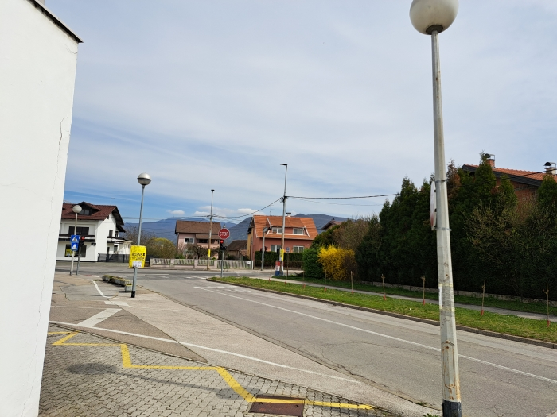

**Seniori – I. ekipa, 2.kolo**  
  
Prošlo kolo smo odigrali čvrsti [meč](https://s2.chess-results.com/tnr1352607.aspx?lan=13&art=3&rd=2&SNode=S0) protiv solidne ekipe iz Zaprešića, protiv kojih tradicionalno bude jako puno remija. Prvi je završio Mladen koji nije bio borbeno raspoložen. Ivana je odigrala solidno otvaranje te nakon par izmjena sklopila remi u jednakoj poziciji. Tu partiju donosimo u prilogu. Ivan Vraneša je dosta blijedo odigrao, bio je previše na “autopilotu” u otvaranju te je zapao u lošiju poziciju. Na našu sreću, njegov protivnik Winkler nije imao ideju kako probiti njegovu obranu te partija završava ponavljanjem poteza. Ivan Maravić je odigrao solidnu partiju koja nije izlazila iz balansa sve do završnice raznobojaca koja je “beton-remi”. Mario je bio lošiji te je došao do završnice u kojoj je imao pješaka manje. Međutim, tada pokazuje izdržljivost te ga brzo vraća i partija također završava remijem. Zadnji je ostao igrati Fran koji je izgradio jako dobru poziciju te imao jedan direktni dobitak u svojoj partiji. Tijekom pritiska uzima kvalitetu, ali u vremenskoj oskudici ne pronalazi način za nastaviti te partija završava trostrukim ponavljanjem pozicije. Kada se sve zbroji i oduzme, poštena podjela bodova. Ohrabruje činjenica da još nismo izgubili niti jednu partiju. Slijedi pauza od dva vikenda nakon koje dočekujemo Končar te se nadamo povratku na pobjedničke staze.

<table><tbody><tr><td>Pl.</td><td></td><td><strong>ŠK Zaprešić</strong></td><td>–</td><td></td><td><strong>ŠK Odra</strong></td><td><b>3-3</b></td></tr><tr><td>1.</td><td>MK</td><td>Jambrešić, Filip 2038</td><td>–</td><td>MK</td><td>Maravić, Ivan 2095</td><td>½–½</td></tr><tr><td>2.</td><td>MK</td><td>Jakupec, Denis 1918</td><td>–</td><td>MK</td><td>Šoš, Fran 2071</td><td>½–½</td></tr><tr><td>3.</td><td>MK</td><td>Raljić, Mirko 2024</td><td>–</td><td>MK</td><td>Ljubičić, Mario 2098</td><td>½–½</td></tr><tr><td>4.</td><td>I</td><td>Ilijaš, Dejan 1955</td><td>–</td><td>MK</td><td>Sliepčević, Mladen 2048</td><td>½–½</td></tr><tr><td>5.</td><td>I</td><td>Gabelica, Damir 1967</td><td>–</td><td></td><td>Mikić, Ivana 1891</td><td>½–½</td></tr><tr><td>6.</td><td>I</td><td>Winkler, Sven 1942</td><td>–</td><td>II</td><td>Vraneša, Ivan 1859</td><td>½–½</td></tr></tbody></table>

```pgn
[Event "III A liga - Zaprešić : Odra"]
[Site "sahovski-klub.com"]
[Date "2026.03.22"]
[Round "2"]
[White "I Gabelica, Damir"]
[Black "Mikić, Ivana"]
[Result "1/2-1/2"]
[ECO "E15"]
[WhiteElo "1967"]
[BlackElo "1891"]
1. d4 Nf6 2. c4 e6 3. Nf3 b6 4. g3 Bb7 5. Bg2 d5 6. cxd5 exd5 7. O-O Bd6 8. Nc3 O-O 9. Nb5 Be7 10. Bf4 Na6 11. Rc1 c6 12. Nc3 Bd6 13. Be5 Nc7 14. a3 Ne6 15. b4 a5 16. Qb3 axb4 17. axb4 Qe7 18. Bxd6 Qxd6 19. Ra1 h6 20. e3 Nc7 21. Rfb1 Ba6 22. Bf1 Bxf1 23. Kxf1 1/2-1/2
```

*IvanM*
