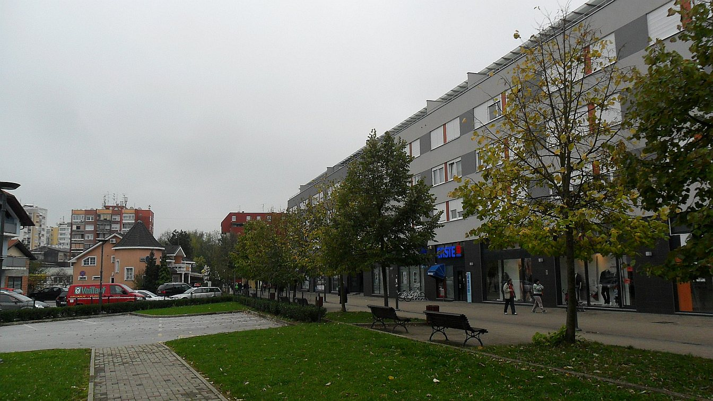
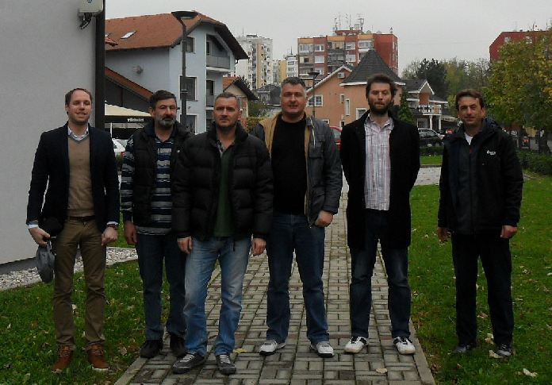
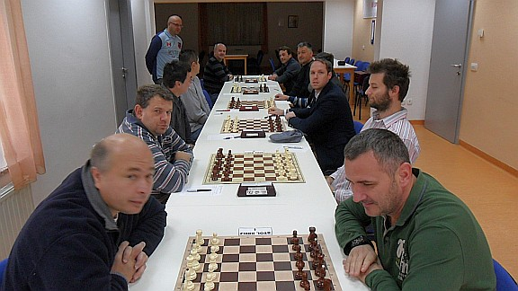

**Seniori, 9. kolo**

Iako je dobro počelo, 9. kolo loše je završilo. Rezultatom 3:3 ne može biti zadovoljna ni jedna ekipa jer su time šanse za plasman u višu ligu svedene na teoriju. Bilo koji drugi rezultat ostavio bi barem jednu ekipu u utrci za plasman u viši rang natjecanja. Više može žaliti ekipa ŠK Odra jer je imala veliku šansu osvojiti dva boda. Stipe je na prvoj ploči odigrao čvrsto i izborio remi, a pozicija je u jednom trenutku nudila šansu i za nešto više. Na drugoj ploči Danko je u završnici odabrao krivi plan i ispustio materijalnu prednost od nekoliko pješaka te na kraju remizirao. Golubinjo je odigrao nešto lošije i, iako se dugo lomio oko žrtvenog nastavka, nije ušao u tu kombinaciju te je na kraju spašavao remi. Kada je ušao u teoretski remi u topovskoj završnici, uspio je pogriješiti i izgubiti. Cvetko je previdio topa u poziciji s dva pješaka više. Darko je komplicirao s crnim figurama, ali je njegov protivnik propustio šansu te je Darko osvojio cijeli bod. Jura je igrao napadački i brzo završio partiju u rokadnom napadu osvojivši također cijeli bod. Ostaje osjećaj da se za pobjedu potrebnih još pola boda moglo osvojiti na više mjesta, ali nije. Meč je odigran u ugodnom prostoru Kluba umirovljenika u Zaprešiću, domaćini su i inače prijateljska ekipa i cjelokupni dojam pokvario je samo sudac Drašković svojim bahatim nastupom. Vjerojatno mu nitko nije rekao da je riječ o amaterskom susretu. Sljedeće kolo ŠK Odra igra 9. studenoga u Odri sa ŠK HRT.

 Na slici lijevo je ekipa ŠK Odra, slijeva: Golubinjo,  Cvetko, Stipe, Darko, Danko, Jura.

 

 **ŠK Zaprešić, Zaprešić – ŠK Odra, Zagreb 3 : 3**

                        
1 MK Urukalović, Roman 2250 – MK Maravić, Stjepan 2115    ½ – ½  
2 MK Jakupec, Denis 2104 – MK Brajdić, Danko 2125              ½ – ½  
3 MK Pavlinić, Darko 2093 – I Golub, Vladimir 2061                   1 – 0  
4 I Gabelica, Damir 2026 – MK Cvetković, Ivan 1981                  1 – 0  
5 II Boljat, Igor 1904 – MK Vidaković, Darko 2128                       0 – 1  
6 II Mihalinec, Predrag 1891 – MK Bačurin, Juraj 2063               0 – 1

v.d.
