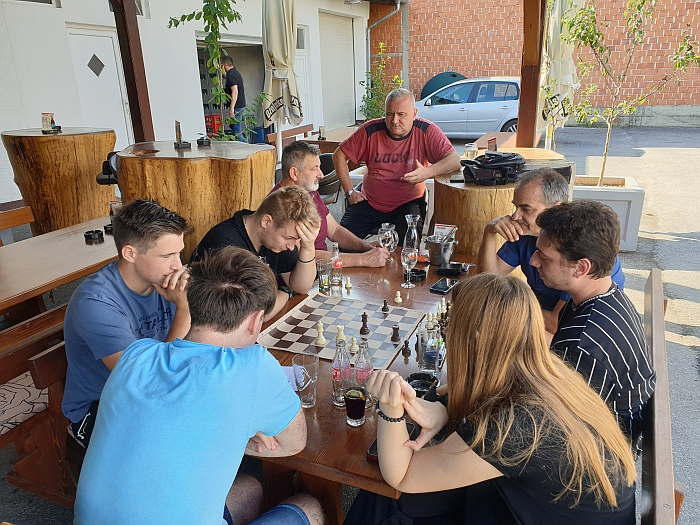
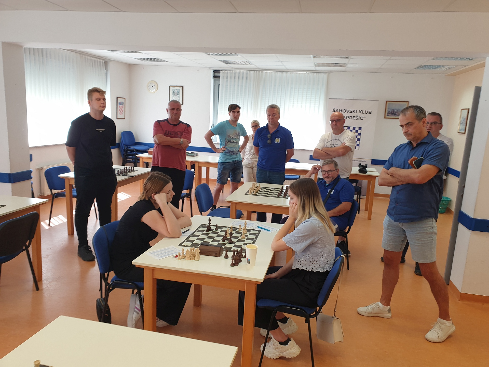

**Seniori – I. ekipa, 7.kolo  
  
**

Prošle nedjelje, 14. rujna, ŠK Odra gostovala je kod ŠK Zaprešić i vratila se kući [s porazom 3,5 : 2,5](https://s1.chess-results.com/tnr1127780.aspx?lan=13&art=3&rd=7&SNode=S0).

Nastupili smo u jakom sastavu: Ivan Maravić, Mladen, Darko, Stjepan Maravić, Ivana Mikić i Ivan Vraneša.

Ivan Maravić se pogubio u otvaranju i ubrzo ostao bez kvalitete. U završnici protivnik previđa taktiku te Ivan uspijeva remizirati partiju.

Mladen je krenuo skromno i neambiciozno, ali dovoljno da partija završi remijem u poziciji gdje je objektivno bio lošiji.

Darko je pružio borbu za gledatelje – solidno otvaranje, puno vatre i šaha, ali na kraju raznobojci odradili svoje i opet remi.

Kapetan Stjepan je samouvjereno odlučio da nam je pobjeda ionako u džepu – pa zašto se onda truditi? Njegova partija završava, pogađate, remijem.

Ivana je igrala kvalitetno i nadigrala protivnicu, ali propušta nekoliko lijepih šansi koje su mirisale na pobjedu. Na kraju opet remi – šahovski déjà vu.  


Ivan Vraneša je već u otvaranju izgubio puno vremena zbog nesigurnosti. Ipak, uspio je steći konkretnu prednost, no pod pritiskom protivnika i vlastitog cajtnota gubi partiju. Još malo rada na otvaranjima i satovima, i vratit će se Ivan u pobjednički ritam.

Sve u svemu, nespretan dan za našu prvu ekipu. Iduće kolo dočekujemo ŠK Špansko na domaćem terenu – nadamo se da će tada naši šahisti manje griješiti, a više matirati!

<table><tbody><tr><td>Pl.</td><td></td><td><strong>ŠK Zaprešić</strong></td><td>–</td><td></td><td><strong>ŠK Odra&nbsp;</strong></td><td><b>3,5-2,5</b></td></tr><tr><td>1.</td><td>&nbsp;MK</td><td>Jambrešic, Filip 2036</td><td>–</td><td>MK</td><td>Maravić, Ivan 2098</td><td>1/2-1/2</td></tr><tr><td>2.</td><td>&nbsp;MK</td><td>Jakupec, Denis 1916</td><td>–</td><td>MK</td><td>Sliepčević, Mladen 2059</td><td>1/2-1/2</td></tr><tr><td>3.</td><td>&nbsp;MK</td><td>Raljic, Mirko 2008</td><td>–</td><td>&nbsp;MK</td><td>Vidaković, Darko 2109</td><td>1/2-1/2</td></tr><tr><td>4.</td><td>&nbsp;I</td><td>Ilijaš, Dejan 1976</td><td>–</td><td>MK</td><td>&nbsp;Maravić, Stjepan 2073</td><td>1/2-1/2</td></tr><tr><td>5.</td><td>&nbsp;NM</td><td>Golub, Nikolina 1931</td><td>–</td><td></td><td>Mikić, Ivana 1919</td><td>1/2-1/2</td></tr><tr><td>6.</td><td>&nbsp;I</td><td>Winkler, Sven 1934</td><td>–</td><td>&nbsp;II</td><td>Vraneša, Ivan 1873</td><td>1-0</td></tr></tbody></table>

---

```pgn
[Event "3 A Liga Centar"]
[Site "Zaprešić"]
[Date "14.09.2025."]
[Round "7"]
[White "Vraneša, Ivan "]
[Black "Winkler, Swen "]
[Result "0-1"]
[WhiteElo "1873"]
[BlackElo "1934"]
[Board "6"]

1. e4 c5 2. Nf3 e6 3. d4 cxd4 4. Nxd4 Nc6 5. Nc3 Qc7 6. Be3 a6 7. Qf3 b5 8. O-O-O Bb7 9. Bd3 Rc8 10. Nxc6 Qxc6 11. Qg3 b4 12. Ne2 Nf6 13. f3 d5 14. e5 Nd7 15. f4 g6 16. h4 Bc5 17. h5 Rg8 18. Bd2 Be7 19. Nd4 Qb6 20. Nb3 a5 21. Be3 Qc7 22. Bd4 a4 23. Nd2 Nc5 24. Bxc5 Qxc5 25. hxg6 hxg6 26. f5 exf5 27. Rhe1 b3 28. axb3 a3 29. bxa3 Qxa3+ 30. Kb1 Ra8 31. Bb5+ Kf8 32. Ba4 Rxa4 33. Qc3 Qa2+ 34. Kc1 Ba3+ 0-1
```

---

```pgn
[Event "3 A Liga Centar"]
[Site "Zaprešić"]
[Date "14.09.2025."]
[Round "7"]
[White "NM Golub, Nikolina "]
[Black "Mikić, Ivana "]
[Result "0-1"]
[WhiteElo "1931"]
[BlackElo "1934"]
[Board "6"]

1. d4 Nf6 2. c4 e6 3. Nf3 b6 4. g3 Bb7 5. Bg2 d5 6. cxd5 exd5 7. O-O Bd6 8. Nc3
O-O 9. Nb5 Be7 10. Bf4 Na6 11. a3 c6 12. Nc3 Nc7 13. Qd3 Ne6 14. Be3 Rc8 15. Ng5
Nxg5 16. Bxg5 Qd7 17. Rfe1 h6 18. Bf4 Rfd8 19. Rad1 c5 20. dxc5 bxc5 21. Qc2 Qe6
22. Bd2 Bc6 23. Na4 Bb5 24. Nc3 Be8 25. e3 Qb6 26. Bc1 Bc6 27. Qf5 Qb7 28. h3
Qd7 29. Qb1 Qb7 30. Qf5 a5 31. Kh2 Qd7 32. Qb1 Qe6 33. Qc2 Bf8 34. b3 Qd7 35.
Ne4 Nxe4 36. Bxe4 Qe8 37. Bh7+ Kh8 38. Bf5 Rb8 39. Bb2 c4 40. Qc3 Rxb3 41. Qd4
Rdb8 42. Rb1 Qd8 43. Bc2 R3b7 44. Bc3 Rxb1 45. Rxb1 Rxb1 46. Bxb1 Kg8 47. Bc2
Qd7 48. Qe5 Qd6 49. Qf5 g6 50. Qg4 Bg7 51. Bxa5 Qxa3 52. Qc8+ Bf8 53. Qxc6 Qxa5
54. Qa4 Qd2 55. Kg2 h5 56. Bb1 Qb2 57. Qc2 Qe5 58. Qe2 Bd6 59. Qf3 Kg7 60. Qf4
Qe6 61. Qf3 Be5 62. Bc2 Bf6 63. Qf4 Qc6 64. Qf3 h4 65. Kh2 Be5 66. Kg1 hxg3 67.
fxg3 Qd6 68. Kg2 Qc5 69. g4 d4 70. exd4 Qxd4 71. Qf2 Qc3 72. Be4 Bd4 73. Qe2 Qc1
74. Bc2 Qg1+ 75. Kf3 Qh1+ 76. Kg3 Qd5 77. Qe4 Be5+ 78. Kf3 Qc5 79. Kg2 Bb8 80.
Qf3 Qd6 81. Qc3+ Kg8 82. Qxc4 Qg3+ 83. Kf1 Qxh3+ 84. Ke1 Bg3+ 85. Kd2 Qg2+ 86.
Kc3 Be5+ 87. Kb3 Kg7 88. Qe4 Qg3+ 89. Kc4 Qc3+ 90. Kd5 Bf6 91. Bd3 Qb3+ 92. Kc5
Qb8 93. Kc4 Qc7+ 94. Kb5 Be7 95. Qd5 Qf4??{ Previd! Propušta uzeti besplatnog pješaka.}
(95... Qb8+ 96. Ka6 Qc8+ 97. Kb5 Qxg4) 96. Bc4 Qg5 97. Qxg5 Bxg5 98. Kc5 f6
99. Kd5 Bc1 100. Ke4 Kh6 101. Be2 Kg5 102. Bd1 f5+ 103. gxf5 gxf5+ 104. Kf3 f4 1/2-1/2
```
