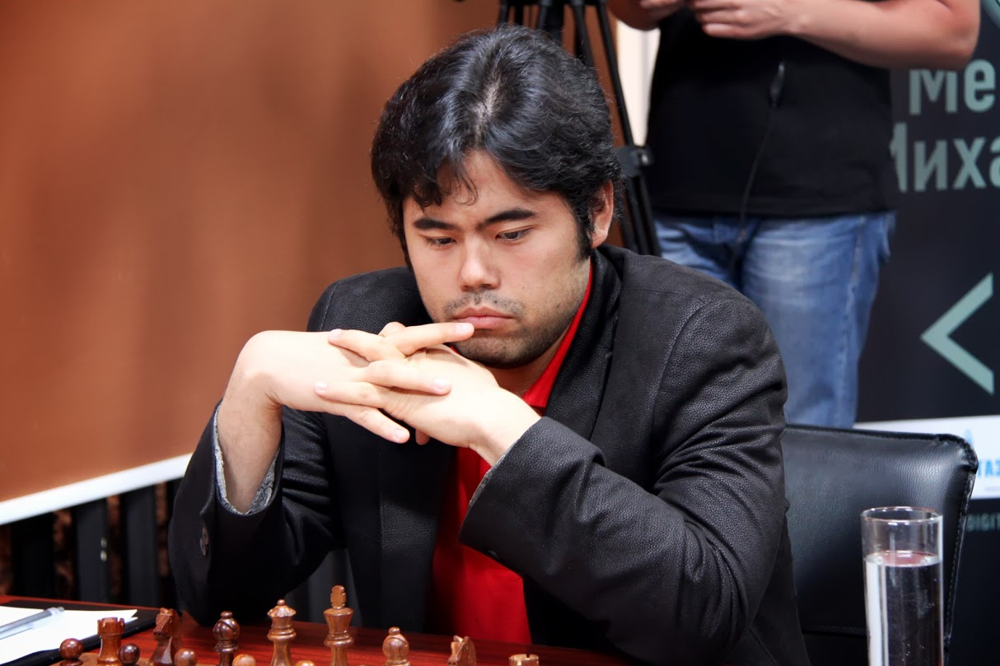

****

Dvije odlučene partije i tri podjele bodova su rezime današnjeg dana. U partiji Andrejkin – Anand igrači su vrlo rano odstupili od teorije, no ruski prvak nije najbolje iskoristio svoju šansu, izgubio je dosta vremena i ostalo mu je 10 minuta za 18 poteza, pa je partija završila podjelom bodova. Karjakin i Carlsen su odigrali prilično mirnu partiju sa puno ranih izmjena, uz nešto izgledniju poziciju bijelog, a partija je završila u 38. potezu ponavljanjem pozicije. Caruana je protiv Gelfanda izašao bolji iz otvaranja, ali je u nastavak krenuo možda malo preambiciozno, što ga je koštalo partije. Sličnu situaciju imao je i Kramnik protiv Nakamure, izašao je puno bolji iz otvaranja i pomalo lakomisleno prvo ispustio pobjedu, a zatim borbeni Nakamura čak uspijeva okrenuti izglede u svoju korist i pobjediti. Morozevich je protiv Mamedyarova dobro krenuo u partiju, ali ne pronalazi najbolji nastavak u 15. potezu, kvari poziciju i na kraju može biti zadovoljan remijem.

**Rezultati 2. kola:** Morozevich – Mamedyarov 1/2-1/2, Kramnik – **Nakamura** 0-1, Karjakin – Carlsen 1/2-1/2, Caruana – **Gelfand** 0-1, Andrejkin – Anand 1/2-1/2

**Poredak nakon 2. kola:**

<table><tbody><tr><td>1</td><td>&nbsp;Mamedyarov</td><td>1,5</td></tr><tr><td>2</td><td>&nbsp;Carlsen</td><td>1,5</td></tr><tr><td>3</td><td>&nbsp;Gelfand</td><td>1,5</td></tr><tr><td>4</td><td>&nbsp;Andrejkin</td><td>1</td></tr><tr><td>5</td><td>&nbsp;Nakamura</td><td>1</td></tr><tr><td>6</td><td>&nbsp;Karjakin</td><td>1</td></tr><tr><td>7</td><td>&nbsp;Caruana</td><td>1</td></tr><tr><td>8</td><td>&nbsp;Morozevich</td><td>1</td></tr><tr><td>9</td><td>&nbsp;Anand</td><td>0,5</td></tr><tr><td>10</td><td>&nbsp;Kramnik</td><td>0</td></tr></tbody></table>

**Parovi 3. kola:** Anand – Morozevich, Gelfand – Andrejkin, Carlsen – Caruana, Nakamura – Karjakin, Mamedyarov – Kramnik
