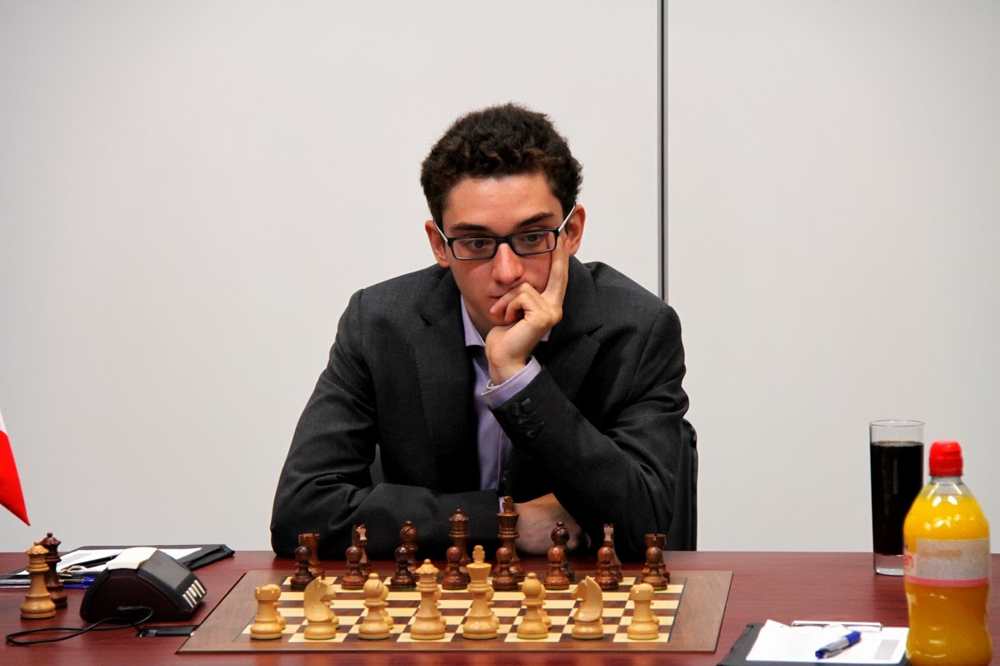

Borbeno treće kolo. **Kramnik** je dobro pripremio otvaranje i uhvatio **Mammadyarova** u varijantu. Azerbejdžanski velemajstor se na kraju uspio izvući vječnim šahom. U rjeđe igranom otvaranju **Gelfand** kao bijeli zadržava lovački par, ali zaostaje u razvoju, dok **Andrejkin** vještim manevrima održava dinamičku ravnotežu. Na kraju, nijedna strana ne može ojačati poziciju bez velikog rizika, pa se bijeli odlučuje iznuditi remi ponavljanjem poteza. **Carlsen**, nakon greške u otvaranju koja ga je koštala pješaka uspjeva tvrdoglavom obranom postići dobru poziciju, ali onda ponovo griješi, a **Caruana** ne propušta tu priliku. **Karjakin**, koji je na nedavnom turniru demonstrirao savršenu formu, ovdje prečesto griješi. U ovoj partiji nakon niza kontroverznih odluka prvo je oslabio daminu stranu, zatim je nakon promašenog plana skakačem u centru dao i “e” liniju. Dojam je da **Nakamura** danas nije morao previše učiniti za pobjedu. **Anand** je protiv **Morozevicha** vodio kompliciranu stratešku bitku u španjolskom otvaranju i nakon stvaranja dva pješaka viška mirno odbio sve napade i realizirao materijalnu prednost.

**Rezultati 3. kola:** **Anand** – Morozevich 1-0, Gelfand – Andrejkin 1/2-1/2, Carlsen – **Caruana** 0-1, **Nakamura** – Karjakin 1-0, Mamedyarov – Kramnik 1/2-1/2

| Mjesto |  |  |  | 1 | 2 | 3 | 4 | 5 | 6 | 7 | 8 | 9 | 10 | Bodovi |
| --- | --- | --- | --- | --- | --- | --- | --- | --- | --- | --- | --- | --- | --- | --- |
| 1-4 | Gelfand | 🇮🇱 | 2755 |  |  |  | 1 | ½ |  |  | ½ |  |  | 2 |
| 1-4 | Nakamura | 🇺🇸 | 2784 |  |  | 0 |  |  |  |  | 1 |  | 1 | 2 |
| 1-4 | Mamedyarov | 🇦🇿 | 2753 |  | 1 |  |  |  |  |  |  | ½ | ½ | 2 |
| 1-4 | Caruana | 🇮🇹 | 2774 | 0 |  |  |  |  | 1 | 1 |  |  |  | 2 |
| 5-7 | Andrejkin | 🇷🇺 | 2713 | ½ |  |  |  |  | ½ |  |  | ½ |  | 1½ |
| 5-7 | Anand | 🇮🇳 | 2786 |  |  |  | 0 | ½ |  |  |  | 1 |  | 1½ |
| 5-7 | Carlsen | 🇳🇴 | 2864 |  |  |  | 0 |  |  |  | ½ |  | 1 | 1½ |
| 8-9 | Karjakin | 🇷🇺 | 2782 | ½ | 0 |  |  |  |  | ½ |  |  |  | 1 |
| 8-9 | Morozevich | 🇷🇺 | 2760 |  |  | ½ |  | ½ | 0 |  |  |  |  | 1 |
| 10 | Kramnik | 🇷🇺 | 2803 |  | 0 | ½ |  |  |  | 0 |  |  |  | ½ |

**Parovi 4. kola:** Morozevich – Kramnik, Karjakin – Mamedyarov,  Caruana – Nakamura, Andrejkin – Carlsen,  Anand – Gelfand
