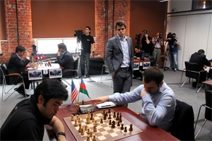

Danas je u Moskvi, u Centru digitalnih tehnologija *Красный Октябрь* odigrano prvo kolo Taljevog memorijala. Na ovom vrlo jakom turniru sa nagradnim fondom od 100.000 € sudjeluje 10 igrača: **Magnus Carlsen** (1), **Vladimir Kramnik** (3), **Fabiano Caruana** (4), **Sergey Karjakin** (5), **Viswanathan Anand** (6),  **Hikaru Nakamura** (8), **Shakhriyar Mamedyarov** (11), **Boris Gelfand** (13), **Alexander Morozevich** (17) i **Dmitry Andreikin** (31).

Carlsen, Caruana i Mamedyarov su u turnir krenuli pobjedama. Zanimljivost je da se turnir odigrava u relativno maloj prostoriji, pa je pristup fotografima ograničen na prvih 10 minuta (evo tih **[fotki](https://plus.google.com/u/0/photos/103210961228345855717/albums/5888934431037202161/5888935009400144834?sort=7&pid=5888935009400144834&oid=103210961228345855717 "Taljev memorijal, prvo kolo - foto album")**), a ostatak se može pratiti putem kamera **[Chess.TV](http://chesstv.com/en "Chess.TV (en)")**, tvrtke koja osigurava video prijenos. U drugoj, većoj prostoriji nalaze se komentatori (danas su to bili Svidler i Grishcuk) – ako štovanom posjetitelju ovog weba taj podatak nešto znači, obzirom da su komentari samo na ruskom, jednako kao i službena stranica turnira. To im je bila fakat super ideja koja će sigurno povećati broj posjetitelja njihovog weba. U Google-ovoj interpretaciji, na hrvatskom, stranica izgleda **[ovako](http://www.google.com/translate?hl=en&sl=auto&tl=hr&u=http%3A%2F%2Frussiachess.org%2F "http://russiachess.org/ prevedena na hrvatski")**.

Partije s analizama možete pogledati **[ovdje](http://online.russiachess.org/#2013/06/tal2013 "Taljev memorijal - analiza partija")**.

**Rezultati 1. kola:** Andrejkin – Morozevich 1/2:1/2, Anand – **Caruana** 0:1, Gelfand – Karjakin 1/2:1/2, **Carlsen** – Kramnik 1:0, Nakamura – **Mamedyarov** 0-1.

**Parovi 2. kola:** Morozevich – Mamedyarov, Kramnik – Nakamura, Karjakin – Carlsen, Caruana – Gelfand, Andrejkin – Anand
