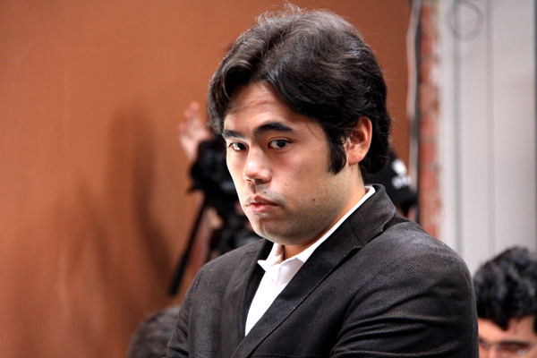

**Nakamura**, vodeći nakon šestog kola, pokazuje da je u odličnoj formi. Prvo je osvojio brzopotezni turnir sa 7/9 bodova, a do sada je odlučio 4 partije u svoju korist, zaključno s današnjom protiv svjetskog prvaka, uz samo po jedan remi i poraz. U sljedećim kolima još igra protiv **Gelfanda** (2.) i **Carlsena** (3.) koji su mu, kako sada stvari stoje, direktni konkurenti za prvo mjesto, a u zadnjem kolu protiv zadnjeplasiranog **Morozovicha**.

Stanje nakon 6. kola:

| Mjesto |  |  |  | 1 | 2 | 3 | 4 | 5 | 6 | 7 | 8 | 9 | 10 | Bodovi |
| --- | --- | --- | --- | --- | --- | --- | --- | --- | --- | --- | --- | --- | --- | --- |
| 1 | Nakamura | 🇺🇸 | 2784 |  |  |  | 0 | 
½

 | 1 | 1 | 1 | 1 |  | 4½ |
| 2 | Gelfand | 🇮🇱 | 2755 |  |  | ½ |  | ½ | 1 | ½ | 

½

 |  | 

1

 | 4 |
| 3-4 | Carlsen | 🇳🇴 | 2753 |  | ½ |  |  | ½ | 0 |  | 1 | 1 |  | 3½ |
| 3-4 | Mamedyarov | 🇦🇿 | 2774 | 1 |  |  |  | ½ | ½ | 

½

 |  | ½ | ½ | 3½ |
| 5-6 | Andrejkin | 🇷🇺 | 2713 | 

½

 | ½ | ½ | ½ |  |  |  | ½ |  | ½ | 3 |
| 5-6 | Caruana | 🇮🇹 | 2786 | 0 | 0 | 1 | ½ | 

½

 |  |  |  | 

1

 | ½ | 3 |
| 7 | Karjakin | 🇷🇺 | 2864 | 0 | ½ | ½ | 

½

 |  |  |  |  | ½ | 

½

 | 2½ |
| 8-10 | Anand | 🇮🇳 | 2782 | 0 | 

½

 | 0 | ½ |  | 0 | 

½

 |  |  | 1 | 2 |
| 8-10 | Kramnik | 🇷🇺 | 2760 | 0 |  | 0 | ½ |  | 

½

 | ½ |  |  | ½ | 2 |
| 8-10 | Morozevich | 🇷🇺 | 2803 |  | 

0

 |  | ½ | ½ |  | 

½

 | 0 | ½ |  | 2 |
