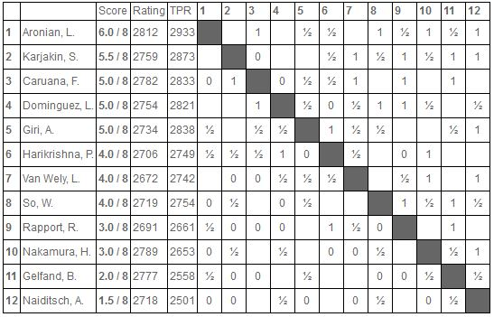

Na glavnom turniru nastupa 12 igrača, a za razliku od *[Tata Steel 2013](/novosti/magnus-carlsen-osvojio-tata-steel-2013/ "Tata Steel 2013 - konačni poredak")*, ove godine nema prošlogodišnjeg pobjednika Carslena, kao ni bivšeg svjetskog prvaka Ananda.

Danas je dan odmora, a sutra počinje završna faza turnira koja će dati ovogodišnjeg pobjednika. Trenutno je vodeći neporaženi **Aronian** sa 6/8 bodova, no u borbi za prvo mjesto još su **Karjakin** (5,5), **Caruana** (5), **Dominguez** (5) i **Giri** (5), a teoretski i još neki igrači sa 4 boda. Posebno zanimljivi mogli bi biti međusobni obračuni igrača koji se bore za sam vrh tablice: **Aronian – Karjakin**, **Giri – Karjakin**, **Dominguez – Aronian** i **Karjakin – Dominguez**. Možda najlakši zadatak ima **Caruana** jer igra još protiv **Nakamure** koji je, nakon sjajnih izvedbi u posljednje vrijeme, očito u vrlo lošoj formi (3/8), posljednjeplasiranog **Naiditscha** (1,5/8), te **Wesley Soa** (4/8). Spomenimo još i neprepoznatljivu izvedbu prošle sezone sjanog **Gelfanda** (2/8).

Od ostalih zanimljivosti svakako treba spomenuti sjajan nastup našeg reprezentativca [**Ivana Šarića**](http://ratings.fide.com/card.phtml?event=14508150 "Ivan Šarić - FIDE Chess Profile") na *[Tata Steel Challengers](http://www.tatasteelchess.com/tournament/standings/year/2014/group/2 "Tata Steel Challengers 2014 - poredak").* Trenutno je vodeći sa 7/9, 4 kola prije kraja, a [u tijeku je deseto kolo](http://www.tatasteelchess.com/tournament/livegames "Tata Steel Challengers 2014 - livegames").
