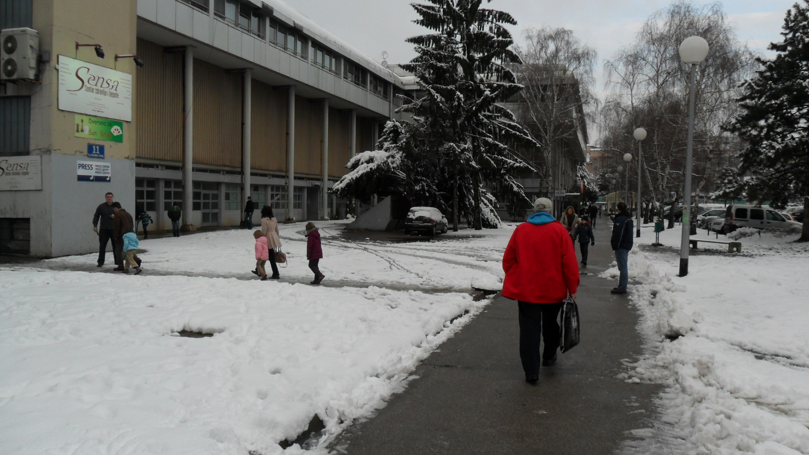

Završilo je pojedinačno Prvenstvo Zagreba 2014. za učenike i učenice. Velik uspjeh ostvario je [Ivan Maravić](./ivan-3mj-2014.jpg). Pobjedom u posljednjem kolu nad Kristijanom Šagovcem, inače uvjerljivim pobjednikom turnira, Ivan je  zasluženo osvojio  treće mjesto! Čestitamo!

Još je veći uspjeh napredak naših kadeta, koji su počeli igrati lijepe partije, zapisivati poteze, truditi se. U svakom slučaju, ugodno su iznenadili. Još da i djevojčice počnu zapisivati partije…

Svi kadeti i kadetkinje, članovi Kluba, nastupili su na ovom prvenstvu, a uskoro ih očekuju i ekipna prvenstva ([dečki](/files/wp/2014/02/ekipno_OS_decki_2014.pdf "termini ekipno decki SKOLE 2014") već 12. i 13. veljače). Šteta je što nisu nastupili Erik i Zagorec jer je ekipi potrebna potpora za nadolazeća natjecanja.

[Dječaci](/files/wp/2014/02/prvenstvo-zagreba-kadeti-do-11-godina-2014.pdf "prvenstvo-zagreba-kadeti-do-11-godina-2014.pdf"), rezultati  
[Djevojčice](/files/wp/2014/02/prvenstvo-zagreba-kadetkinje-do-9-2014.pdf "prvenstvo-zagreba-kadetkinje-do-9-2014.pdf"), rezultati

 
