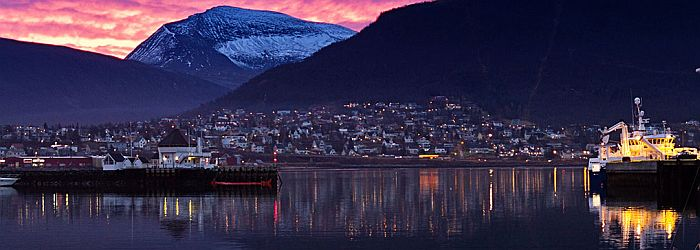

U 10. kolu 41. šahovske olimpijade muška reprezentacija Hrvatske izborila je pobjedu već nakon tri odlučene partije, a **Stević** bi je mogao i podebljati jer ima dobivenu poziciju crnim figurama na drugoj ploči protiv inače solidnog **Hammera**. **Šarić** je na prvoj ploči dobio **Carlsena**!, **Kožul** na četvrtoj **Lie, Kjetil A.** (2582), a **Palac** je remizirao protiv **Johannessena** (2582).

Hrvatska muška ekipa nakon 9. kola sa 12 bodova zauzima 24. mjesto od 177 ekipa, a sad bi tu poziciju mogla i popraviti. Hrvatska ženska ekipa nakon 9. kola je 13. (od 136 ekipa) s 13 bodova. ([Tablica](https://chess24.com/en/olympiad2014/games/standings "Tromsø 2014 Chess Olympiad | Tablica"))

Više o Olimpijadi na [chess24.com/en/olympiad2014](https://chess24.com/en/olympiad2014 "Tromsø 2014 Chess Olympiad 01.08 - 14.08.2014")

```pgn
[Event "Chess Olympiad Tromso 2014"]
[Date "2014.08.12"]
[Round "10"]
[White "Saric, Ivan 2671"]
[Black "Carlsen , Magnus 2877"]
[Result "1-0"]
[ECO "C61"]
[WhiteElo "2671"]
[BlackElo "2877"]
[PlyCount "73"]

1. e4 e5 2. Nf3 Nc6 3. Bb5 Nd4 4. Nxd4 exd4 5. Bc4 Nf6 6. O-O d5 7. exd5 Be7 8.
Qf3 Bg4 9. Qf4 O-O 10. h3 Bd6 11. Qxd4 c5 12. Qd3 Bh5 13. Nc3 Re8 14. f4 a6 15.
a4 Qd7 16. Qg3 Ne4 17. Nxe4 Rxe4 18. b3 Qc7 19. d3 Re2 20. Qg5 g6 21. Bb2 Be7
22. Bf6 h6 23. Be5 Qd8 24. Qxh6 Rxe5 25. d6 Re2 26. dxe7 Qxe7 27. f5 Qh4 28.
Qf4 g5 29. Qxh4 gxh4 30. Rf4 Rxc2 31. Rxh4 Be2 32. Re4 Rd2 33. Re7 Bxd3 34.
Bxf7+ Kf8 35. f6 Rd8 36. Bh5 Kg8 37. Re8+ 1-0
```
