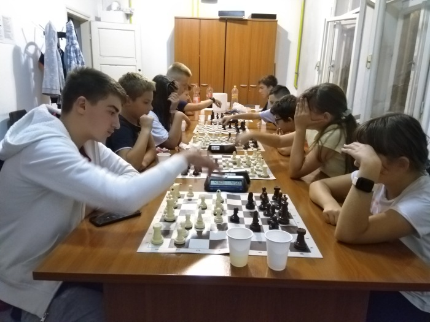
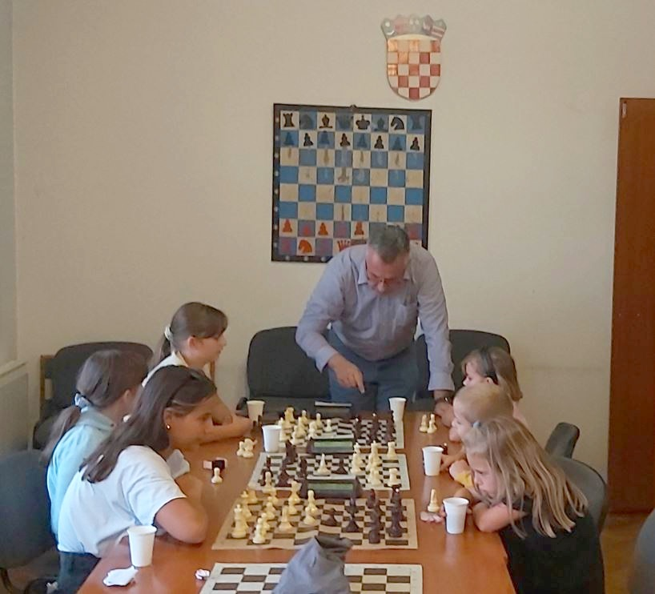

  
U petak je u Klubu odigran seniorsko-juniorsko-kadetski brzopotezni turnir. Nastupile su sve generacije šahista u Klubu. U pravilima su se napravile sitne preinake, umjesto “takac-makac” se primjenilo pravilo “ček-ček” te su Kuhar i sudac mogli sugerirati poteze. Turnir je uvjerljivo osvojila kombinacija Vraneša-Kobali, Vraneša je započeo turnir, ali je zbog prevelikog pritiska odustao usred turnira te je Boris uskočio i  iskusno priveo turnir kraju. Drugi je bio Josip, koji je imao isto bodova kao treća Lucija, ali zbog pobjede u međusobnom susretu prisvojio je srebro. Ostali detalji u tablici ispod. Sve u svemu, bio je ovo jedan lijepi događaj te se nadamo da ćemo češće viđati ovakve turnire u Klubu. Od “velikih” klinaca, Luka je kasnio jer je dao prioritet ćevapima, a ni Iva se nije pojavila. Od manjih, Petra je došla tek u sedam zbog školskih obaveza, ali je koncentrirano odradila sat vremena treninga.  
Za zainteresirane, počeli smo i raniji termin, od 18-19, za najmanje koji će tek postati vrhunski šahisti. Trenersku ulogu uspješno su odradile Lucija, Ivana i Vjeka.

<table><tbody><tr><td>Sbr</td><td>Ime</td><td>1</td><td>2</td><td>3</td><td>4</td><td>5</td><td>6</td><td>7</td><td>8</td><td>9</td><td>10</td><td>Bod.</td><td>Mj.</td></tr><tr><td>1</td><td><strong>Vraneša-Kobali</strong></td><td>X</td><td>1</td><td>1</td><td>1</td><td>1</td><td>1</td><td>1</td><td>1</td><td>1</td><td>1</td><td>9</td><td><strong>I.</strong></td></tr><tr><td>2</td><td>Filip</td><td>0</td><td>X</td><td>1</td><td>1</td><td>1</td><td>0</td><td>0</td><td>0</td><td>1</td><td>1</td><td>5</td><td></td></tr><tr><td>3</td><td>Slavko</td><td>0</td><td>0</td><td>X</td><td>0</td><td>1</td><td>1</td><td>0</td><td>1</td><td>1</td><td>1</td><td>5</td><td></td></tr><tr><td>4</td><td>Tonči</td><td>0</td><td>0</td><td>1</td><td>X</td><td>1</td><td>0</td><td>0</td><td>0</td><td>0</td><td>0</td><td>2</td><td></td></tr><tr><td>5</td><td>Kosta</td><td>0</td><td>0</td><td>0</td><td>0</td><td>X</td><td>0</td><td>0</td><td>0</td><td>0</td><td>0</td><td>0</td><td></td></tr><tr><td>6</td><td>Ivan</td><td>0</td><td>1</td><td>0</td><td>1</td><td>1</td><td>X</td><td>1</td><td>0</td><td>1</td><td>0</td><td>5</td><td></td></tr><tr><td>7</td><td><strong>Lucija</strong></td><td>0</td><td>1</td><td>1</td><td>1</td><td>1</td><td>0</td><td>X</td><td>1</td><td>1</td><td>0</td><td>6</td><td><strong>III.</strong></td></tr><tr><td>8</td><td>Ivana</td><td>0</td><td>1</td><td>0</td><td>1</td><td>1</td><td>1</td><td>0</td><td>X</td><td>0.5</td><td>0</td><td>4.5</td><td></td></tr><tr><td>9</td><td>Vjeka</td><td>0</td><td>0</td><td>0</td><td>1</td><td>1</td><td>0</td><td>0</td><td>0.5</td><td>X</td><td>0</td><td>2.5</td><td></td></tr><tr><td>10</td><td><strong>Josip</strong></td><td>0</td><td>0</td><td>0</td><td>1</td><td>1</td><td>1</td><td>1</td><td>1</td><td>1</td><td>X</td><td>6</td><td><strong>II.</strong></td></tr></tbody></table>
