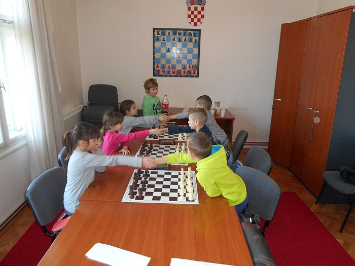
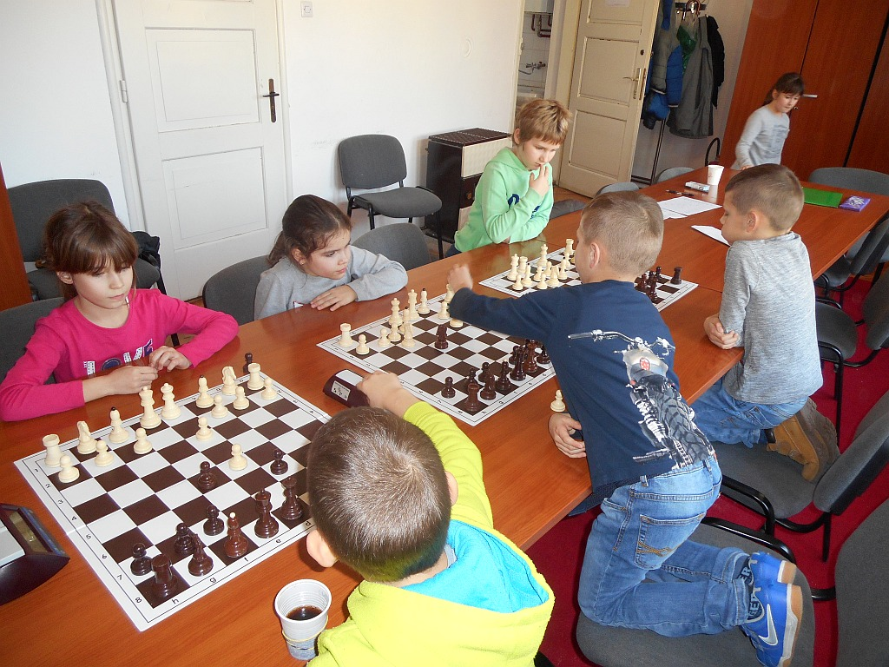
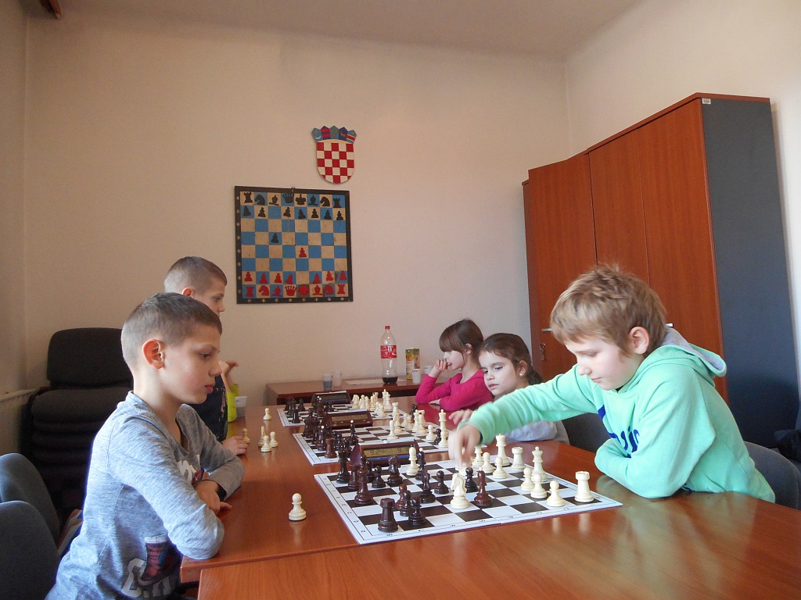
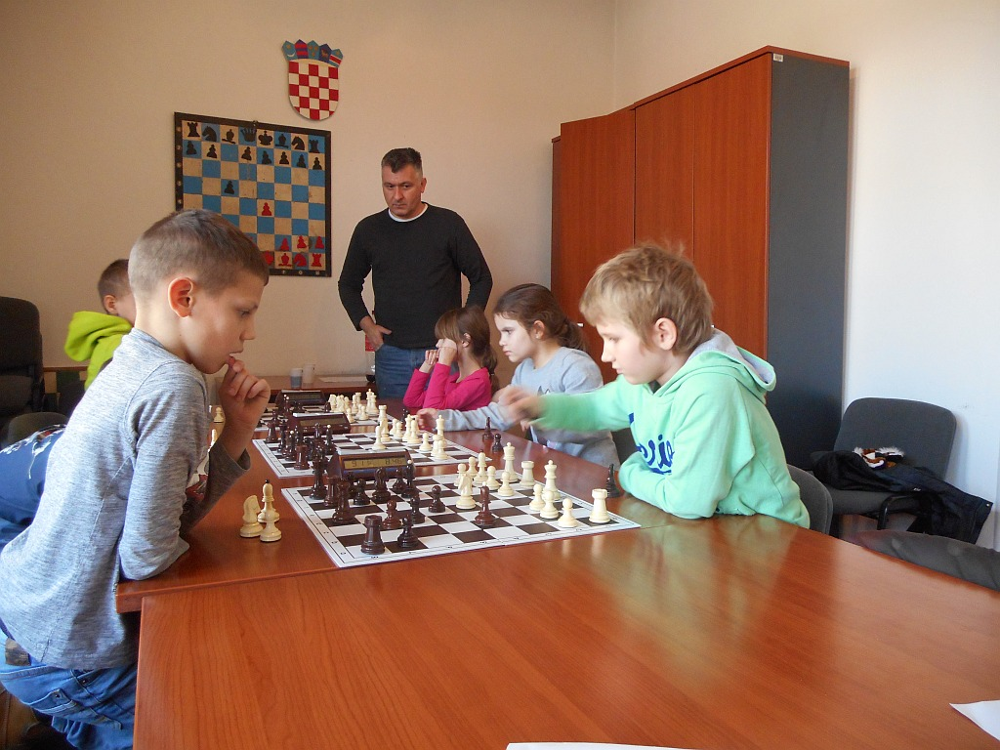
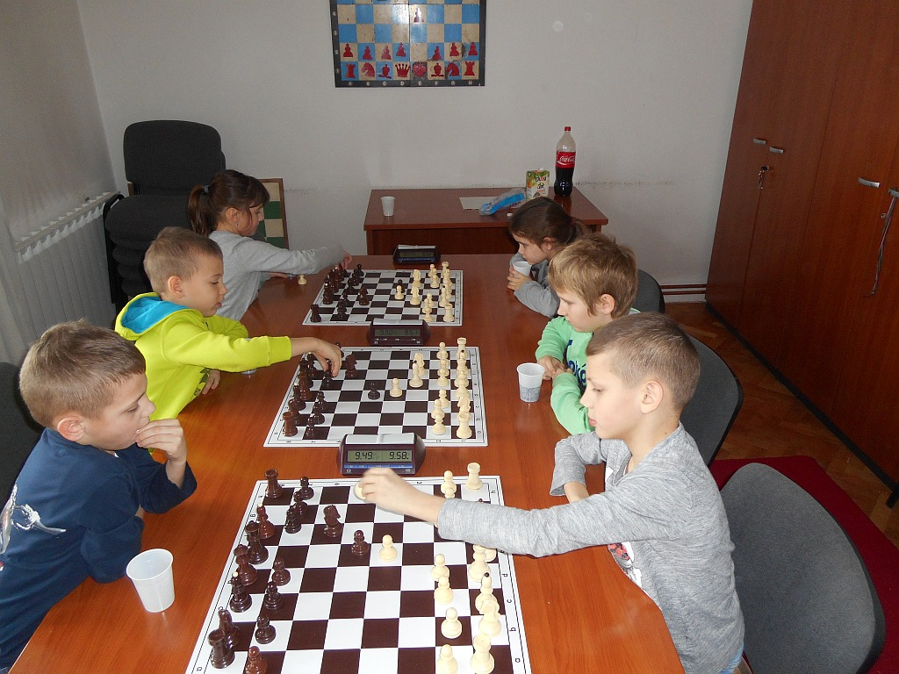
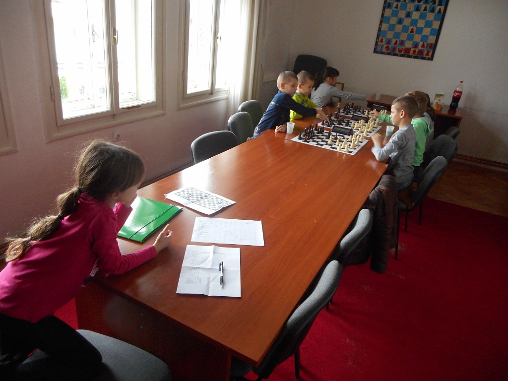
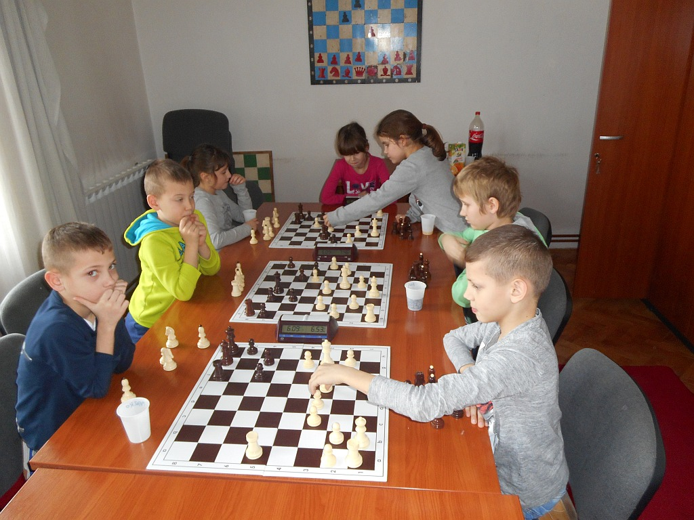
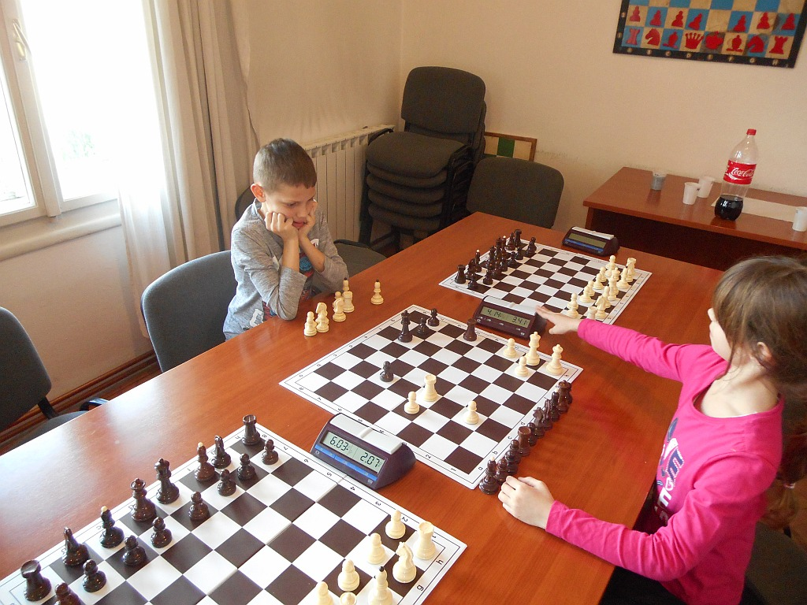
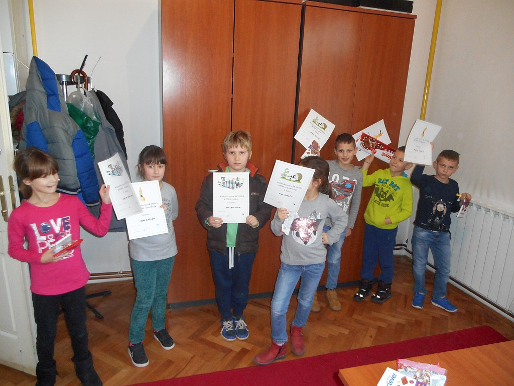

  
Danas je u prostorijama ŠK Odra odigran turnir kadeta početnika, a nastupilo je svih sedam pozvanih kadeta i kadetkinja! Malo nam je zgusnut šahovski raspored u veljači i ožujku, ali smo uspjeli organizirati ovaj turnir, koji je potpuno ispunio svoju svrhu. Većina je napokon vidjela kako izgledaju turnirska pravila i svi su bili prilično disciplinirani, uključujući Marka! Sada su svi spremni i za poneki turnir izvan Kluba. Pobjednik u konkurenciji kadeta je **Noa Markulin,** koji već dulje vrijeme pokazuje zanimanje za šah, ali ga roditelji tako rijetko dovode na druženja petkom da ga ove godine nismo ni registrirali niti imali priliku prijaviti za kadetsku ekipu Kluba. Noa je svladao matiranje teškim figurama i u više partija to lijepo demonstrirao. U konkurenciji kadetkinja pobjednica je **Lucija Hana Kaić,** koja je već uspjela shvatiti snagu pješaka u završnici, a uspjela je i matirati Petra. Petar je nažalost propustio veliku priliku za osvajanje prvog mjesta. U odlučujućoj partiji s Noom, u kojoj je imao topa više, loše je odigrao završnicu u vremenskom tjesnacu. Noa se bolje snašao i zasluženo osvojio turnir. Toni je proigrao tek pri kraju turnira nakon maloga motivacijskoga govora, Dora je gubila partije s dečkima, ali se klupskim kolegicama nije dala svladati. Ana je, kao i Hana, izgubila samo jednu partiju, a jedina se izborila za remi s pobjednikom. Uz to, vrlo je brzo shvatila koliku ulogu igra pravilno raspoređeno vrijeme za razmišljanje. Marku, kao i Toniju, nedostaje malo više samopouzdanja, ali vjerujem da će se to ispraviti čim malo bolje svladaju tehnike matiranja.

Tablica:  

| Ime | 1. | 2. | 3. | 4. | 5. | 6. | 7. | Bod. | Mjesto |
| --- | --- | --- | --- | --- | --- | --- | --- | --- | --- |
| Pisačić, Petar | \* | 1 | 1 | 1 | 0 | 0,5 | 0 | 3,5 | 2. |
| Pisačić, Marko | 0 | \* | 1 | 0 | 0,5 | 0 | 0 | 1,5 | 3. |
| Halužan, Toni | 0 | 0 | \* | 1 | 0,5 | 0 | 0 | 1,5 | 4. |
| Bačurin, Dora | 0 | 1 | 0 | \* | 0,5 | 0,5 | 0 | 2 | 3. |
| **Kaić, Lucija Hana** | 1 | 0,5 | 0,5 | 0,5 | \* | 1 | 0 | 3,5 | 1. |
| Kovačić, Ana | 0,5 | 1 | 1 | 0,5 | 0 | \* | 0,5 | 3,5 | 2. |
| **Markulin, Noa** | 1 | 1 | 1 | 1 | 1 | 0,5 | \* | 5,5 | 1. |

     
   
