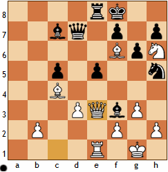
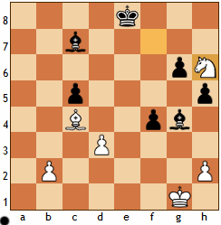
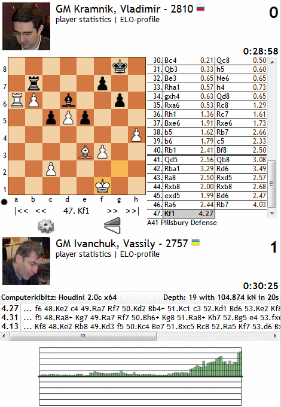

Iiii…?!

Čekamo službenu objavu, ali kako sada stvari stoje, zbog boljeg dodatnog kriterija – više pobjeda – **Magnus** **Carlsen** je novi izazivač svjetskog šahovskog prvaka! Neki bi rekli – očekivano, po igrama kakve je prikazivao zadnjih mjeseci, međutim do tog statusa je došao teško i na kraju na prilično iznenađujući način. Naime, kolo prije kraja **Carlsen** i **Kramnik** dijelili su vrh tablice sa po 8½/13, da bi u 14. kolu, vjerojatno na iznenađenje mnogih – obojica izgubili!

**Carlsen** je kao bijeli igrao zatvorenu varijantu španjolke i, iako je imao inicijativu, potrošio je dosta vremena, pa je 30-i do 40-i potez morao izvući za minutu i 20 sekundi. Kad se dim razišao, nalazio se u teškoj poziciji.

*Situacija nakon 29. i 40. poteza bijelog*

**Kramnik** je obrnutim redoslijedom poteza ušao u pirčevu obranu (1.d4 d6 2. e4 Sf6..) gdje je od početka stajao nešto pasivnije, ali je držao situaciju pod kontrolom. Međutim, **Ivanchuk** je danas bio  vrlo raspoložen, kao i često puta ranije kada je igrao protiv top igrača (pobjedio je i **Carlsena** na ovom turniru), te je tako još jednom opravdao svoj nadimak *giant killer*. **Kramniku** je ovo prvi i jedini poraz na turniru, te stvarno ima za čime žaliti.

