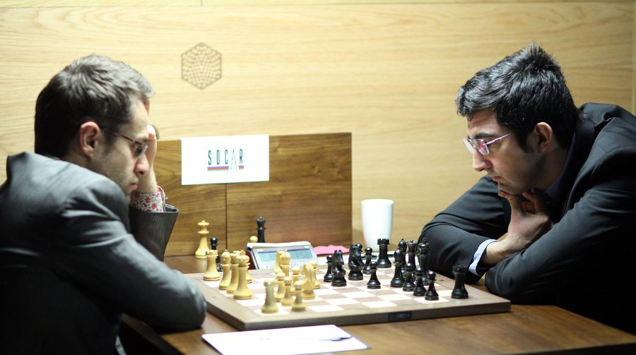

… a situcija na tablici se promjenila. Nakon dramatične borbe u 12. kolu, na vrh je sâm zasjeo bivši svjetski prvak **Vladimir Kramnik**, jedini neporaženi igrač na turniru koji igra sve bolje iz kola u kolo, a i dobio je posljednje tri partije. Na ruku mu je išlo i to što je njegov protivnik **Aronian** morao igrati na pobjedu, ne bi li se održao u borbi za vodeću poziciju. Stari lisac **Kramnik** lukavo je iskoristio rivalitet mladih lavova i sad je sve u njegovim rukama, jer ima 8 bodova iz 12 partija, pola boda više od **Carlsena** koji je po prvi put poražen na ovom turniru (**Ivanchuk**) i uopće nakon dosta vremena, pa ostaje za vidjeti kako će se to odraziti na njegovo samopouzdanje, uz činjenicu da će sada i on morati forsirati igru na pobjedu želi li eventualno sustići **Kramnika** i osigurati barem razigravanje. **Aronianu** bod i pol zaostatka ne daje baš prevelike šanse, dok ostali igrači redom zaostaju 2,5 ili više bodova za **Kramnikom** i otpali su iz utrke za status izazivača.

U svakom slučaju očekuje nas još uzbuđenja prije kraja turnira. Danas je dan odmora, a zadnja dva kola igraju se sutra i prekosutra.

