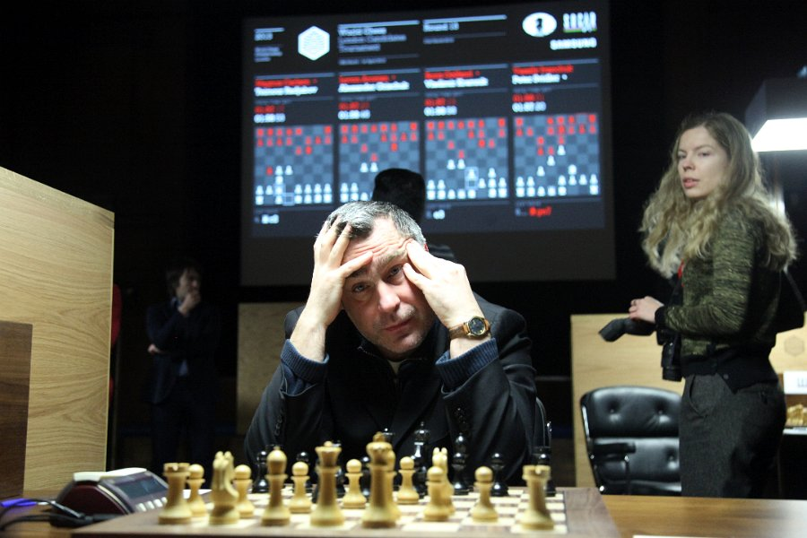

Jučer je igrana trinaesta partija i situacija na vrhu je opet neizvjesna. **Kramnik** je protiv **Gelfanda** imao izglednu poziciju, međutim propustio je održati bodovnu razliku pred **Carlsenom** koji je pobjedio **Radjabova** u prilično izjednačenoj završnici, gdje je lako mogao, ustvari i trebao biti i remi.

Ostale partije su bile samo za prestiž: **Grischuk** je protiv **Aroniana** remizirao, a **Svidler** je bio bolji od **Ivanchuka**, koji je ponovo imao problema s vremenom, odnosno čak peti put na ovom turniru pala mu je zastavica! Njegov protivnik **Svidler** je nakon partije izjavio: *“To je bilo novo iskustvo za mene. Kada je igrao 27 … Rd7 odsutno je gledao u daljinu i nakon što sam odigrao 28.a4 i pritisnuo sat on je izgubio oko pola minute pokušavajući shvatiti koji sam potez povukao”.* Pomalo nevjerojatno, zar ne?

[Videozapis / ugrađeni sadržaj (new.livestream.com)](http://new.livestream.com/accounts/1504418/events/1984770/videos/15210877/player?autoPlay=false&height=360&mute=false&width=640)

Danas u 15 h po našem vremenu igra se zadnje kolo. Bijeli **Carlsen** dočekuje opasnog **Svidlera**, a *giant killer* **Ivanchuk** crnog **Kramnika**. **Magnus Carlsen** je u trenutno u prednosti zbog većeg broja pobjeda.

[Stay Tuned](http://london2013.fide.com/analysis/index.html "London 2013, turnir kandidata - Live s analizom") 😉
