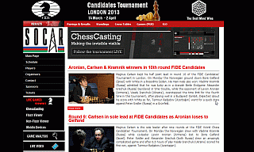
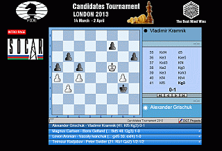
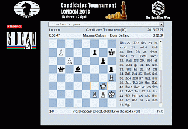
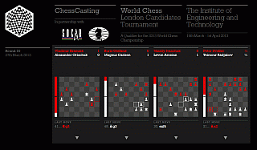
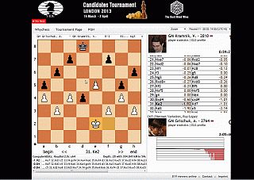
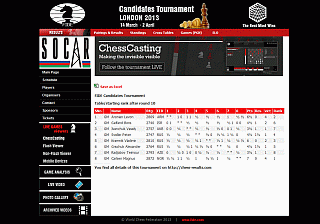

Ta njihova stranica je malo neobično organizirana, pa evo linkovi za lakše snalaženje:

\*Sljedeći link Firefox, Chrome, Opera, Safari… (i vjerojatno svi drugi alternativni preglednici na svijetu) normalno otvaraju, jedino Internet Explorer, kao i mnogi put ranije 😉 ima neku svoju logiku, pa se ne vidi ništa. Uglavnom puna putanja je [http://candidates2013.worldchess.com/#todays-pairings-view](http://candidates2013.worldchess.com/#todays-pairings-view), ali IE niti to ne priznaje. Vjerojatno ima neka kvaka, nek traži Onaj kome se dade…

.

.

.

.

.

.

.

.

.

.

.

