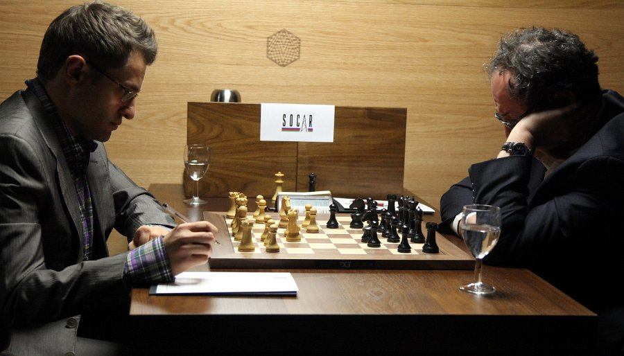

Bitka za status izazivača svjetskog šahovskog prvaka se zahuktava. **Aronian** i **Carlsen** čvrsto drže prvu poziciju, bez izgubljene partije. Osim njih dvojice, neporažen je još jedino **Kramnik** koji, međutim, nikoga nije uspio ni pobjediti.

**Trenutni poredak** uoči osmog kola koje je na rasporedu danas u 15 sati po našem vremenu (*live* prijenos [ovdje](http://london2013.fide.com/index.html "Live - London 2013, turnir kandidata")):

<table><tbody><tr><td><b>&nbsp;</b></td><td></td><td></td><td><b>Bodovi</b></td><td><strong>Omjer</strong></td></tr><tr><td><strong>1</strong></td><td><a href="http://worldchess.com/candidates/aronian.html" target="_blank">Aronian, Levon</a><strong> </strong></td><td></td><td><b>5/7</b></td><td>(+3 -0 =4)</td></tr><tr><td><strong>2</strong></td><td><a href="http://worldchess.com/candidates/magnus.html" target="_blank">Carlsen, Magnus</a></td><td></td><td><b>5/7</b></td><td>(+3 -0 =4)</td></tr><tr><td><strong>3</strong></td><td><a href="http://worldchess.com/candidates/kramnik.html" target="_blank">Kramnik, Vladimir</a></td><td></td><td><b>3.5/7</b></td><td>(+0 -0 =7)</td></tr><tr><td><strong>4</strong></td><td><a href="http://worldchess.com/candidates/svidler.html" target="_blank">Svidler, Peter</a></td><td></td><td><b>3.5/7</b></td><td>(+1 -1 =5)</td></tr><tr><td><strong>5</strong></td><td><a href="http://worldchess.com/candidates/grischuk.html" target="_blank">Grischuk, Alexander</a></td><td></td><td><b>3/7</b></td><td>(+0 -1 =6)</td></tr><tr><td><strong>6</strong></td><td><a href="http://worldchess.com/candidates/radjabov.html" target="_blank">Radjabov, Teimour</a><strong> </strong></td><td></td><td><b>3/7</b></td><td>(+1 -2 =4)</td></tr><tr><td><strong>7</strong></td><td><a href="http://worldchess.com/candidates/ivanchuk.html" target="_blank">Ivanchuk, Vassily</a><strong> </strong></td><td></td><td><b>2.5/7</b></td><td>(+0 -2 =5)</td></tr><tr><td><strong>8</strong></td><td><a href="http://worldchess.com/candidates/gelfand.html" target="_blank">Gelfand, Boris</a>&nbsp;<strong><strong></strong></strong></td><td></td><td><b>2.5/7</b></td><td>(+0 -2 =5)</td></tr></tbody></table>
