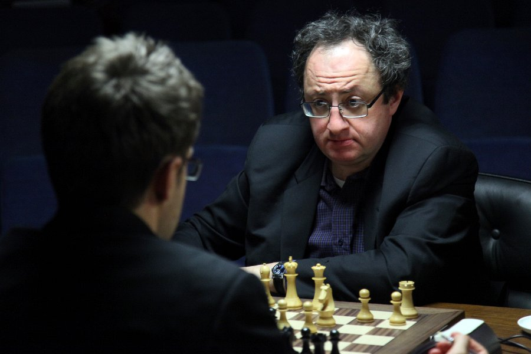

Jučer je opet bilo zanimljivo. Nakon mrtve trke između **Aroniana** i **Carlsena** prvih osam kola, u devetom kolu **Gelfand** je unio neravnotežu u vrh nanijevši prvi poraz na turniru **Aronianu**. **Carlsen** je u zanimljivoj partiji protiv sve boljeg **Kramnika** remizirao, i sada je sam na vrhu sa pola boda prednosti (6/9), a njih dvojica su i jedini još neporaženi igrači na turniru. **Ivanchuk** je napokon upisao prvu pobjedu.

Deseto kolo je na rasporedu sutra u 15h po našem vremenu.

[Videozapis / ugrađeni sadržaj (new.livestream.com)](http://new.livestream.com/accounts/1504418/events/1976153/videos/14726558/player?autoPlay=false&height=360&mute=false&width=640)

<table><tbody><tr><td colspan="9" nowrap="nowrap"><b>FIDE Turnir kandidata </b></td></tr><tr><td colspan="9" nowrap="nowrap"><b>1. krug </b></td></tr><tr><td nowrap="nowrap">1</td><td nowrap="nowrap">GM</td><td nowrap="nowrap">Aronian Levon</td><td nowrap="nowrap">2809</td><td nowrap="nowrap">½ – ½</td><td nowrap="nowrap">GM</td><td nowrap="nowrap">Carlsen Magnus</td><td nowrap="nowrap">2872</td><td nowrap="nowrap">8</td></tr><tr><td nowrap="nowrap">2</td><td nowrap="nowrap">GM</td><td nowrap="nowrap">Gelfand Boris</td><td nowrap="nowrap">2740</td><td nowrap="nowrap">½ – ½</td><td nowrap="nowrap">GM</td><td nowrap="nowrap">Radjabov Teimour</td><td nowrap="nowrap">2793</td><td nowrap="nowrap">7</td></tr><tr><td nowrap="nowrap">3</td><td nowrap="nowrap">GM</td><td nowrap="nowrap">Ivanchuk Vassily</td><td nowrap="nowrap">2757</td><td nowrap="nowrap">½ – ½</td><td nowrap="nowrap">GM</td><td nowrap="nowrap">Grischuk Alexander</td><td nowrap="nowrap">2764</td><td nowrap="nowrap">6</td></tr><tr><td nowrap="nowrap">4</td><td nowrap="nowrap">GM</td><td nowrap="nowrap">Svidler Peter</td><td nowrap="nowrap">2747</td><td nowrap="nowrap">½ – ½</td><td nowrap="nowrap">GM</td><td nowrap="nowrap">Kramnik Vladimir</td><td nowrap="nowrap">2810</td><td nowrap="nowrap">5</td></tr><tr><td colspan="9" nowrap="nowrap"><b>2. krug </b></td></tr><tr><td nowrap="nowrap">8</td><td nowrap="nowrap">GM</td><td nowrap="nowrap">Carlsen Magnus</td><td nowrap="nowrap">2872</td><td nowrap="nowrap">½ – ½</td><td nowrap="nowrap">GM</td><td nowrap="nowrap">Kramnik Vladimir</td><td nowrap="nowrap">2810</td><td nowrap="nowrap">5</td></tr><tr><td nowrap="nowrap">6</td><td nowrap="nowrap">GM</td><td nowrap="nowrap">Grischuk Alexander</td><td nowrap="nowrap">2764</td><td nowrap="nowrap">½ – ½</td><td nowrap="nowrap">GM</td><td nowrap="nowrap">Svidler Peter</td><td nowrap="nowrap">2747</td><td nowrap="nowrap">4</td></tr><tr><td nowrap="nowrap">7</td><td nowrap="nowrap">GM</td><td nowrap="nowrap"><strong>Radjabov Teimour</strong></td><td nowrap="nowrap">2793</td><td nowrap="nowrap">1 – 0</td><td nowrap="nowrap">GM</td><td nowrap="nowrap">Ivanchuk Vassily</td><td nowrap="nowrap">2757</td><td nowrap="nowrap">3</td></tr><tr><td nowrap="nowrap">1</td><td nowrap="nowrap">GM</td><td nowrap="nowrap"><strong>Aronian Levon</strong></td><td nowrap="nowrap">2809</td><td nowrap="nowrap">1 – 0</td><td nowrap="nowrap">GM</td><td nowrap="nowrap">Gelfand Boris</td><td nowrap="nowrap">2740</td><td nowrap="nowrap">2</td></tr><tr><td colspan="9" nowrap="nowrap"><b>3. krug </b></td></tr><tr><td nowrap="nowrap">2</td><td nowrap="nowrap">GM</td><td nowrap="nowrap">Gelfand Boris</td><td nowrap="nowrap">2740</td><td nowrap="nowrap">0 – 1</td><td nowrap="nowrap">GM</td><td nowrap="nowrap"><strong>Carlsen Magnus</strong></td><td nowrap="nowrap">2872</td><td nowrap="nowrap">8</td></tr><tr><td nowrap="nowrap">3</td><td nowrap="nowrap">GM</td><td nowrap="nowrap">Ivanchuk Vassily</td><td nowrap="nowrap">2757</td><td nowrap="nowrap">0 – 1</td><td nowrap="nowrap">GM</td><td nowrap="nowrap"><strong>Aronian Levon</strong></td><td nowrap="nowrap">2809</td><td nowrap="nowrap">1</td></tr><tr><td nowrap="nowrap">4</td><td nowrap="nowrap">GM</td><td nowrap="nowrap"><strong>Svidler Peter</strong></td><td nowrap="nowrap">2747</td><td nowrap="nowrap">1 – 0</td><td nowrap="nowrap">GM</td><td nowrap="nowrap">Radjabov Teimour</td><td nowrap="nowrap">2793</td><td nowrap="nowrap">7</td></tr><tr><td nowrap="nowrap">5</td><td nowrap="nowrap">GM</td><td nowrap="nowrap">Kramnik Vladimir</td><td nowrap="nowrap">2810</td><td nowrap="nowrap">½ – ½</td><td nowrap="nowrap">GM</td><td nowrap="nowrap">Grischuk Alexander</td><td nowrap="nowrap">2764</td><td nowrap="nowrap">6</td></tr><tr><td colspan="9" nowrap="nowrap"><b>4. krug </b></td></tr><tr><td nowrap="nowrap">8</td><td nowrap="nowrap">GM</td><td nowrap="nowrap"><strong>Carlsen Magnus</strong></td><td nowrap="nowrap">2872</td><td nowrap="nowrap">1 – 0</td><td nowrap="nowrap">GM</td><td nowrap="nowrap">Grischuk Alexander</td><td nowrap="nowrap">2764</td><td nowrap="nowrap">6</td></tr><tr><td nowrap="nowrap">7</td><td nowrap="nowrap">GM</td><td nowrap="nowrap">Radjabov Teimour</td><td nowrap="nowrap">2793</td><td nowrap="nowrap">½ – ½</td><td nowrap="nowrap">GM</td><td nowrap="nowrap">Kramnik Vladimir</td><td nowrap="nowrap">2810</td><td nowrap="nowrap">5</td></tr><tr><td nowrap="nowrap">1</td><td nowrap="nowrap">GM</td><td nowrap="nowrap">Aronian Levon</td><td nowrap="nowrap">2809</td><td nowrap="nowrap">½ – ½</td><td nowrap="nowrap">GM</td><td nowrap="nowrap">Svidler Peter</td><td nowrap="nowrap">2747</td><td nowrap="nowrap">4</td></tr><tr><td nowrap="nowrap">2</td><td nowrap="nowrap">GM</td><td nowrap="nowrap">Gelfand Boris</td><td nowrap="nowrap">2740</td><td nowrap="nowrap">½ – ½</td><td nowrap="nowrap">GM</td><td nowrap="nowrap">Ivanchuk Vassily</td><td nowrap="nowrap">2757</td><td nowrap="nowrap">3</td></tr><tr><td colspan="9" nowrap="nowrap"><b>5. krug </b></td></tr><tr><td nowrap="nowrap">3</td><td nowrap="nowrap">GM</td><td nowrap="nowrap">Ivanchuk Vassily</td><td nowrap="nowrap">2757</td><td nowrap="nowrap">½ – ½</td><td nowrap="nowrap">GM</td><td nowrap="nowrap">Carlsen Magnus</td><td nowrap="nowrap">2872</td><td nowrap="nowrap">8</td></tr><tr><td nowrap="nowrap">4</td><td nowrap="nowrap">GM</td><td nowrap="nowrap">Svidler Peter</td><td nowrap="nowrap">2747</td><td nowrap="nowrap">½ – ½</td><td nowrap="nowrap">GM</td><td nowrap="nowrap">Gelfand Boris</td><td nowrap="nowrap">2740</td><td nowrap="nowrap">2</td></tr><tr><td nowrap="nowrap">5</td><td nowrap="nowrap">GM</td><td nowrap="nowrap">Kramnik Vladimir</td><td nowrap="nowrap">2810</td><td nowrap="nowrap">½ – ½</td><td nowrap="nowrap">GM</td><td nowrap="nowrap">Aronian Levon</td><td nowrap="nowrap">2809</td><td nowrap="nowrap">1</td></tr><tr><td nowrap="nowrap">6</td><td nowrap="nowrap">GM</td><td nowrap="nowrap">Grischuk Alexander</td><td nowrap="nowrap">2764</td><td nowrap="nowrap">½ – ½</td><td nowrap="nowrap">GM</td><td nowrap="nowrap">Radjabov Teimour</td><td nowrap="nowrap">2793</td><td nowrap="nowrap">7</td></tr><tr><td colspan="9" nowrap="nowrap"><b>6. krug </b></td></tr><tr><td nowrap="nowrap">4</td><td nowrap="nowrap">GM</td><td nowrap="nowrap">Svidler Peter</td><td nowrap="nowrap">2747</td><td nowrap="nowrap">0 – 1</td><td nowrap="nowrap">GM</td><td nowrap="nowrap"><strong>Carlsen Magnus</strong></td><td nowrap="nowrap">2872</td><td nowrap="nowrap">8</td></tr><tr><td nowrap="nowrap">5</td><td nowrap="nowrap">GM</td><td nowrap="nowrap">Kramnik Vladimir</td><td nowrap="nowrap">2810</td><td nowrap="nowrap">½ – ½</td><td nowrap="nowrap">GM</td><td nowrap="nowrap">Ivanchuk Vassily</td><td nowrap="nowrap">2757</td><td nowrap="nowrap">3</td></tr><tr><td nowrap="nowrap">6</td><td nowrap="nowrap">GM</td><td nowrap="nowrap">Grischuk Alexander</td><td nowrap="nowrap">2764</td><td nowrap="nowrap">½ – ½</td><td nowrap="nowrap">GM</td><td nowrap="nowrap">Gelfand Boris</td><td nowrap="nowrap">2740</td><td nowrap="nowrap">2</td></tr><tr><td nowrap="nowrap">7</td><td nowrap="nowrap">GM</td><td nowrap="nowrap">Radjabov Teimour</td><td nowrap="nowrap">2793</td><td nowrap="nowrap">0 – 1</td><td nowrap="nowrap">GM</td><td nowrap="nowrap"><strong>Aronian Levon</strong></td><td nowrap="nowrap">2809</td><td nowrap="nowrap">1</td></tr><tr><td colspan="9" nowrap="nowrap"><b>7. krug </b></td></tr><tr><td nowrap="nowrap">8</td><td nowrap="nowrap">GM</td><td nowrap="nowrap">Carlsen Magnus</td><td nowrap="nowrap">2872</td><td nowrap="nowrap">½ – ½</td><td nowrap="nowrap">GM</td><td nowrap="nowrap">Radjabov Teimour</td><td nowrap="nowrap">2793</td><td nowrap="nowrap">7</td></tr><tr><td nowrap="nowrap">1</td><td nowrap="nowrap">GM</td><td nowrap="nowrap">Aronian Levon</td><td nowrap="nowrap">2809</td><td nowrap="nowrap">½ – ½</td><td nowrap="nowrap">GM</td><td nowrap="nowrap">Grischuk Alexander</td><td nowrap="nowrap">2764</td><td nowrap="nowrap">6</td></tr><tr><td nowrap="nowrap">2</td><td nowrap="nowrap">GM</td><td nowrap="nowrap">Gelfand Boris</td><td nowrap="nowrap">2740</td><td nowrap="nowrap">½ – ½</td><td nowrap="nowrap">GM</td><td nowrap="nowrap">Kramnik Vladimir</td><td nowrap="nowrap">2810</td><td nowrap="nowrap">5</td></tr><tr><td nowrap="nowrap">3</td><td nowrap="nowrap">GM</td><td nowrap="nowrap">Ivanchuk Vassily</td><td nowrap="nowrap">2757</td><td nowrap="nowrap">½ – ½</td><td nowrap="nowrap">GM</td><td nowrap="nowrap">Svidler Peter</td><td nowrap="nowrap">2747</td><td nowrap="nowrap">4</td></tr><tr><td colspan="9" nowrap="nowrap"><b>8. krug </b></td></tr><tr><td nowrap="nowrap">8</td><td nowrap="nowrap">GM</td><td nowrap="nowrap">Carlsen Magnus</td><td nowrap="nowrap">2872</td><td nowrap="nowrap">½ – ½</td><td nowrap="nowrap">GM</td><td nowrap="nowrap">Aronian Levon</td><td nowrap="nowrap">2809</td><td nowrap="nowrap">1</td></tr><tr><td nowrap="nowrap">7</td><td nowrap="nowrap">GM</td><td nowrap="nowrap">Radjabov Teimour</td><td nowrap="nowrap">2793</td><td nowrap="nowrap">0 – 1</td><td nowrap="nowrap">GM</td><td nowrap="nowrap"><strong>Gelfand Boris</strong></td><td nowrap="nowrap">2740</td><td nowrap="nowrap">2</td></tr><tr><td nowrap="nowrap">6</td><td nowrap="nowrap">GM</td><td nowrap="nowrap"><strong>Grischuk Alexander</strong></td><td nowrap="nowrap">2764</td><td nowrap="nowrap">1 – 0</td><td nowrap="nowrap">GM</td><td nowrap="nowrap">Ivanchuk Vassily</td><td nowrap="nowrap">2757</td><td nowrap="nowrap">3</td></tr><tr><td nowrap="nowrap">5</td><td nowrap="nowrap">GM</td><td nowrap="nowrap"><strong>Kramnik Vladimir</strong></td><td nowrap="nowrap">2810</td><td nowrap="nowrap">1 – 0</td><td nowrap="nowrap">GM</td><td nowrap="nowrap">Svidler Peter</td><td nowrap="nowrap">2747</td><td nowrap="nowrap">4</td></tr><tr><td colspan="9" nowrap="nowrap"><b>9. krug </b></td></tr><tr><td nowrap="nowrap">5</td><td nowrap="nowrap">GM</td><td nowrap="nowrap">Kramnik Vladimir</td><td nowrap="nowrap">2810</td><td nowrap="nowrap">½ – ½</td><td nowrap="nowrap">GM</td><td nowrap="nowrap">Carlsen Magnus</td><td nowrap="nowrap">2872</td><td nowrap="nowrap">8</td></tr><tr><td nowrap="nowrap">4</td><td nowrap="nowrap">GM</td><td nowrap="nowrap">Svidler Peter</td><td nowrap="nowrap">2747</td><td nowrap="nowrap">½ – ½</td><td nowrap="nowrap">GM</td><td nowrap="nowrap">Grischuk Alexander</td><td nowrap="nowrap">2764</td><td nowrap="nowrap">6</td></tr><tr><td nowrap="nowrap">3</td><td nowrap="nowrap">GM</td><td nowrap="nowrap"><strong>Ivanchuk Vassily</strong></td><td nowrap="nowrap">2757</td><td nowrap="nowrap">1 – 0</td><td nowrap="nowrap">GM</td><td nowrap="nowrap">Radjabov Teimour</td><td nowrap="nowrap">2793</td><td nowrap="nowrap">7</td></tr><tr><td nowrap="nowrap">2</td><td nowrap="nowrap">GM</td><td nowrap="nowrap"><strong>Gelfand Boris</strong></td><td nowrap="nowrap">2740</td><td nowrap="nowrap">1 – 0</td><td nowrap="nowrap">GM</td><td nowrap="nowrap">Aronian Levon</td><td nowrap="nowrap">2809</td><td nowrap="nowrap">1</td></tr><tr><td colspan="9" nowrap="nowrap"><b>10. krug (sutra) </b></td></tr><tr><td nowrap="nowrap">8</td><td nowrap="nowrap">GM</td><td nowrap="nowrap">Carlsen Magnus</td><td nowrap="nowrap">2872</td><td nowrap="nowrap">–</td><td nowrap="nowrap">GM</td><td nowrap="nowrap">Gelfand Boris</td><td nowrap="nowrap">2740</td><td nowrap="nowrap">2</td></tr><tr><td nowrap="nowrap">1</td><td nowrap="nowrap">GM</td><td nowrap="nowrap">Aronian Levon</td><td nowrap="nowrap">2809</td><td nowrap="nowrap">–</td><td nowrap="nowrap">GM</td><td nowrap="nowrap">Ivanchuk Vassily</td><td nowrap="nowrap">2757</td><td nowrap="nowrap">3</td></tr><tr><td nowrap="nowrap">7</td><td nowrap="nowrap">GM</td><td nowrap="nowrap">Radjabov Teimour</td><td nowrap="nowrap">2793</td><td nowrap="nowrap">–</td><td nowrap="nowrap">GM</td><td nowrap="nowrap">Svidler Peter</td><td nowrap="nowrap">2747</td><td nowrap="nowrap">4</td></tr><tr><td nowrap="nowrap">6</td><td nowrap="nowrap">GM</td><td nowrap="nowrap">Grischuk Alexander</td><td nowrap="nowrap">2764</td><td nowrap="nowrap">–</td><td nowrap="nowrap">GM</td><td nowrap="nowrap">Kramnik Vladimir</td><td nowrap="nowrap">2810</td><td nowrap="nowrap">5</td></tr></tbody></table>
