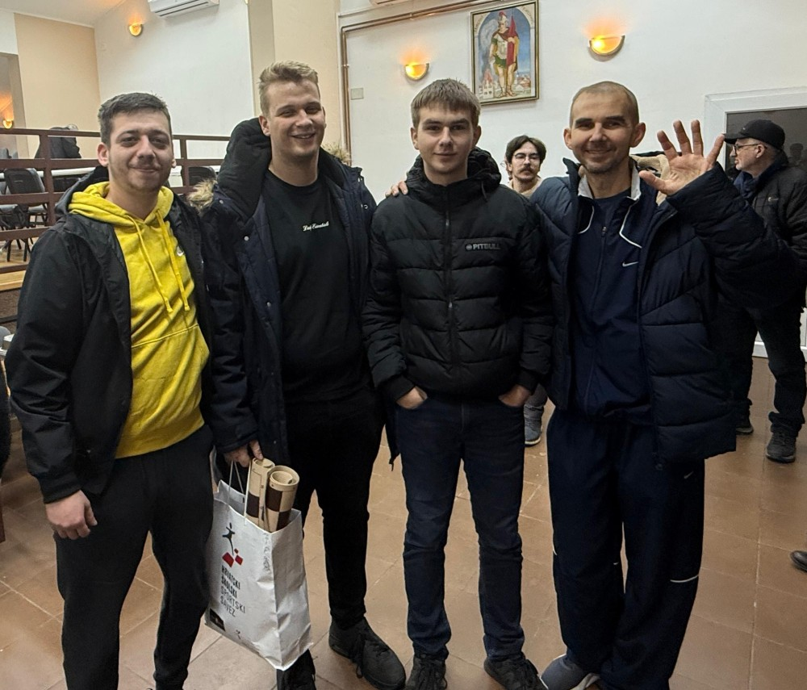
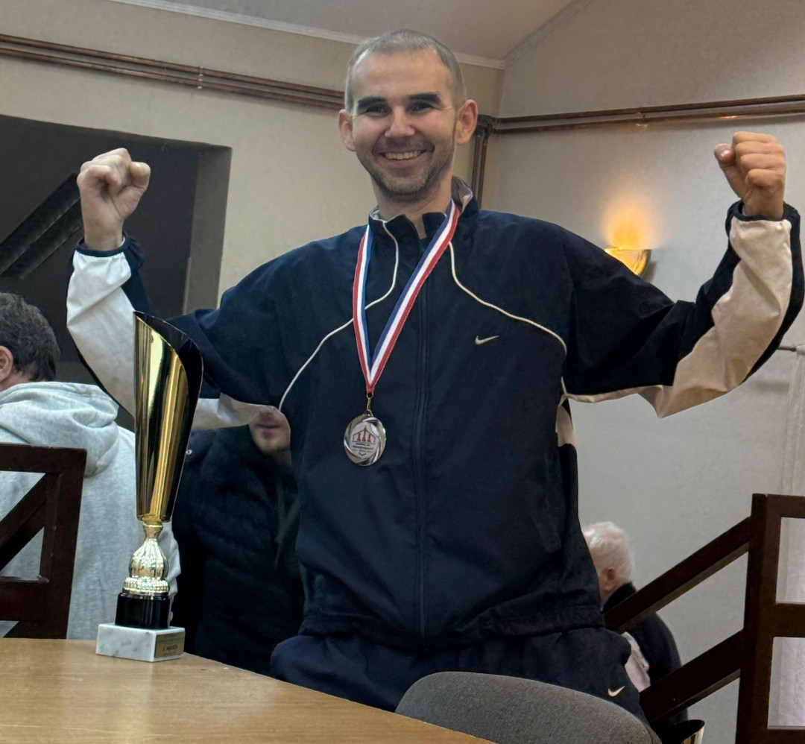
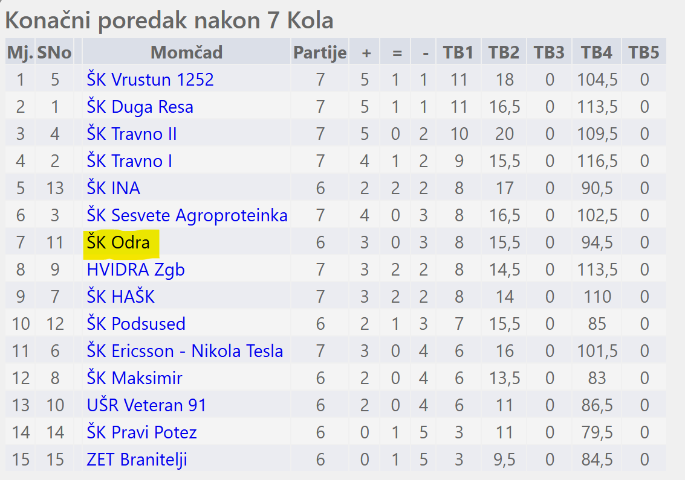

Dana **14\. prosinca 2025.** održana je završnica **24\. Tradicionalne „Šahovske lige – Hrvatski branitelj“**, natjecanja koje se već godinama s pravom smatra jednim od najljepših šahovskih događaja među hrvatskim braniteljima i HRVI-jem. Šah je ovdje više od igre — spoj iskustva, discipline i onog pravog natjecateljskog duha.

Ekipa **ŠK Odre** natjecanje je završila na **7\. mjestu od ukupno 15 ekipa**, uz solidnu i borbenu igru kroz cijeli turnir. Nastupili su redom: Ivan Vraneša, Božo Cvetković, Luka Fiolić i Goran Fiolić. Ipak, jedan se nastup posebno izdvojio. 

**Goran Fiolić** bio je prvo ime naše ekipe te je zasluženo osvojio **medalju za drugog najboljeg igrača na 4. ploči**. U šest odigranih partija osvojio je **impresivna 4 boda**, uz samo jedan poraz. Njegov smiren, autoritativan nastup za pločom podsjetio je na neke od najvećih — bez pretjerivanja, bilo je tu i **Kasparovskog štiha**.

Turnir je protekao u prijateljskom ozračju, a sve je zaokruženo zajedničkim druženjem i klopom na kraju, **kojom je organizator počastio sve sudionike**. Kako kažu — slika govori više od tisuću riječi, a mi ćemo dodati: i dobra partija se pamti dugo nakon zadnjeg poteza.

Ivan V
