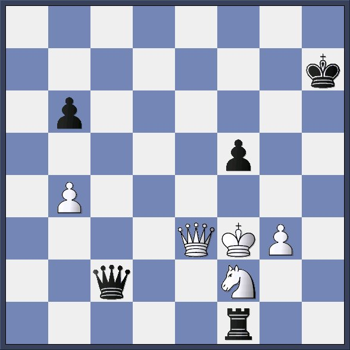

OBAVIJESTI

U petak 1. studenoga nema šahovske škole zbog blagdana Svih svetih!

Prvenstvo OŠ Novog Zagreba odigrat će se u petak 22. studenog 2013. godine u prostorijama I. osnovne škole Dugave, Školski prilaz bb. Početak prvenstva je u 17:30 sati, a kraj oko 20:30 sati. Generalni sponzor Dugave opena je izdavačka kuća Školska knjiga.

Ako skupimo dvije ekipe (i cure i dečke na šest ploča),  igrat će dvije ekipe. Svi koji su voljni nastupiti molimo da to potvrde do petka (zaključno sa) 8. studenoga. Za registrirane članove Kluba smatramo da se nastup za OŠ  podrazumijeva.

Mozgalica: crni vuče i matira u dva poteza!

