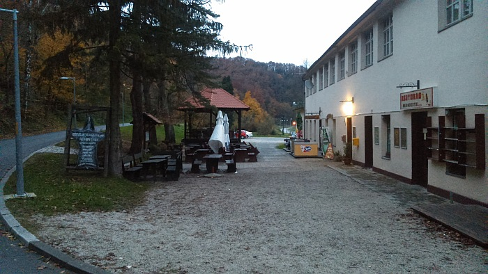
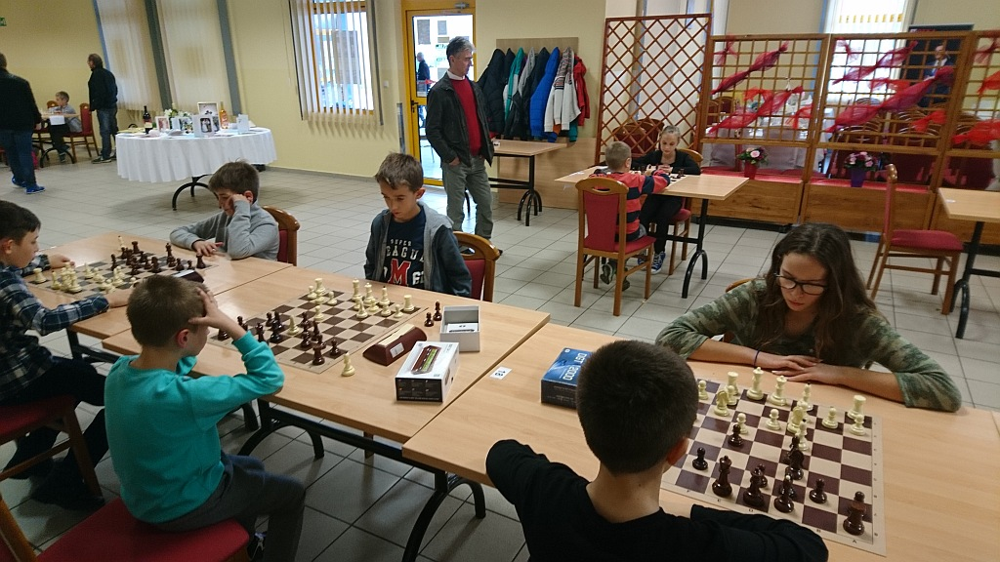
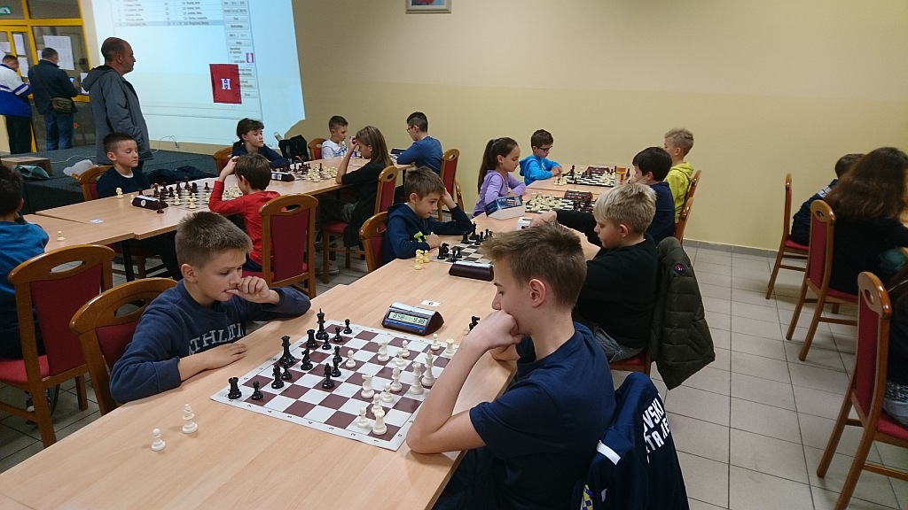
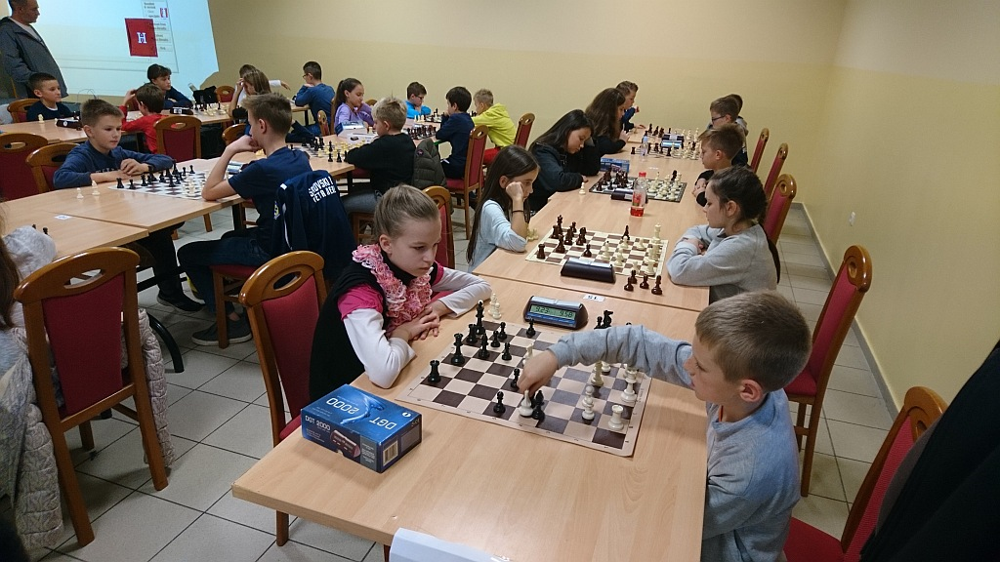
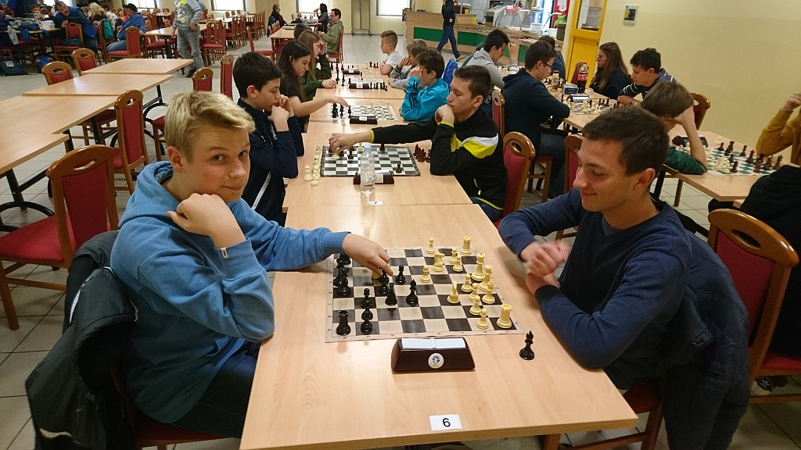
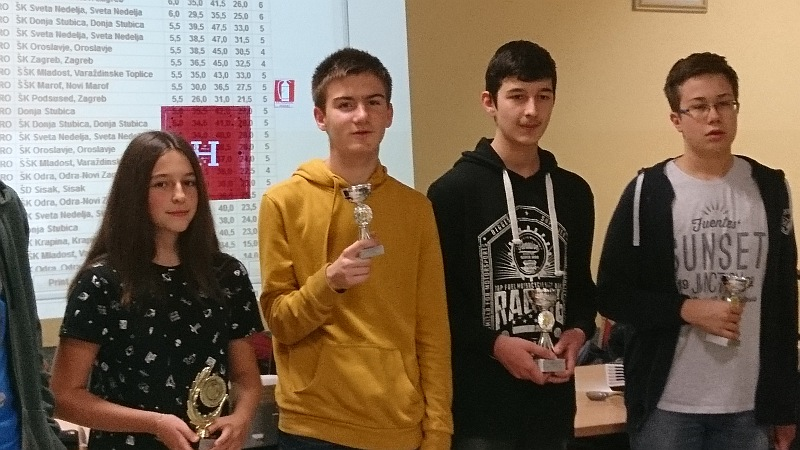
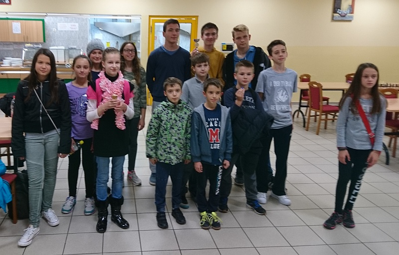

Šahovski savez Krapinsko-zagorske županije uz tehničku organizaciju Šahovskog kluba Krapina organizirao je 11. studenoga 2017. **VI. otvoreno kadetsko prvenstvo Krapinsko-zagorske županije u konkurenciji do 12 i 16 godina**. Turnir se igrao na tempo 10+5, a odigran je u restoranu KTC-a u Krapini. Od naših igrača na koje smo računali nedostajali su Katarina zbog bolesti, Bruno jer ga mama nije pustila, Dora jer je imala prevažan rođendan i Roko koji nije bio u Zagrebu ovaj vikend. Ipak, većina je nastupila na ovom turniru i vjerujem da su stekli novo važno iskustvo, prvenstveno što se tiče tempa igre. Sve je više digitalnih satova u upotrebi te vjerujem da će i drugi organizatori ubrzo prihvatiti tempo sa dodatkom vremena kao pravedniji i prihvatljiviji za kadetske turnire.

Medaljama su se okitili, na turniru [**U16**](http://chess-results.com/tnr312411.aspx?lan=13&art=1&turdet=YES&wi=984):  
1\. MK Marko Novosel, 2121 ŠK Donja Stubica  
2\. MK Oliver Kukas, 2120 ŠK Oroslavje  
**3\. II Ivan Maravić, 1895 ŠK Odra**  
Najbolja djevojka u konkurenciji U16 bila je MK Petra Randić, 1912 iz ŠD Sisak koja je u posljednjem kolu pobijedila i našeg Ivana Maravića, ali je zbog lošijih dodatnih kriterija završila na četvrtom mjestu sa istim brojem bodova.

Na turniru [**U12**](http://chess-results.com/tnr312412.aspx?lan=13&art=1&turdet=YES&wi=984) medalje su osvojili:  
1\. II Leon Putar, 1809 ŠK Brestje, Sesvete  
2\. III Lovro Novosel, 1888 ŠK Sveta Nedelja  
3\. III Marin Grgantov, 1848 ŠK Petar Sedlar-Pepe, Kaštel Novi  
Najbolja djevojčica u ovoj konkurenciji bila je I Lara Putar, 1824 iz ŠK Brestje koja je sa šest bodova završila turnir na šestom mjestu u ukupnom poretku.

Od naših igrača i igračica, u gornjoj polovici tablica završili su Ivan Maravić (3. mjesto u konkurenciji U16!), Ivan Vraneša, Luka Fiolić, Monika Kolovrat i Samanta Halužan.  
Bilo je nekoliko iznenađenja, pa je tako Filip u prvom kolu pobijedio Moniku, Franka je pobijedila Anđelu, a Luka Matašić, Anu. Ana nije imala svoj dan na ovom turniru, ali je možda i bolje zakazati na ovom prvenstvu, nego na nekom važnijem školskom. 🙂  
Čestitke svim učesnicima, hvala roditeljima na prijevozu i brizi, a posebno gosp. Igoru Matašiću na slikama i brizi o šahovskom inventaru.  
     
    
darko
