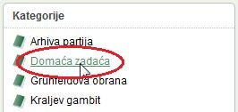
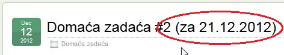
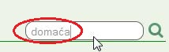

**Kako na stranici pronaći ono što želiš?** Evo kratkih primjera:

**1) Kako pronaći domaću zadaću?**

Klikom da link “Domaća zadaća” (nalazi se desno na stranici) prikazat će se sve domaće zadaće **počevši od posljednje**.

Tada se u naslovu zadaće može pročitati **datum** za koji treba napraviti zadaću.

Drugi način je da **koristiš tražilicu** (nalazi se gore desno) – jednostavno upiši pojam koji tražiš, u ovom slučaju “*domaća zadaća*” ili samo “*domaća*” ili samo “*zadaća*“…

… klikni na povećalo i prikazat će se sve domaće zadaće, **počevši od posljednje**. Onda pogledaš za koji je datum itd. 🙂

**Kategorije** su tu da bi se lakše pronašlo ono što se traži, jer se u istoj kategoriji nalaze npr. sve partije nekog otvaranja.

**Tražilicu** možeš koristiti i za pretragu svega ostalog na stranici (upiši npr. “*sicilijanska* *obrana*“, “kasparov”, “gambit” i sl.)

**2\. Što ako na stranici nema informacija koje su ti potrebne?**

Nema problema. 🙂 Ako na stranici ne pronađeš informaciju koju tražiš, a imaš neka pitanja slobodno nas **nazovi** ili napiši **mail**. Brojeve / mail adrese pronaći ćeš [ovdje](/kontakt/ "Brojevi mobitela i mail adrese").
