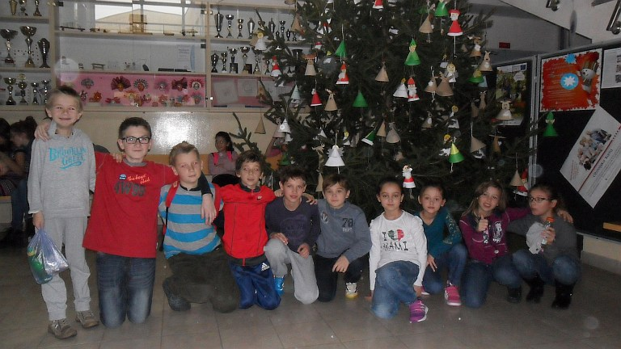
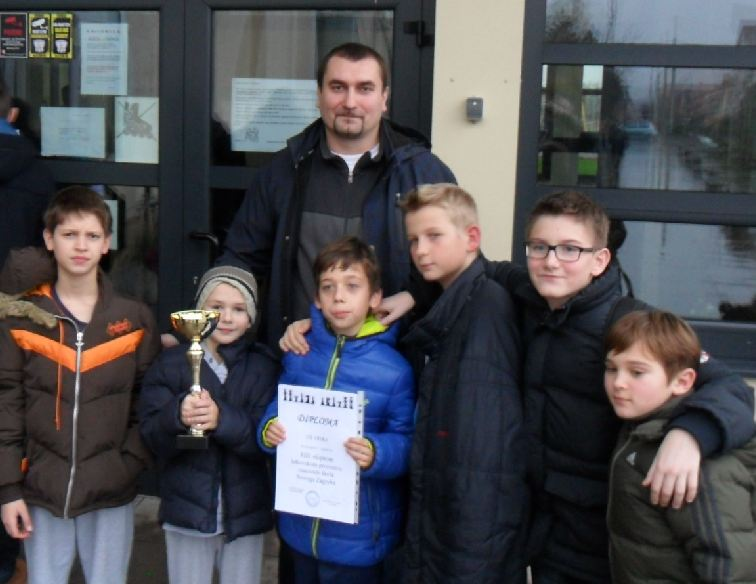
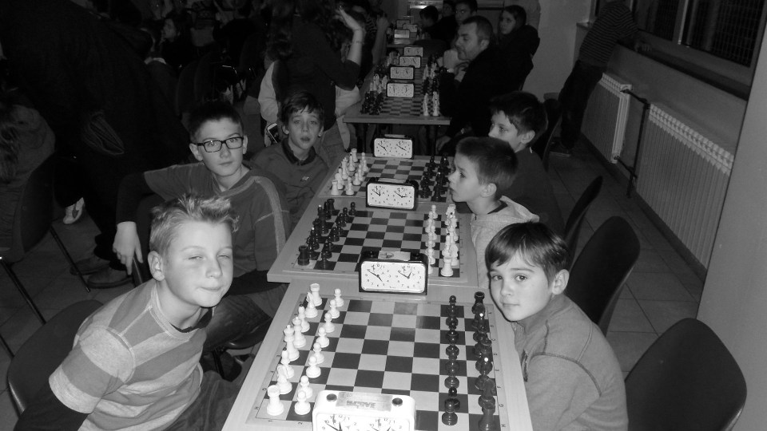
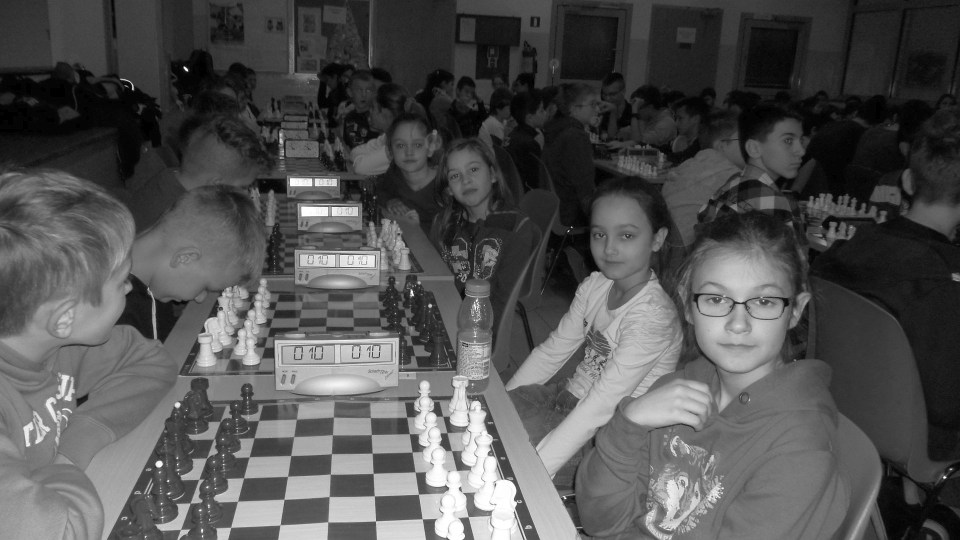

  
Danas je odigrano XIII. ekipno prvenstvo osnovnih škola Novog Zagreba. Prvenstvo je odigrano u [OŠ Klara](http://os-sveta-klara.skole.hr/ "OŠ Klara"), pod pokroviteljstvom ravnateljice škole, gospođe Tajane Bedaković-Koren, dok je voditelj i glavni sudac bio prof. Vjekoslav Novak. Iako sam sklon uglavnom kritikama, ovaj put imam samo pohvale za organizaciju i izvedbu natjecanja. Sve je teklo bez zastoja, bez previše birokracije i strogoće, prostor je bio idealan, suci profesionalni (iako su volontirali! 🙂 ), za djecu i voditelje organizirana je i okrepa, kava, sok…

Ovim putem zahvaljujem svim volonterima te Vjekoslavu i gospođi Tajani Bedaković-Koren na izvrsno odrađenu poslu pa time i jednome lijepom turniru za kadete Novog Zagreba. A sada o još boljim temama. Dečki su osvojili drugo mjesto! I pehar! Prvo mjesto uvjerljivo je osvojila OŠ Frana Galovića, a treće ekipa domaćina; OŠ Klara. Još nisam dobio sve službene rezultate, ali imam samo pohvale za igru svih igrača. Luka Fiolić zaigrao je za prvu ekipu i imao jednu pobjedu, a Luka Fran bio je najučinkovitiji u ekipi br. 2. Sve djevojke upisale su barem po jednu pobjedu, a posebno su me iznenadile Franka i Monika. Nisam ni znao da već tako dobro igraju. Bilo je i dosta izgubljenih partija, ali ne zbog loše igre, nego zbog malo prebrzog tempa. Svima se popravila kondicija, a i ekipni duh došao je do izražaja i nije bilo problema pri izmjenama u pojedinim kolima! Prof. Krešimir uredno je pratio ekipu, na vrijeme unosio izmjene u dogovoru s igračima te mislim da smo dobili još jednoga vrijednoga šahovskog djelatnika!

U [prilogu](/files/wp/2014/12/09-Kona-ni-rezultati-XIII.-ekipnog--ahovskog-prvenstva-O--Novog-Zagreba.xls) su rezultati po kolima.

         

darko

---

###### P.S. Iskoristit ću ovu objavu i na molbu organizatora ponoviti najavu turnira u Brežicama koji se igra za nekoliko dana.

RASPORED IGRANJA:  
1.KOLO: petak 19.12.2014. u 17.30  
2.KOLO: subota 20.12.2014. u 09.00  
3.KOLO: subota 20.12.2014. u 11.00  
4.KOLO: subota 20.12.2014. u 13.00  
5.KOLO:nedjelja 21.12.2014. u 09.00  
6.KOLO:nedjelja 21.12.2014. u 11.00  
7.KOLO:nedjelja 21.12.2014. u 13.00  
[raspis](/files/wp/2014/12/Raspis-za-Brezice-2014-hrvatski.pdf "raspis Brezice 2014")
