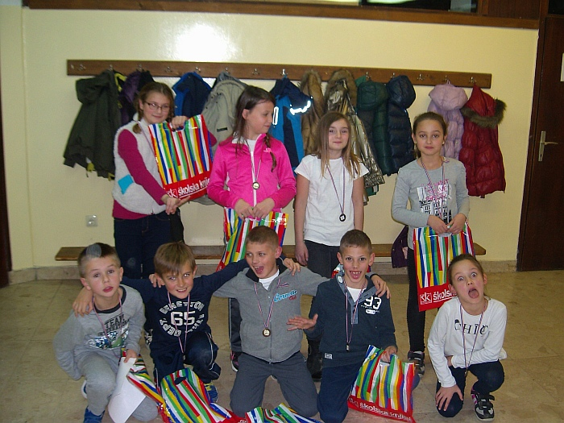
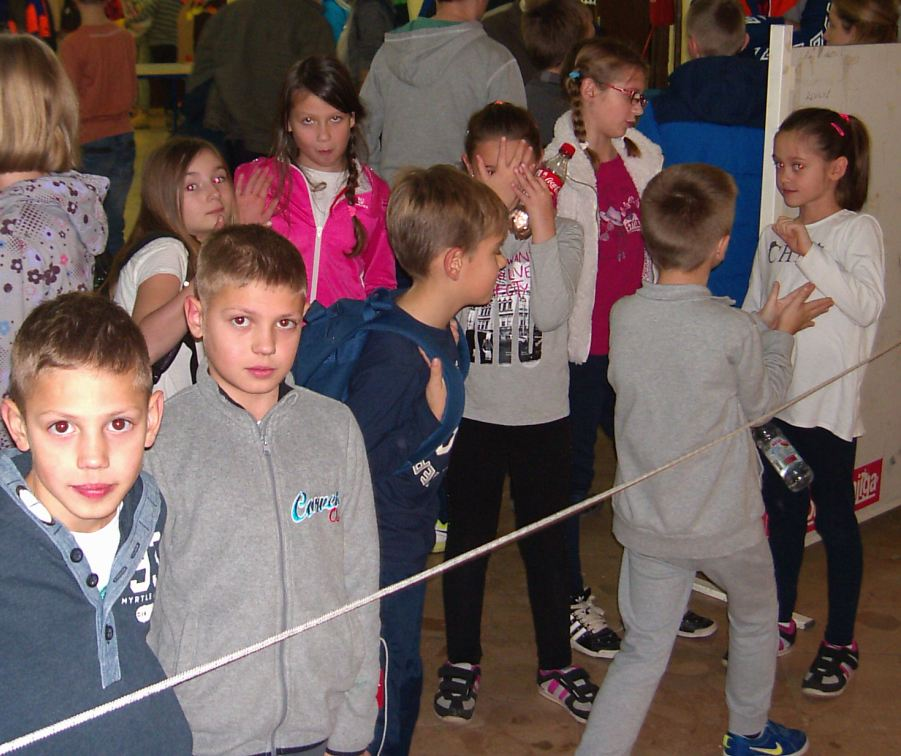
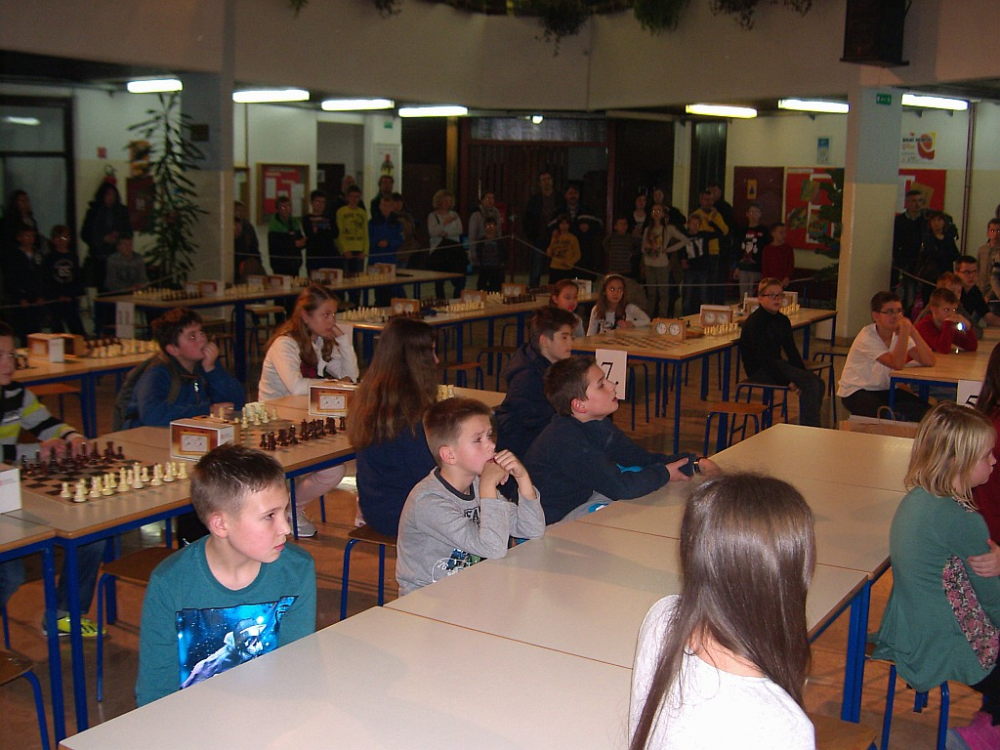
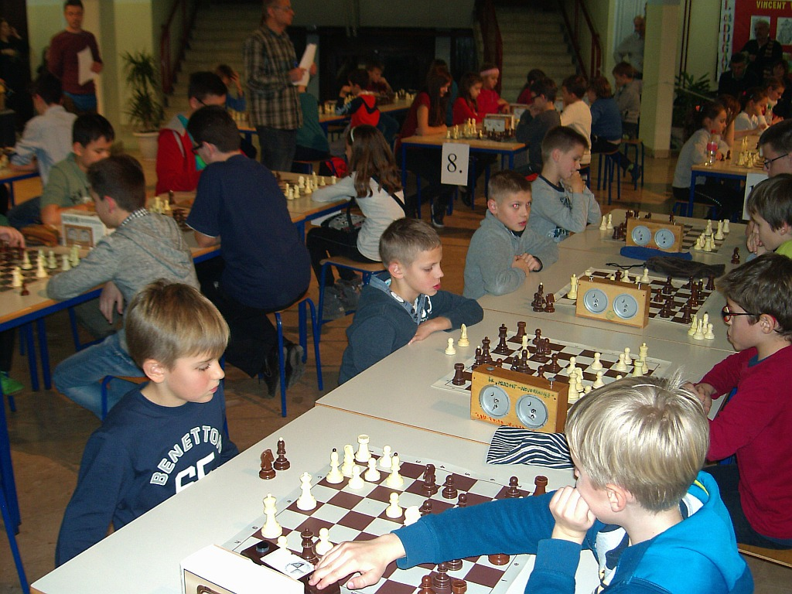
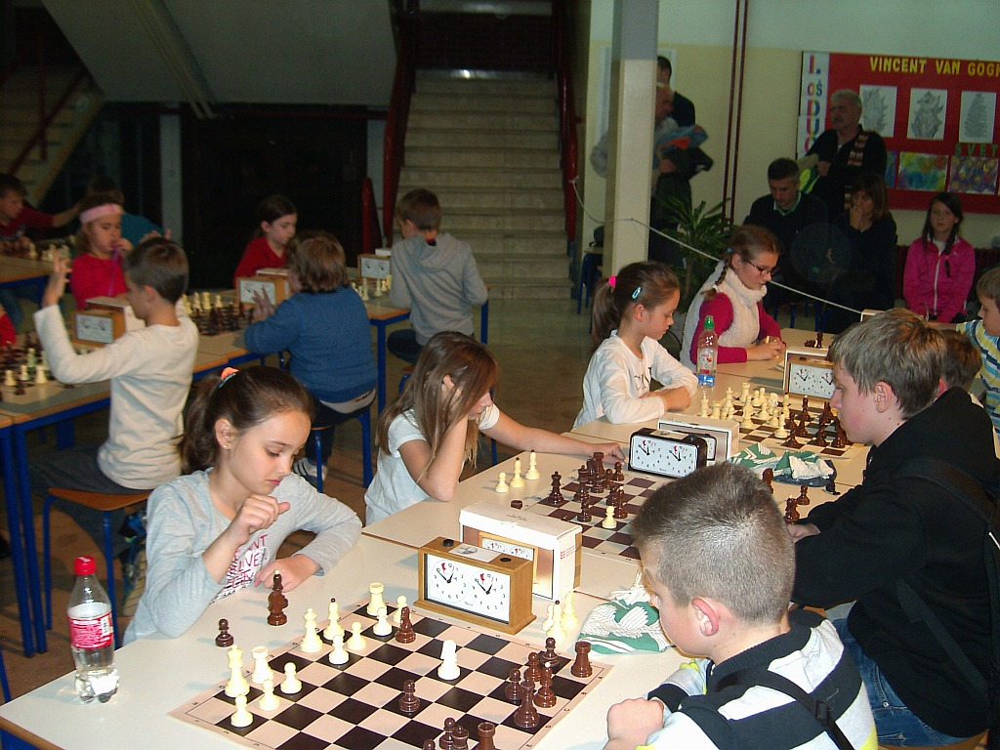
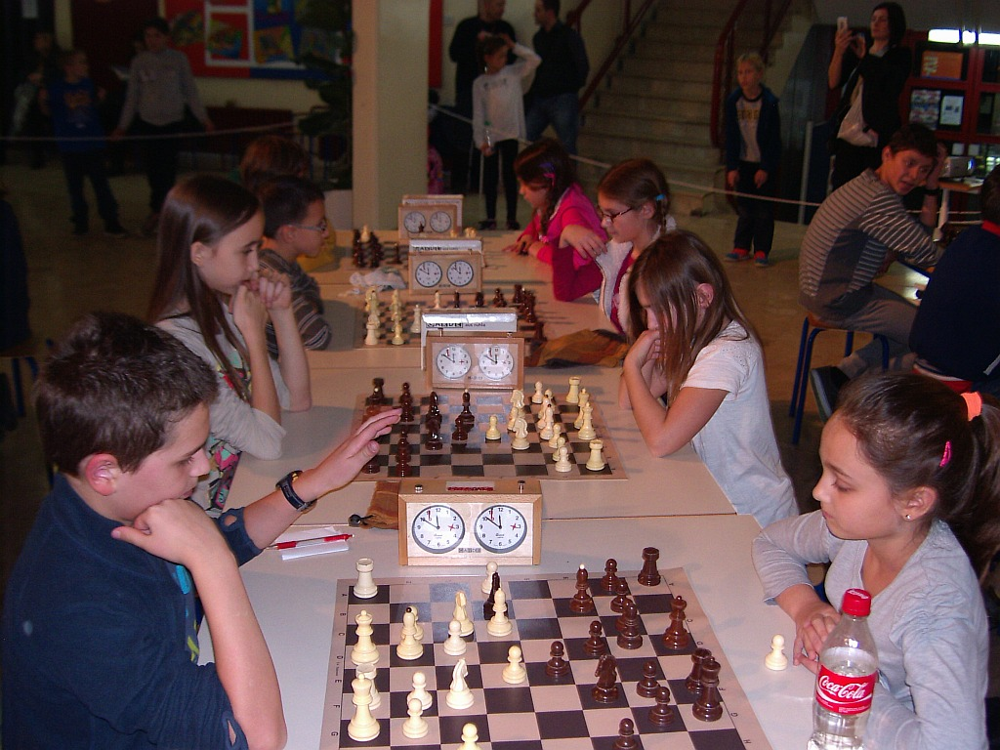
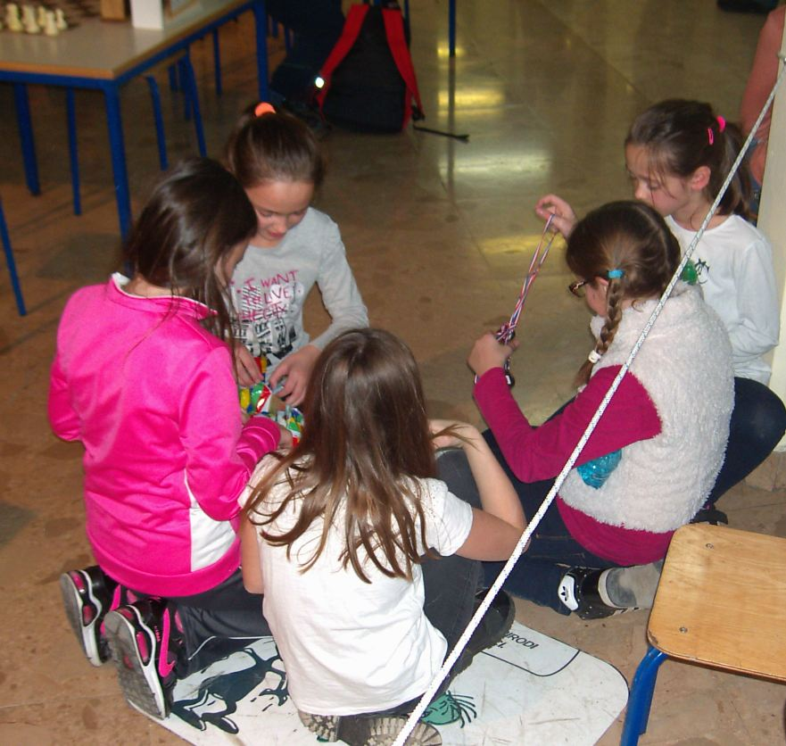

U petak je, u organizaciji [Šahovske škole Dugave](http://sah-dugave.org/) i [I. OŠ Dugave](http://os-prva-dugave-zg.skole.hr/), glavnog voditelja natjecanja prof. Željka Brdala, ravnatelja I. OŠ Dugave gospodina Tomislava Cvitanovića te  sponzora turnira [Školske knjige d.d.](http://www.skolskaknjiga.hr/), odigrano XIV. ekipno šahovsko prvenstvo osnovnih škola Novog Zagreba.  Ove godine uvjerljivu pobjedu ostvarila je OŠ Gustava Krkleca, koja je s prvom i drugom ekipom osvojila prvo odnosno drugo mjesto. Treće mjesto pripalo je OŠ Zapruđe.  
OŠ Odra i ove je godine nastupila s dvije ekipe, kao i na [prošlogodišnjem turniru](/novosti/xiii-ekipno-prvenstvo-osnovnih-skola-novog-zagreba/), kada je prva ekipa osvojila drugo mjesto. Prva ekipa nastupila je u pomlađenom sastavu pa je tako Luka, koji je prošle godine bio rezerva, ove godine igrao prvu ploču te, kao i Monika u drugoj ekipi, ostvario vrlo dobar rezultat. Dečki su nastupili u ekipi: Luka, Juraj, Petar i Antonio, a djevojke u sastavu: Monika, Katarina, Lucija, Ana i Samanta. Katarina i Samanta mijenjale su se pa je svaka dobila priliku odigrati po tri partije. Nažalost, zbog bolesti nisu nastupili Josip i Anđela Mahin.   
Osim što su ugodno iznenadili Luka i Monika, kapetani ekipa, tj. prve ploče, neobično dobar rezultat postigli su Ana i Antonio. Ana je, pojedinačno gledajući, imala najbolji rezultat, četiri pobjede iz pet partija! Velike nade polažem u Luciju i Petra, koji nisu ostvarili pozitivan rezultat, ali sam uvjeren da će vrlo brzo proigrati. Uostalom, uvelike su pomogli time što su pomaknuli Anu i Antonija na četvrtu ploču. Juraj je na visokoj drugoj ploči uspio uhvatiti bod i pol!  
Ekipno, dečki su završili na 18. mjestu s tri neriješena meča, dok su cure na kraju 22. s dva neodlučena meča. Statistiku i sve rezultate prikazujemo u

[prilogu](/files/wp/2016/01/Prvenstvo-OS-Novog-Zagreba-2015.xls).

     
——————————————————————————————————-

### Mikronis kup 2015. – VIII. pojedinačno šahovsko prvenstvo osnovnih škola Novog Zagreba

Kao nastavak ekipnog prvenstva, dan poslije njega, odigrano je i pojedinačno prvenstvo učenika osnovnih škola Novog Zagreba. Mlađa ekipa uglavnom se odmarala, s iznimkom Luke i Samante, a osim njih, od naših članova nastupili su stariji kadeti Ivan, Kljujev, Bruno, Božo, Vraneša i Filip. Voditelj je bio prof. Tomaško. Imali smo pravo prijaviti devet igrača, a kako zbog bolesti neki nisu mogli doći, na kraju smo na turniru imali osam igrača. Nasreću, svi su pokazali da su u dobroj formi. Ivan je završio vrlo visoko, a ni ostali nisu bili daleko. I Samanta je upisala prve dvije pobjede na pojedinačnom natjecanju. Sve ugodnije iznenađenje jest i Luka, koji je u trećem kolu pobijedio Vranešu, koji trenutačno ima zasluženi status drugoga kadeta Kluba. To me podsjetilo na prvo kolo ekipnog prvenstva, kada su Luka i Antonio pobijedili osmaše!  Drago mi je da su Božo i Kljujev remizirali u posljednjem kolu (iako ja tražim igru u svakoj partiji) te tako pokazali školsko i klupsko zajedništvo. Sve u svemu, vrlo lijepo iskustvo za sve koji su nastupili, a ostali će morati potražiti neki drugi turnir da bi se bolje pripremili za nadolazeće Prvenstvo osnovnih škola Zagreba, Pojedinačno kadetsko prvenstvo Zagreba i Klupsku kadetsku ligu.

[Mikronis kup 2015.](/files/wp/2016/01/Mikronis_kup_2015.xls)

darko
