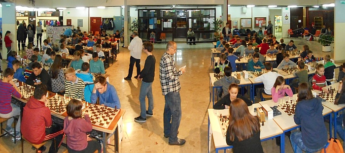  
U petak 2. prosinca 2016. u I. OŠ Dugave odigrano je XV. ekipno prvenstvo osnovnih škola Novog Zagreba u šahu. Generalni sponzor natjecanja bila je [Školska knjiga d. d.](https://shop.skolskaknjiga.hr/), a glavni voditelj prof. Željko Brdal. Nastupile su čak 22 ekipe iz osnovnih škola Novog Zagreba. Iz OŠ Odra  ove su godine nastupile četiri ekipe. Prva i druga muška ekipa imale su po pet članova,  a nažalost iz zdravstvenih razloga ovo natjecanje propustio je Luka Fiolić, trenutačno najveća nada mlađe generacije. Djevojke su se također podijelile u dvije ekipe, a u drugoj su nastupile mlade nade, Dora i Hana. Imali smo sreće da se nitko iz ekipa djevojaka nije razbolio pa su sve imale priliku odigrati ovaj turnir. Dečki iz prve ekipe standardno su se izmjenjivali jer se igralo na četiri ploče. Žensku ekipu ove godine čini čak šest dobrih šahistica i neće biti lako izabrati pet za nastup na prvenstvu Zagreba. 🙂 Druga ekipa dečkiju sastavljena je od mladih šahista koji tek počinju učiti šah, a vjerujem da će već za dvije godine dostojno zamijeniti **prvu ekipu  OŠ Odra** koja je ove godine samouvjereno poharala konkurenciju i s pet pobjeda iz pet kola, 19 ostvarenih bodova od maksimalno mogućih 20 (protivnicima su dali samo dva remija) **uvjerljivo** **osvojila prvo mjesto.** Tako je OŠ Odra prvi put zasjela na pobjedničko postolje Dugave opena! Na ovom turniru nastupili smo prvi put [prije tri godine](/novosti/ekipno-prvenstvo-os-novog-zagreba/). Tada se igralo na šest ploča, a OŠ Odra tada su predstavljali Ivan, Vraneša, Bruno, Božo, Ana, Monika i Lucija. U to vrijeme još nije bilo kadetskih turnira kao danas i zahvalni smo profesoru Brdalu na pozivu jer su se tim nastupom počele formirati naše ekipe, koje su sada među najjačima u gradu.

**Prva ekipa** nastupila je u sljedećem sastavu: Ivan Maravić, Ivan Vraneša (K), Ivan Kljujev, Bruno Kolovrat i Božo Cvetković.  
**Druga ekipa** nastupila je u ovom sastavu: Luka Fiolić, Filip Matašić, Luka Matašić (K), Josip Mahin i Antonio Lorusso. Kako Luka Fiolić nije igrao, teret prve ploče iznio je Filip. Bio je to ujedno prvi ekipni nastup za braću Matašić, kao i za Antonija, koji je također uspio ubilježiti jednu pobjedu. Najveće iznenađenje priredio je Josip, koji je ostvario 4,5/5!  
**Prva ekipa djevojaka** nastupila je u sljedećem sastavu: Monika Kolovrat (K), Ana Katarina Hačić, Anđela Mahin i Lucija Kolovrat. Lucija je svakim danom (tj. sa svakom partijom) sve bolja i bolja, Anđela je i više nego ugodno iznenadila, a s obzirom na to da ona nema mnogo prilika igrati na turnirima, bio sam uvjeren da je ispala iz forme, ali su me njezina igra i rezultat razuvjerili. Katarina je odigrala standardno dobro, iako je opet izbjegavala ulaziti u varijante s c4, oko čega se već neko vrijeme prepiremo. Ona je igračica koja je uložila najviše truda u posljednjih godinu dana i samim time najviše napredovala. Monika je na ovom turniru ostala bez pobjede, igrala je prvu ploču, imala nekoliko dobivenih pozicija… tako  da me njezin rezultat pomalo iznenadio. Nadam se da ju je samo tempo igre spriječio da ostvari bolji učinak. Ipak, na kraju turnira ona me najugodnije iznenadila, kada je odlučila igrati i na Mikronis kupu.  
**Druga ekipa djevojaka** nastupila je u sljedećem sastavu: Ana Kolovrat (K), Samanta Halužan, Dora Bačurin i Lucija Hana Kaić. Očekivano, Dora i Hana ovdje su stjecale iskustvo, a ipak, Hana je uspjela ubilježiti i jednu pobjedu. Pomalo neočekivano, Ana i Samanta su rasturale! Samanta se već neko vrijeme počela pridržavati instrukcija iz škole šaha, dok Ana igra čak mrvicu preagresivno i žrtvuje materijal i kada to ne ide. Ipak, vjerujem da će joj to sve uskoro sjesti i da će u pravo vrijeme pokazati raskoš svoga napadačkog stila. Zanimljivo da su obje ekipe djevojaka ostvarile identičan rezultat, tj. upisale po jednu pobjedu i jedan neriješen meč, iako je druga ekipa imala u sastavu naše najmlađe sudionice, Hanu i Doru.  
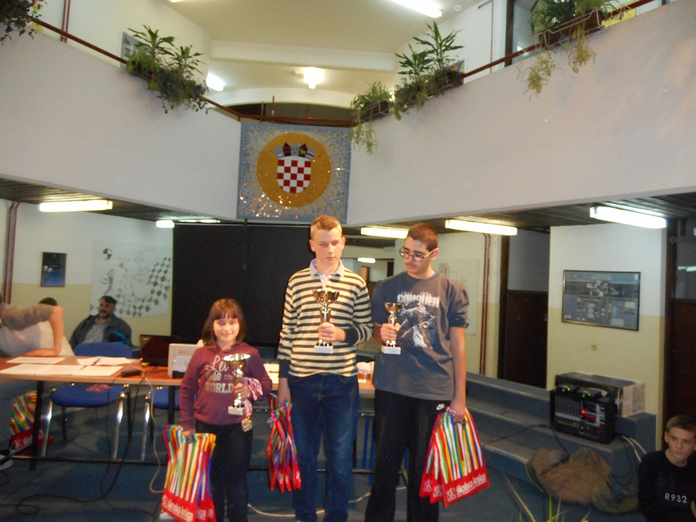 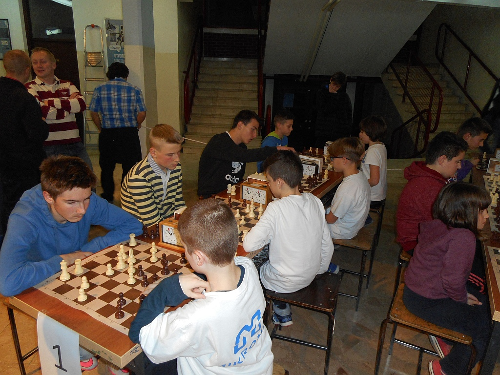 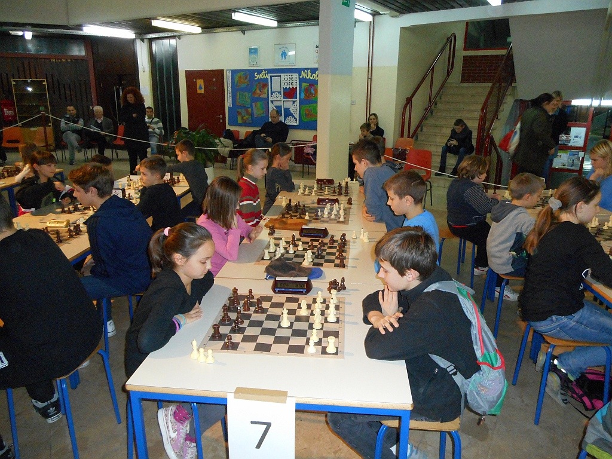 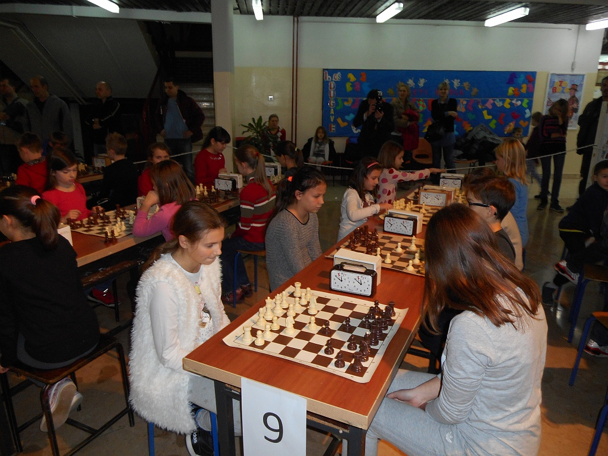  
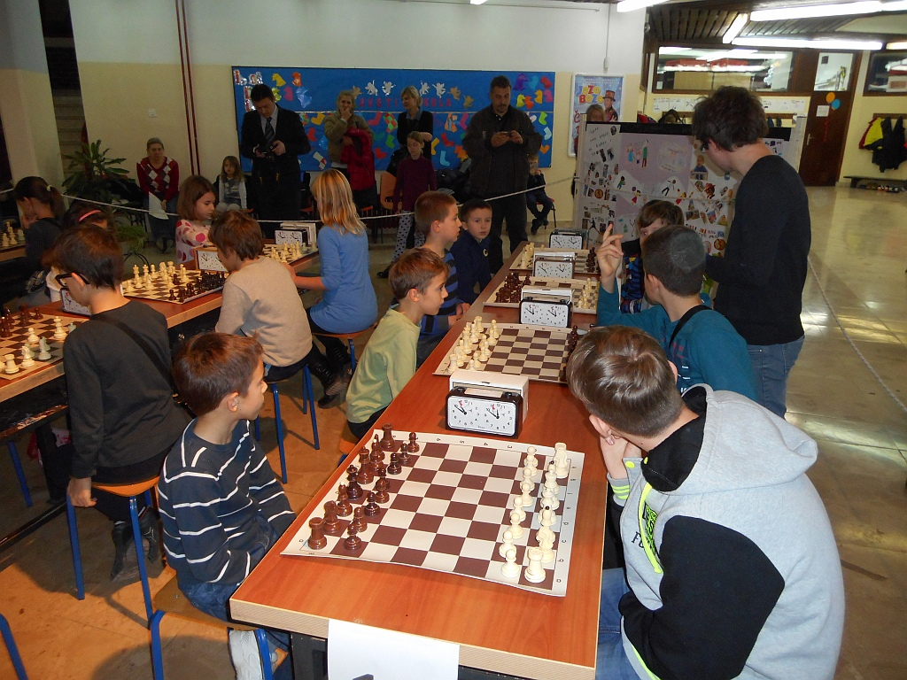 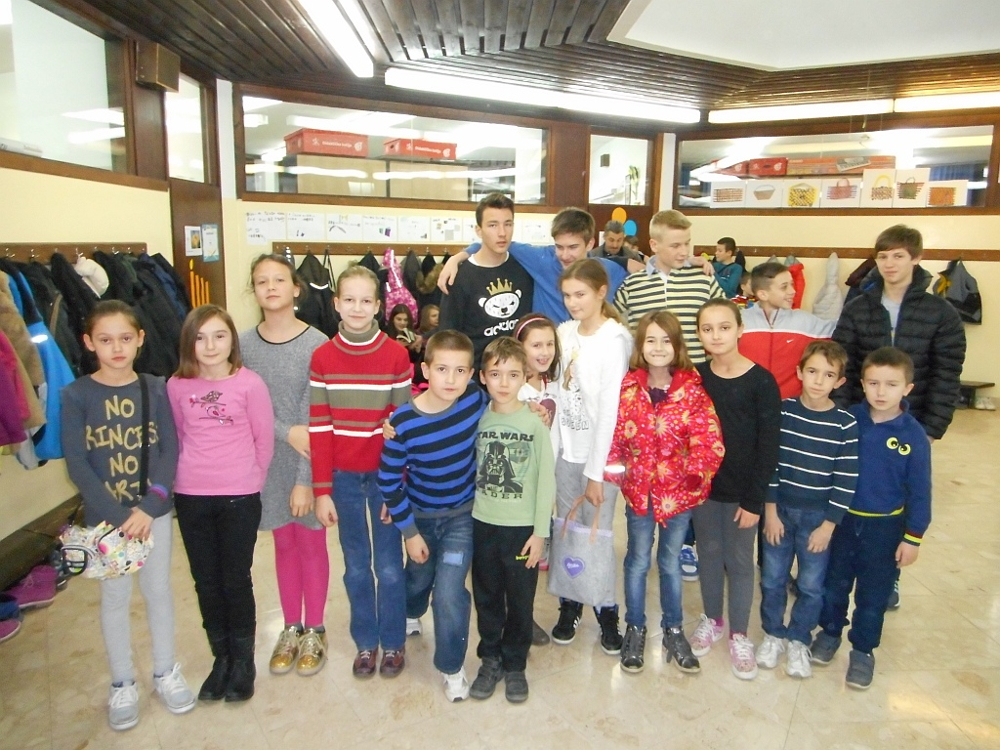 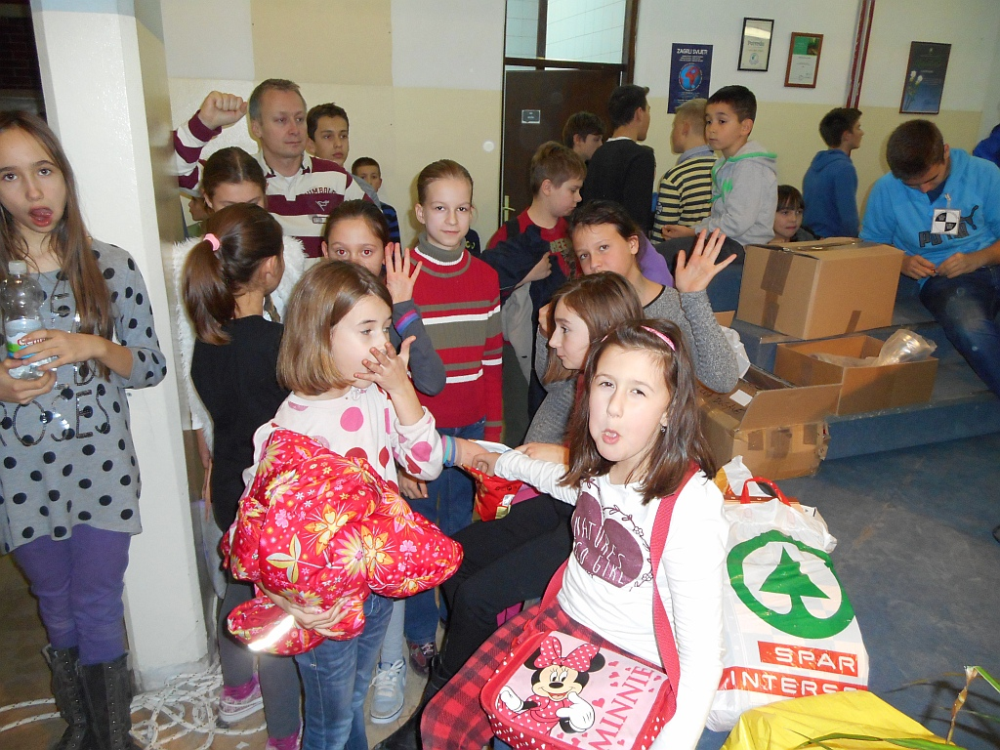 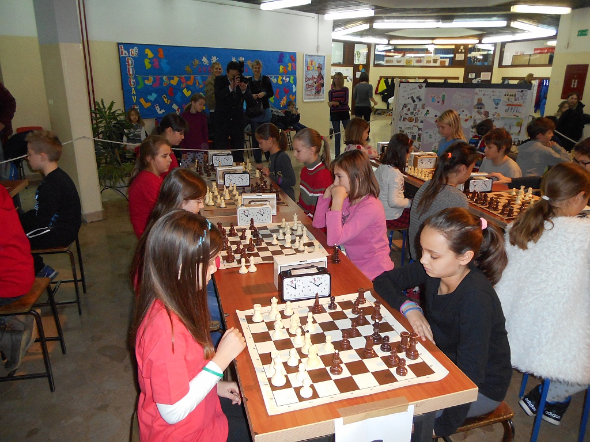  
**Poredak na XV. ekipnom prvenstvu OŠ Novog Zagreba**

1.  **OŠ Odra I, dečki I**   10 bodova
2.  **OŠ Brezovica**  8 bodova
3.  **OŠ Mladost, Utrina** 7 bodova

Svi detalji u prilogu… [rezultati dugave open 2016](/files/wp/2016/12/Dugave_Open2016.pdf)

---

**Mikronis kup 2016.**  
U subotu 3. prosinca odigrano je **pojedinačno prvenstvo za učenike osnovnih škola Novog Zagreba**, plus nekoliko srednjoškolaca, bivših učenika I. OŠ Dugave. Od naših članova nastupili su Ivan, Kljujev, Božo i Vraneša, Luka Matašić, Hana, Ana, Samanta, Monika, Lucija i Dora.  
Dečki iz prve ekipe ponovo su ostvarili vrhunske rezultate, zauzeli su redom 3., 4., 5., i 6. mjesto, a s obzirom na to da su prva dva mjesta zauzeli srednjoškolci koji su na turniru nastupili s pozivnicom, čini se da su naši dečki trenutačno najjači kadeti osnovnoškolci u Novom Zagrebu.  
Probudila se i Monika, koja nije imala pobjedu na ekipnom prvenstvu, ali je na pojedinačnome ostvarila čak četiri. Čini se da joj je nastup u petak poslužio samo kao zagrijavanje. Dora, koja je dijelila istu sudbinu na ekipnom prvenstvu, također je postigla tri pobjede i dostigla Hanin rezultat, koja je na ovom turniru ostvarila dvije pobjede. S obzirom na to da Hanu u posljednje vrijeme rezultat baš nije mazio, to je velik uspjeh i znak da se upornost itekako isplati. Lucija i Samanta skupile su po tri boda i u njihovoj igri vidi se da ozbiljno napreduju. Ana je i na ovom turniru ostvarila fenomenalan rezultat i ubilježila četiri pobjede, kao i Monika.  
Od mlađih dečkiju nastupio je samo Luka Matašić i ostvario impresivan rezultat osvojivši također tri boda. Luka pokazuje veliku volju i nadam se da ćemo naći vremena da mu se više posvetimo u šahovskoj školi.

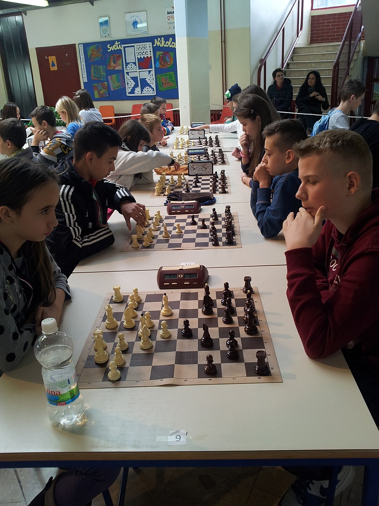 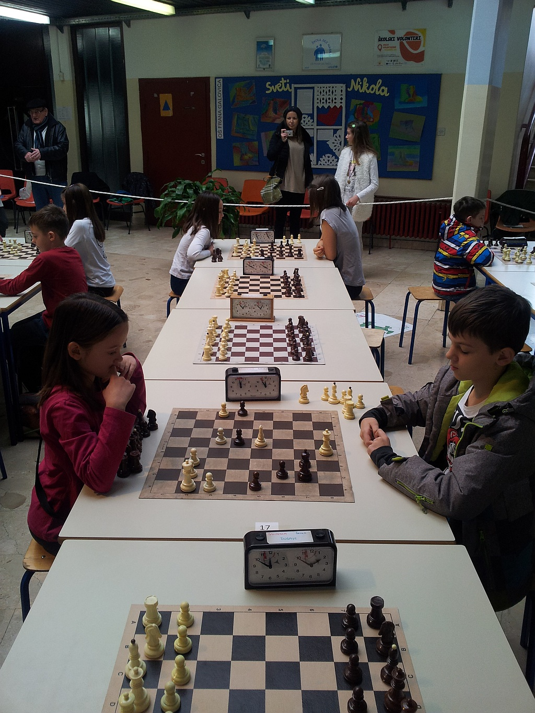 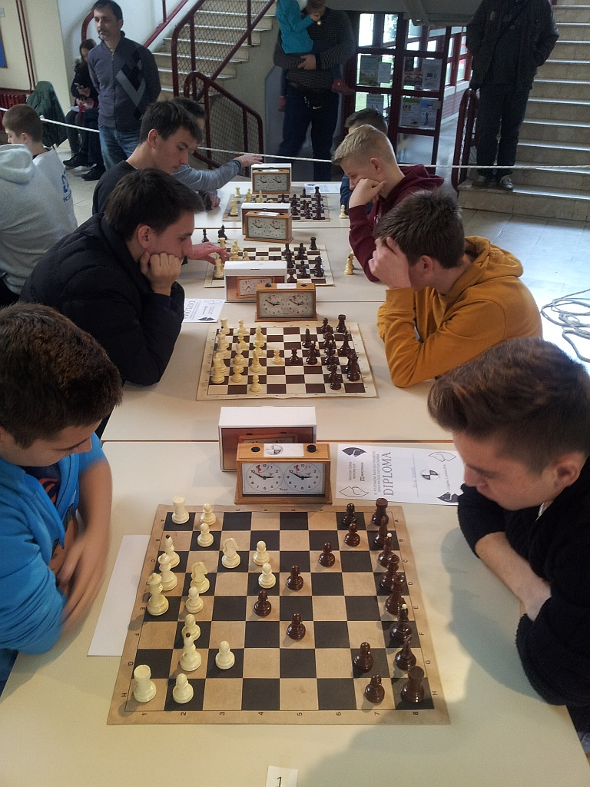

Poredak u prilogu… [Rezultati Mikronis kup 2016.](/files/wp/2016/12/Mikronis-2016.pdf)

darko
