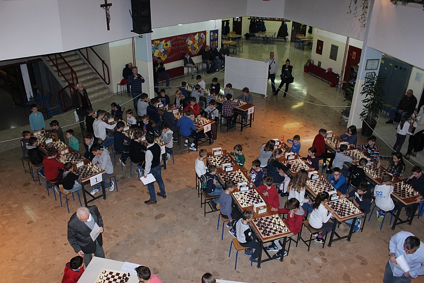

U petak 1. prosinca 2017. u I. OŠ Dugave odigrano je XVI. ekipno prvenstvo osnovnih škola Novog Zagreba u šahu. Generalni sponzor natjecanja bila je [Školska knjiga d. d.](https://shop.skolskaknjiga.hr/), a glavni voditelj prof. Željko Brdal. Nastupile su 22 ekipe iz osnovnih škola Novog Zagreba. Iz OŠ Odra  ove su godine nastupile tri ekipe, za razliku od prošle kada smo imali četiri. Četiri člana prve ekipe, Ivan, Vraneša, Božo i Kljujev, ovih dana nastupaju na seniorskom turniru, [Zagreb openu, 2. memorijalu Krunoslava Hulaka 2017.](http://chess-results.com/tnr305694.aspx?lan=13&art=4&flag=30&wi=821) tako da nisu ni mogli igrati ovo prvenstvo.  
Rezultati su bili očekivani, a iako smo priželjkivali postolje, nismo se na njega uspeli. **Prva ekipa**, koja je prošle godine bila druga ekipa, osvojila je **sedmo mjesto**. Obzirom da su prošle godine bili petnaesti, nije loše. Igrali su u sastavu Bruno (3/5), **Luka Fiolić (K)** (3/5), Luka Matašić (3/5), Filip (1/3) i Josip (1/2).  
Luka Matašić je dobio puno pohvala od ostalih članova ekipe za dobru igru i rezultat, a kako je najmlađi član, vjerujem da će uskoro pokazati još i više.  
Kod djevojaka je došlo do malih promjena u odnosu na prošlogodišnji sastav pa je tako Ana iz druge ekipe prebačena u prvu, a Lucija iz prve u drugu. Obzirom da je Lucija napravila najbolji rezultat od svih učesnika iz OŠ Odra (4/5), nisam siguran da smo ispravno mijenjali. 🙂 U drugoj ekipi je ove godine umjesto Hane zaigrala Franka. Obje su djevojke isto godište i prava je šteta što nam Hana više ne dolazi na treninge. **Prva ekipa djevojaka** zauzela je **osmo mjesto** iako su napravile više pojedinačnih bodova od muške ekipe. Igrale su u sastavu **Monika (K)** (3/5), Ana (3,5/5), Anđela (2,5/5) i Katarina (3,5/5). Prošle godine bile su osamnaeste, ove godine osme! Napredak se vidi. Na [prošlogodišnjem turniru](/novosti/xv-ekipno-sahovsko-prvenstvo-osnovnih-skola-novog-zagreba-dugave-open-2016/) Monika se nije uspjela sastati s pobjedom, a sada je ostvarila tri pobjede, uključujući i pobjedu nad protivnikom od kojeg je Bruno izgubio. Anđela je uspjela patirati protivnika prvo kolo, a Katarina je brzopleto izgubila zadnje kolo. Osim toga, dobre su! **Druga ekipa djevojaka** igrala je u sastavu **Samanta (K)** (2/5), Lucija (4/5), Franka (3/5) i Dora (1/5). Osvojile su **šesnaesto mjesto** te su i one pokazale napredak u odnosu na prošlogodišnje 21. mjesto. Samanta je izgubila peto kolo dobivenu poziciju, opet na temu slabosti zadnjeg reda. Bio sam zadivljen što je u potpunosti nadigrala vrlo jakog protivnika i prava je šteta što je izgubila tu partiju jer bi tim bodom ekipu podigla za još četiri mjesta u konačnom poretku.  
POREDAK:

<table class="CRs1"><tbody><tr class="CRg2"><td class="CRc">1.</td><td class="CR"><strong>Dugave Kraljevi</strong></td><td class="CRc">5</td><td class="CRc">5</td><td class="CRc">0</td><td class="CRc">0</td><td class="CRc">10</td><td class="CRc">54,5</td><td class="CRc">35,50</td></tr><tr class="CRg1"><td class="CRc">2.</td><td class="CR"><strong>Ivo Andrić Vukovi</strong></td><td class="CRc">5</td><td class="CRc">3</td><td class="CRc">2</td><td class="CRc">0</td><td class="CRc">8</td><td class="CRc">49,5</td><td class="CRc">30,50</td></tr><tr class="CRg2"><td class="CRc">3.</td><td class="CR"><strong>Mladost Utrine I</strong></td><td class="CRc">5</td><td class="CRc">3</td><td class="CRc">1</td><td class="CRc">1</td><td class="CRc">7</td><td class="CRc">62,0</td><td class="CRc">37,50</td></tr><tr class="CRg1"><td class="CRc">4.</td><td class="CR">Trnsko I</td><td class="CRc">5</td><td class="CRc">3</td><td class="CRc">1</td><td class="CRc">1</td><td class="CRc">7</td><td class="CRc">54,0</td><td class="CRc">31,00</td></tr><tr class="CRg2"><td class="CRc">5.</td><td class="CR">Zapruđe I</td><td class="CRc">5</td><td class="CRc">3</td><td class="CRc">1</td><td class="CRc">1</td><td class="CRc">7</td><td class="CRc">50,0</td><td class="CRc">30,50</td></tr><tr class="CRg1"><td class="CRc">6.</td><td class="CR">Lučko</td><td class="CRc">5</td><td class="CRc">3</td><td class="CRc">0</td><td class="CRc">2</td><td class="CRc">6</td><td class="CRc">60,0</td><td class="CRc">36,50</td></tr><tr class="CRg2"><td class="CRc">7.</td><td class="CR"><strong><a class="CRdb" style="color: #ff0000;" href="http://chess-results.com/tnr316725.aspx?lan=13&amp;art=20&amp;wi=821&amp;snr=5" target="_blank">Odra I</a></strong></td><td class="CRc">5</td><td class="CRc">3</td><td class="CRc">0</td><td class="CRc">2</td><td class="CRc">6</td><td class="CRc">52,5</td><td class="CRc">29,50</td></tr><tr class="CRg1"><td class="CRc">8.</td><td class="CR"><strong><a class="CRdb" style="color: #ff0000;" href="http://chess-results.com/tnr316725.aspx?lan=13&amp;art=20&amp;wi=821&amp;snr=6" target="_blank">Odra II učenice</a></strong></td><td class="CRc">5</td><td class="CRc">3</td><td class="CRc">0</td><td class="CRc">2</td><td class="CRc">6</td><td class="CRc">47,5</td><td class="CRc">28,00</td></tr><tr class="CRg2"><td class="CRc">9.</td><td class="CR">Otok I</td><td class="CRc">5</td><td class="CRc">2</td><td class="CRc">2</td><td class="CRc">1</td><td class="CRc">6</td><td class="CRc">46,0</td><td class="CRc">28,50</td></tr><tr class="CRg1"><td class="CRc">10.</td><td class="CR">Kajzerica I</td><td class="CRc">5</td><td class="CRc">2</td><td class="CRc">1</td><td class="CRc">2</td><td class="CRc">5</td><td class="CRc">62,0</td><td class="CRc">36,50</td></tr><tr class="CRg2"><td class="CRc">11.</td><td class="CR">Trnsko II</td><td class="CRc">5</td><td class="CRc">2</td><td class="CRc">1</td><td class="CRc">2</td><td class="CRc">5</td><td class="CRc">47,0</td><td class="CRc">29,00</td></tr><tr class="CRg1"><td class="CRc">12.</td><td class="CR">Dugave Dame</td><td class="CRc">5</td><td class="CRc">2</td><td class="CRc">1</td><td class="CRc">2</td><td class="CRc">5</td><td class="CRc">42,5</td><td class="CRc">24,50</td></tr><tr class="CRg2"><td class="CRc">13.</td><td class="CR">Zapruđe II</td><td class="CRc">5</td><td class="CRc">1</td><td class="CRc">2</td><td class="CRc">2</td><td class="CRc">4</td><td class="CRc">59,0</td><td class="CRc">35,00</td></tr><tr class="CRg1"><td class="CRc">14.</td><td class="CR">Sveta Klara</td><td class="CRc">5</td><td class="CRc">2</td><td class="CRc">0</td><td class="CRc">3</td><td class="CRc">4</td><td class="CRc">51,0</td><td class="CRc">32,50</td></tr><tr class="CRg2"><td class="CRc">15.</td><td class="CR">Dugave Lovci</td><td class="CRc">5</td><td class="CRc">1</td><td class="CRc">2</td><td class="CRc">2</td><td class="CRc">4</td><td class="CRc">51,0</td><td class="CRc">32,00</td></tr><tr class="CRg1"><td class="CRc">16.</td><td class="CR"><strong><a class="CRdb" style="color: #ff0000;" href="http://chess-results.com/tnr316725.aspx?lan=13&amp;art=20&amp;wi=821&amp;snr=9" target="_blank">Odra III učenice</a></strong></td><td class="CRc">5</td><td class="CRc">1</td><td class="CRc">2</td><td class="CRc">2</td><td class="CRc">4</td><td class="CRc">46,5</td><td class="CRc">27,50</td></tr><tr class="CRg2"><td class="CRc">17.</td><td class="CR">Ivo Andrić mladi vukovi</td><td class="CRc">5</td><td class="CRc">2</td><td class="CRc">0</td><td class="CRc">3</td><td class="CRc">4</td><td class="CRc">41,0</td><td class="CRc">22,00</td></tr><tr class="CRg1"><td class="CRc">18.</td><td class="CR">Mladost Utrine II</td><td class="CRc">5</td><td class="CRc">1</td><td class="CRc">1</td><td class="CRc">3</td><td class="CRc">3</td><td class="CRc">50,5</td><td class="CRc">30,00</td></tr><tr class="CRg2"><td class="CRc">19.</td><td class="CR">Fran Galović</td><td class="CRc">5</td><td class="CRc">1</td><td class="CRc">1</td><td class="CRc">3</td><td class="CRc">3</td><td class="CRc">47,0</td><td class="CRc">29,00</td></tr><tr class="CRg1"><td class="CRc">20.</td><td class="CR">Otok II</td><td class="CRc">5</td><td class="CRc">1</td><td class="CRc">1</td><td class="CRc">3</td><td class="CRc">3</td><td class="CRc">42,0</td><td class="CRc">25,00</td></tr><tr class="CRg2"><td class="CRc">21.</td><td class="CR">Braće Radića</td><td class="CRc">5</td><td class="CRc">1</td><td class="CRc">0</td><td class="CRc">4</td><td class="CRc">2</td><td class="CRc">38,5</td><td class="CRc">20,00</td></tr><tr class="CRg1"><td class="CRc">22.</td><td class="CR">Kajzerica II</td><td class="CRc">5</td><td class="CRc">0</td><td class="CRc">1</td><td class="CRc">4</td><td class="CRc">1</td><td class="CRc">46,0</td><td class="CRc">23,00</td></tr></tbody></table>

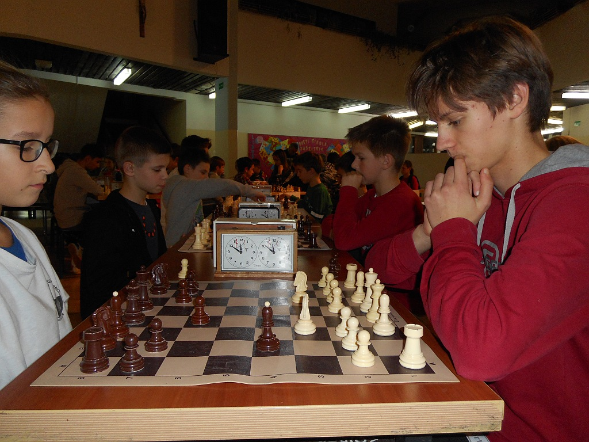 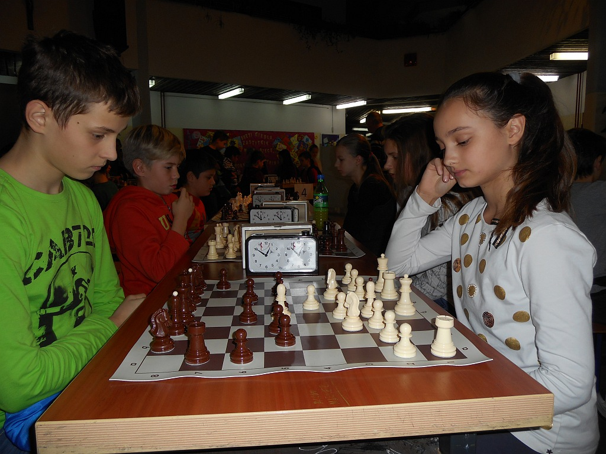 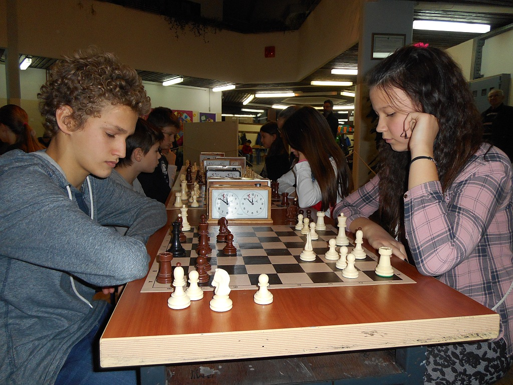 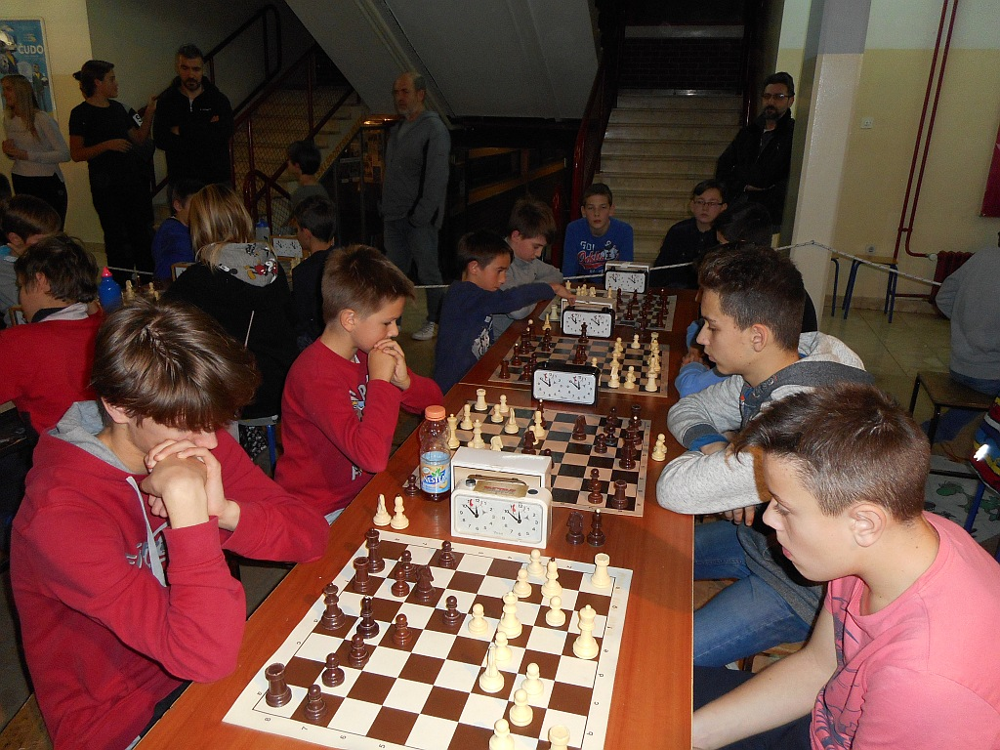  
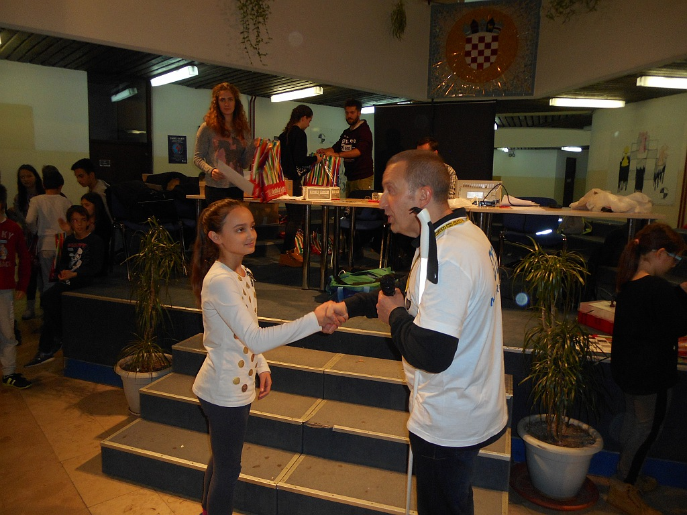 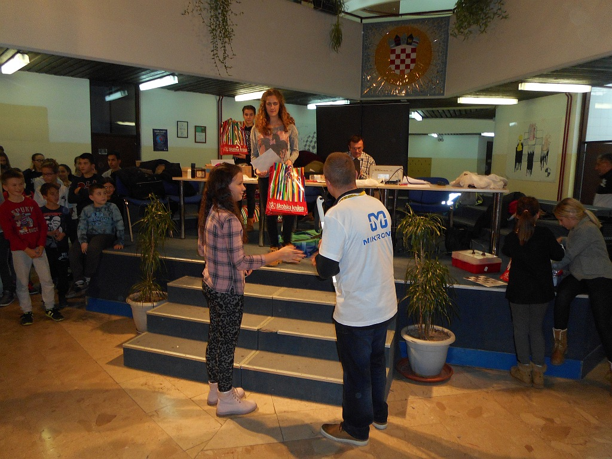 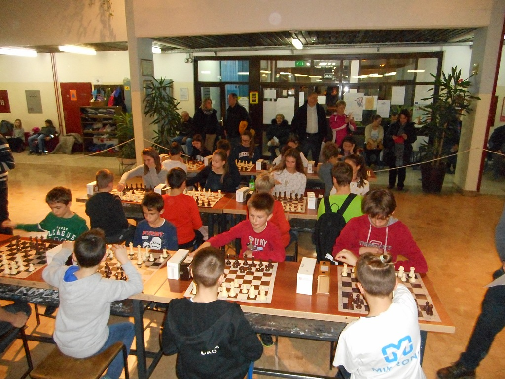 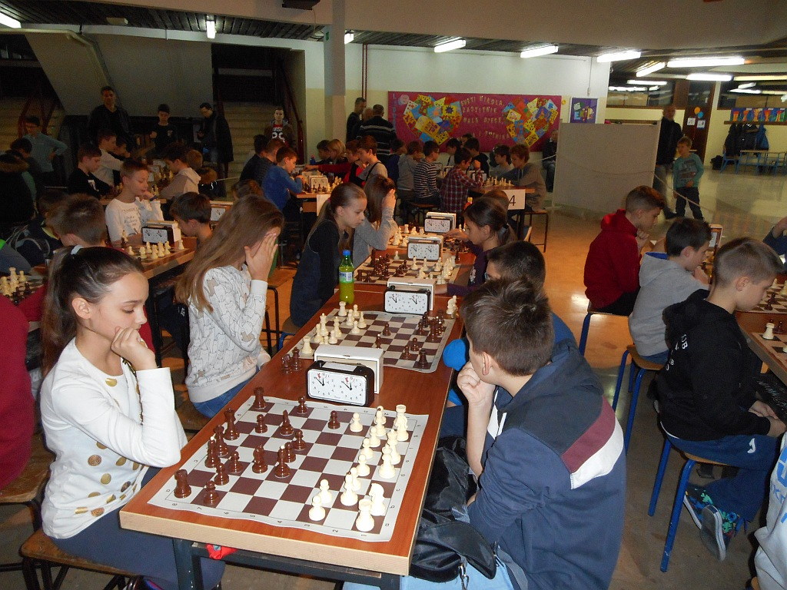  
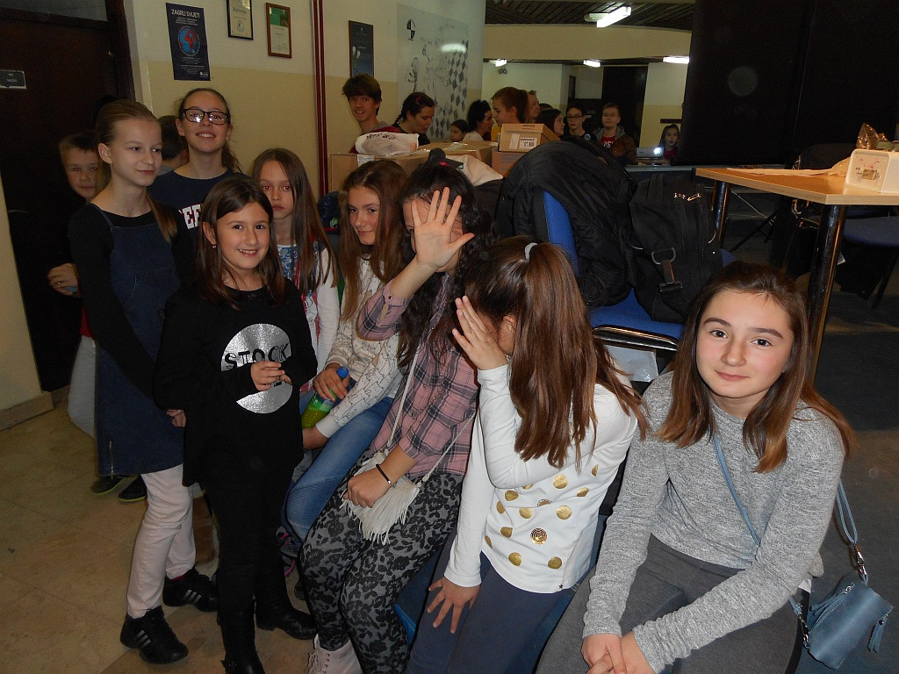 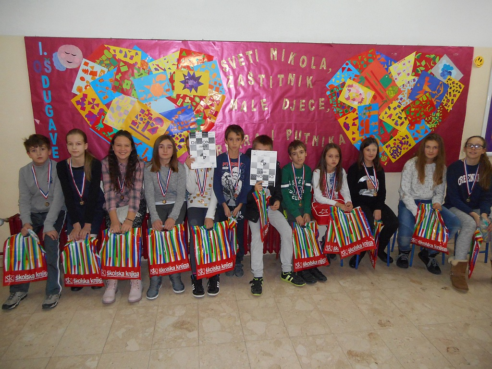

---

**Mikronis kup 2017.  
**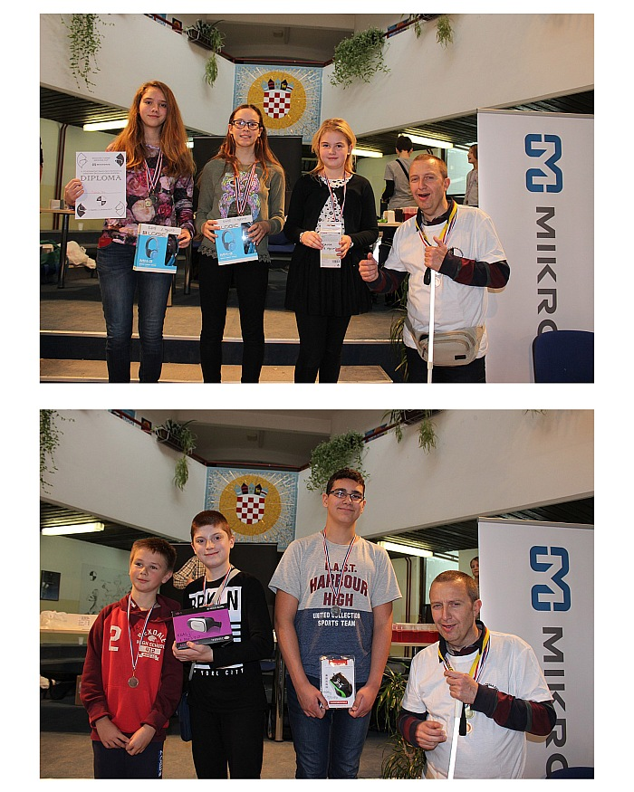  
U subotu 2. prosinca odigrano je **[pojedinačno prvenstvo za učenike osnovnih škola Novog Zagreba](http://chess-results.com/tnr316879.aspx?lan=13&art=1&wi=821).** Pokrovitelj natjecanja bila je tvrtka [Mikronis](https://www.mikronis.hr/). I ovaj turnir odigran je u I. OŠ Dugave. Kao i na prethodnom turniru, tempo igre bio je 10+0. Nastupilo je 84 učenika i učenica OŠ Novog Zagreba. Iz OŠ Odra nastupili su **Luka Fiolić (6/7), Franka (5/7)**, Katarina (4,5/7), Lucija (4,5/7), Monika (4,5/7), Samanta (4/7), Amar (3/7), Roko (1,5/7), Tin (1/7) i Antonio (1/7). Zbog vjeronauka nisu mogli doći Dora, Kljujev i Luka Matašić, Filip se nažalost razbolio, Josipa i Anđelu roditelji nisu pustili na turnir, a Ana je imala već isplanirani izlet. Posebno mi je drago da su turnir došli igrati i dječaci koji nisu redoviti na treningu, ili se ne trude dovoljno. Možda im ovo bude poticaj. Za godinu dana dolazi do smjene generacija, a Luka Fiolić, Luka Matašić i Filip su svojim trudom, zalaganjem i rezultatima već zacementirali mjesto u školskoj ekipi. Trebaju nam još barem dva igrača za jednu stabilnu školsku ekipu i tražiti ćemo ih između njih.  
Djevojke su dobro odigrale, nedostaje im “još jedan bod” da bi se našle u samom vrhu. Od dječaka koji su nešto manje aktivni u šahu, Amara, Roka, Tina i Antonia, rezultati su očekivani, a ugodno je iznenadio Amar koji je osvojio tri boda. Neugodne probleme stvaraju nam Franka i Lucija. Njih dvije ostvaruju čak bolje rezultate od ostalih djevojaka, pa iako sam (do)nedavno smatrao da su one mrvicu slabije od ostalih, uporno me svojim rezultatima razuvjeravaju. Tako da više ne znam predložiti najbolje četiri za skoro Ekipno prvenstvo Grada Zagreba.  
**Luka Fiolić** je napokon uspio uloviti onaj jedan bod koji mu obično na turnirima nedostaje i uspeo se na postolje osvajanjem **trećeg mjesta u ukupnom poretku**. Veliko iznenađenje priredila je **Franka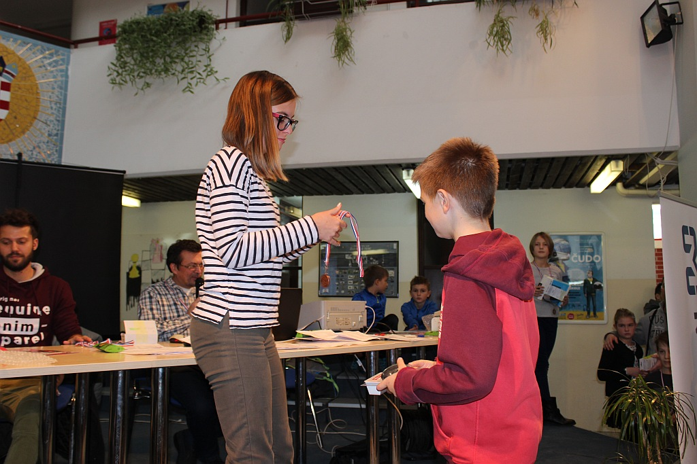 Kolovrat**, koja je osovojila **treće mjesto u konkurenciji djevojčica**, a visoko 13. u ukupnom poretku. Čestitke svima na uspješnom nastupu, a posebno Luki i Franki na osvojenim medaljama!

POREDAK:  
1\. Karlo Krušlin, I. OŠ Dugave  
2\. Sven Cetina, OŠ Gustava Krkleca  
3\. Luka Fiolić, OŠ Odra  
…

POREDAK DJEVOJČICE:  
1\. Petra Mardešić, OŠ Ive Andrića  
2\. Petra Malbaša, OŠ Gustava Krkleca  
3\. Franka Kolovrat, OŠ Odra  
…
