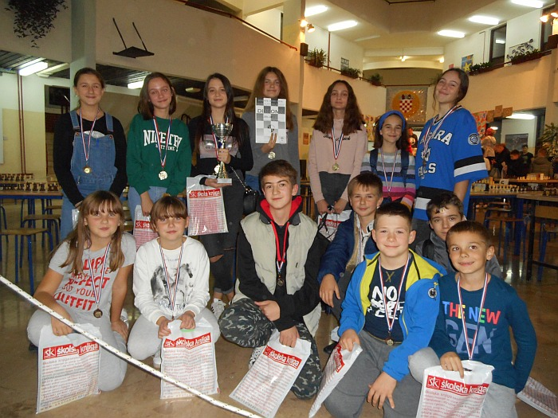
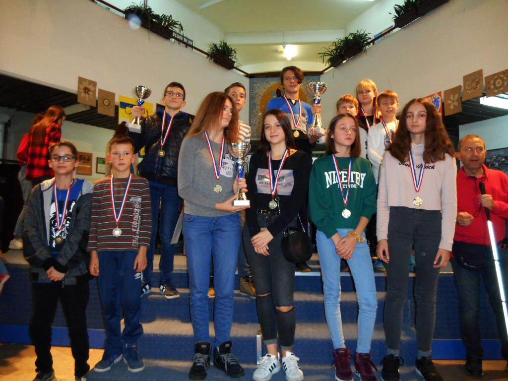
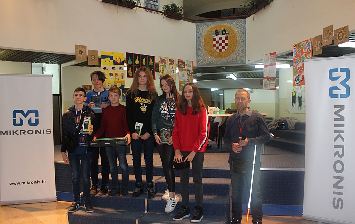
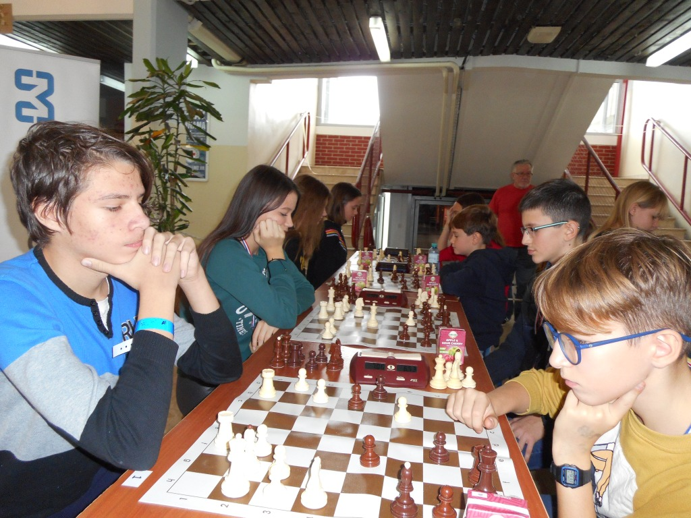
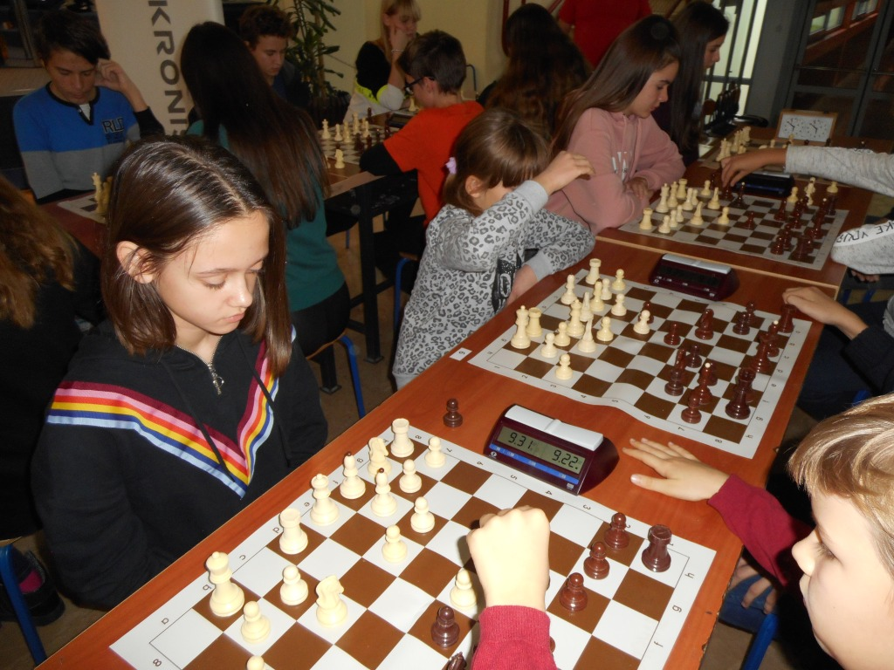
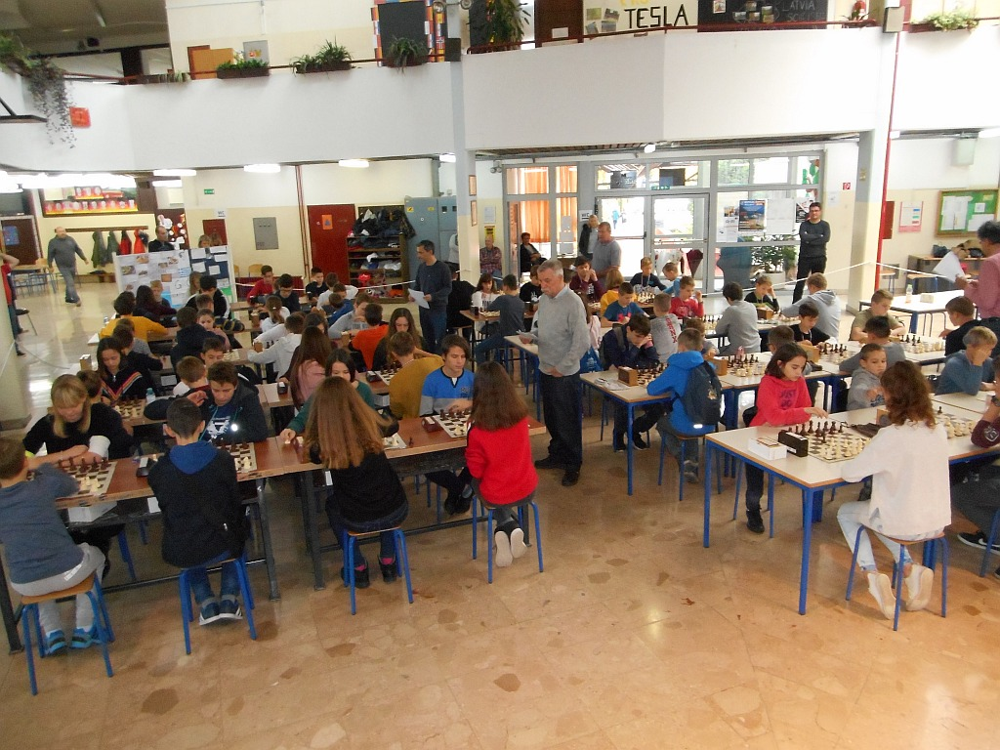
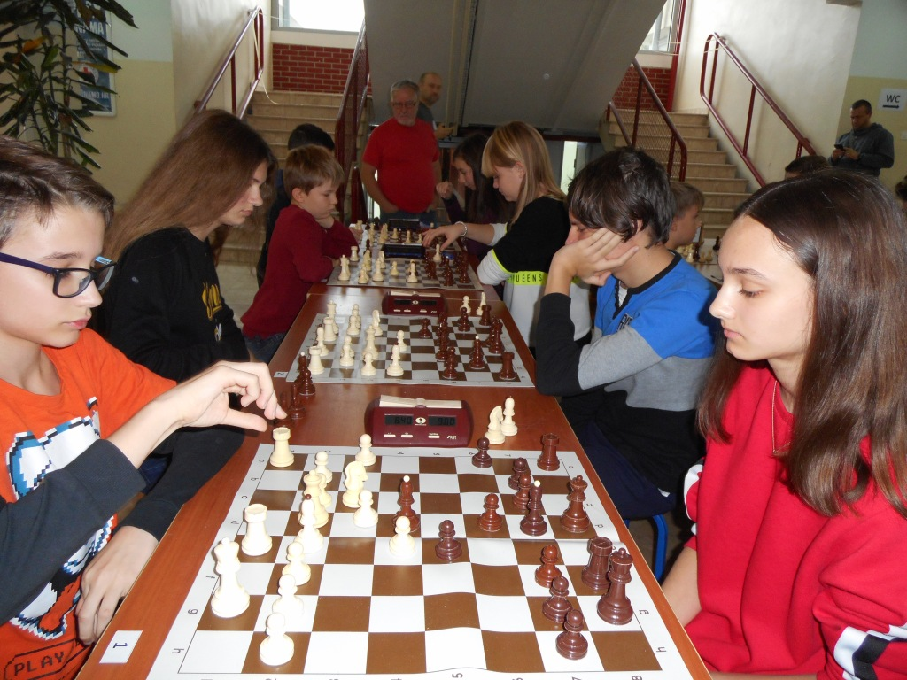

  
U petak 15. studenog 2019. u I. OŠ Dugave odigrano je XVII. ekipno prvenstvo osnovnih škola Novog Zagreba u šahu, [“Dugave open”](https://chess-results.com/tnr486350.aspx?lan=13&art=63).  Generalni sponzor natjecanja bila je [Školska knjiga d. d.](https://shop.skolskaknjiga.hr/), glavni voditelj prof. Željko Brdal i glavni sudac gosp. Jelenko Mikacinić. Turnir je govorom dobrodošlice otvorila ravnateljica škole gđa. Kristina Vidović. Nastupilo je 20 ekipa iz osnovnih škola s područja Novog Zagreba. Igralo se na četiri ploče, a tempo igre bio je 10+0, švicarski sustav u pet kola. Sva djeca su dobila prigodne nagrade sponzora natjecanja, a pobjedničke ekipe diplome i pehare. Pobjednik turnira je ekipa “Vukovi Sopot” iz OŠ Ive Andrića, s četiri pobjede i jednim neriješenim rezultatom. Ekipa [“Odra Cure I”](https://chess-results.com/tnr486350.aspx?lan=13&art=20&snr=2) iz OŠ Odra **osvojila je drugo mjesto**, a ekipa “Lučko I” treće mjesto. OŠ Odra nastupila je s tri ekipe, a u ekipi koje se uspela na postolje igrale su Ana (K) (2,5/5), Monika (3,5/5), Samanta (4/5) i Lucija (5/5). Na prošlom prvenstvu koje se igralo u prosincu 2017., djevojke su bile osme pa je ovo značajan napredak, iako su one bile nezadovoljne. 🙂 Dečki su, pod vodstvom Luke Fiolića, završili na šestom mjestu, a druga ekipa djevojaka na devetom. Kod dečkiju je došlo do smjene generacije pa ćemo tek vidjeti koliko će daleko dogurati. U drugoj ekipi djevojaka igrale su i stjecale iskustvo sestre Fiolić koje će se već od sljedeće godine pridružiti prvoj ekipi. Čestitke djevojkama na osvojenom II. mjestu sa željom za još boljim rezultatom na Prvenstvu OŠ Zagreba koje počinje za tri tjedna.

**Turnirski sastav sa rezultatima po kolima**

<table><tbody><tr><td colspan="14"><strong>&nbsp;&nbsp;2. Odra Cure I (RtgAvg:1679, TB1: 8 / TB2: 15)</strong></td></tr><tr><td><strong>Bo.</strong></td><td></td><td><strong>Ime</strong></td><td><strong>Rtg</strong></td><td><strong>&nbsp;</strong></td><td><strong>&nbsp;</strong></td><td><strong>1</strong></td><td><strong>2</strong></td><td><strong>3</strong></td><td><strong>4</strong></td><td><strong>5</strong></td><td><strong>Bod.</strong></td><td><strong>Partije</strong></td><td><strong>RtgAvg</strong></td></tr><tr><td>1</td><td>II</td><td>Kolovrat Ana</td><td>1664</td><td></td><td></td><td>1</td><td>½</td><td>0</td><td>0</td><td>+</td><td>2,5</td><td>5</td><td>1520</td></tr><tr><td>2</td><td>II</td><td>Kolovrat Monika</td><td>1763</td><td></td><td></td><td>1</td><td>1</td><td>½</td><td>0</td><td>1</td><td>3,5</td><td>5</td><td>1276</td></tr><tr><td>3</td><td>III</td><td>Halužan Samanta</td><td>1668</td><td></td><td></td><td>1</td><td>1</td><td>1</td><td>0</td><td>1</td><td>4,0</td><td>5</td><td>1367</td></tr><tr><td>4</td><td>IV</td><td>Kolovrat Lucija</td><td>1622</td><td></td><td></td><td>1</td><td>1</td><td>1</td><td>1</td><td>1</td><td>5,0</td><td>5</td><td>1369</td></tr></tbody></table>

<table><tbody><tr><td colspan="14"><strong>&nbsp;&nbsp;6. Odra Dečki (RtgAvg:1622, TB1: 6 / TB2: 11)</strong></td></tr><tr><td><strong>Bo.</strong></td><td></td><td><strong>Ime</strong></td><td><strong>Rtg</strong></td><td><strong>&nbsp;</strong></td><td><strong>&nbsp;</strong></td><td><strong>1</strong></td><td><strong>2</strong></td><td><strong>3</strong></td><td><strong>4</strong></td><td><strong>5</strong></td><td><strong>Bod.</strong></td><td><strong>Partije</strong></td><td><strong>RtgAvg</strong></td></tr><tr><td>1</td><td>IV</td><td>Fiolić Luka</td><td>1627</td><td></td><td></td><td>1</td><td>1</td><td>1</td><td>0</td><td>1</td><td>4,0</td><td>5</td><td>1423</td></tr><tr><td>2</td><td></td><td>Matašić Filip</td><td>1600</td><td></td><td></td><td>1</td><td>0</td><td>1</td><td>0</td><td>1</td><td>3,0</td><td>5</td><td>1255</td></tr><tr><td>3</td><td></td><td>Biondić Slavko</td><td>1616</td><td></td><td></td><td>0</td><td>1</td><td></td><td></td><td>0</td><td>1,0</td><td>3</td><td>1200</td></tr><tr><td>4</td><td></td><td>Pisačić Ivan</td><td>1616</td><td></td><td></td><td>0</td><td></td><td>1</td><td>0</td><td></td><td>1,0</td><td>3</td><td>1212</td></tr><tr><td>5</td><td></td><td>Mahin Josip</td><td>1630</td><td></td><td></td><td></td><td>1</td><td>1</td><td>0</td><td>0</td><td>2,0</td><td>4</td><td>1461</td></tr></tbody></table>

<table><tbody><tr><td colspan="14"><strong>&nbsp;&nbsp;9. Odra Cure II (RtgAvg:1621, TB1: 6 / TB2: 10)</strong></td></tr><tr><td><strong>Bo.</strong></td><td></td><td><strong>Ime</strong></td><td><strong>Rtg</strong></td><td><strong>&nbsp;</strong></td><td><strong>&nbsp;</strong></td><td><strong>1</strong></td><td><strong>2</strong></td><td><strong>3</strong></td><td><strong>4</strong></td><td><strong>5</strong></td><td><strong>Bod.</strong></td><td><strong>Partije</strong></td><td><strong>RtgAvg</strong></td></tr><tr><td>1</td><td>II</td><td>Kolovrat Franka</td><td>1664</td><td></td><td></td><td>1</td><td>1</td><td>0</td><td>1</td><td>0</td><td>3,0</td><td>5</td><td>1416</td></tr><tr><td>2</td><td>III</td><td>Botica Lucija</td><td>1621</td><td></td><td></td><td>1</td><td>1</td><td>0</td><td>1</td><td>0</td><td>3,0</td><td>5</td><td>1396</td></tr><tr><td>3</td><td></td><td>Fiolić Ivana</td><td>1600</td><td></td><td></td><td>1</td><td>1</td><td></td><td>1</td><td>0</td><td>3,0</td><td>4</td><td>1309</td></tr><tr><td>4</td><td></td><td>Fiolić Lucija</td><td>1600</td><td></td><td></td><td>0</td><td></td><td>0</td><td>1</td><td>0</td><td>1,0</td><td>4</td><td>1311</td></tr><tr><td>5</td><td></td><td>Bačurin Dora</td><td>1600</td><td></td><td></td><td></td><td>0</td><td>0</td><td></td><td></td><td>0,0</td><td>2</td><td>1600</td></tr></tbody></table>

**Konačni poredak sa partijama nakon 5 Kola**

<table><tbody><tr><td><strong>Mj.</strong></td><td><strong>Ekipa</strong></td><td><strong>1.Rd</strong></td><td><strong>2.Rd</strong></td><td><strong>3.Rd</strong></td><td><strong>4.Rd</strong></td><td><strong>5.Rd</strong></td><td><strong>&nbsp;TB1&nbsp;</strong></td><td><strong>&nbsp;TB2&nbsp;</strong></td><td><strong>&nbsp;TB3&nbsp;</strong></td></tr><tr><td>1.</td><td>Vukovi Sopot</td><td>19b4</td><td>3b2</td><td>9w4</td><td>2w3</td><td>7b4</td><td>9</td><td>17,0</td><td>36,0</td></tr><tr><td><strong>2.</strong></td><td><strong>Odra Cure I</strong></td><td>14w4</td><td>5b3½</td><td>3w2½</td><td>1b1</td><td>12b4</td><td>8</td><td>15,0</td><td>37,0</td></tr><tr><td>3.</td><td>Lučko I</td><td>13b4</td><td>1w2</td><td>2b1½</td><td>6w4</td><td>9b4</td><td>7</td><td>15,5</td><td>36,0</td></tr><tr><td>4.</td><td>Otok I</td><td>11b2</td><td>17w3</td><td>6b0</td><td>16w3</td><td>15b3</td><td>7</td><td>11,0</td><td>27,5</td></tr><tr><td>5.</td><td>Zapruđe I</td><td>8b4</td><td>2w½</td><td>16b3</td><td>7b2</td><td>6w2</td><td>6</td><td>11,5</td><td>33,0</td></tr><tr><td><strong>6.</strong></td><td><strong>Odra Dečki</strong></td><td>7w2</td><td>12b3</td><td>4w4</td><td>3b0</td><td>5b2</td><td>6</td><td>11,0</td><td>33,5</td></tr><tr><td>7.</td><td>Zapruđe II</td><td>6b2</td><td>11w3</td><td>18b4</td><td>5w2</td><td>1w0</td><td>6</td><td>11,0</td><td>32,5</td></tr><tr><td>8.</td><td>Kraljevi Dugave</td><td>5w0</td><td>14b3</td><td>10w1</td><td>19b4</td><td>13w3</td><td>6</td><td>11,0</td><td>29,5</td></tr><tr><td><strong>9.</strong></td><td><strong>Odra Cure II</strong></td><td>10b3</td><td>16w3</td><td>1b0</td><td>11w4</td><td>3w0</td><td>6</td><td>10,0</td><td>36,0</td></tr><tr><td>10.</td><td>Fran Galović I</td><td>9w1</td><td>15b2</td><td>8b3</td><td>12w1</td><td>18b3½</td><td>5</td><td>10,5</td><td>28,0</td></tr><tr><td>11.</td><td>Mladi vukovi Sopot</td><td>4w2</td><td>7b1</td><td>14w3</td><td>9b0</td><td>20w4</td><td>5</td><td>10,0</td><td>31,0</td></tr><tr><td>12.</td><td>Kajzerica</td><td>18b3</td><td>6w1</td><td>15b2</td><td>10b3</td><td>2w0</td><td>5</td><td>9,0</td><td>30,5</td></tr><tr><td>13.</td><td>Dame Dugave</td><td>3w0</td><td>19b3</td><td>17b3</td><td>15w2</td><td>8b1</td><td>5</td><td>9,0</td><td>28,0</td></tr><tr><td>14.</td><td>Lovci Dugave</td><td>2b0</td><td>8w1</td><td>11b1</td><td>20w4</td><td>19w4</td><td>4</td><td>10,0</td><td>24,0</td></tr><tr><td>15.</td><td>Mladost Utrine I</td><td>17b2</td><td>10w2</td><td>12w2</td><td>13b2</td><td>4w1</td><td>4</td><td>9,0</td><td>28,5</td></tr><tr><td>16.</td><td>Lučko II</td><td>20w3</td><td>9b1</td><td>5w1</td><td>4b1</td><td>17w2½</td><td>4</td><td>8,5</td><td>29,0</td></tr><tr><td>17.</td><td>Aska Sopot</td><td>15w2</td><td>4b1</td><td>13w1</td><td>18w2½</td><td>16b1½</td><td>3</td><td>8,0</td><td>26,5</td></tr><tr><td>18.</td><td>Mladost Utrine II</td><td>12w1</td><td>20b4</td><td>7w0</td><td>17b1½</td><td>10w½</td><td>2</td><td>7,0</td><td>27,5</td></tr><tr><td>19.</td><td>Otok II</td><td>1w0</td><td>13w1</td><td>20b2</td><td>8w0</td><td>14b0</td><td>1</td><td>3,0</td><td>30,0</td></tr><tr><td>20.</td><td>Fran Galović II</td><td>16b1</td><td>18w0</td><td>19w2</td><td>14b0</td><td>11b0</td><td>1</td><td>3,0</td><td>25,5</td></tr></tbody></table>

---

## [**MIKRONIS KUP  2019.**](https://chess-results.com/tnr488317.aspx?lan=13&art=4&fed=CRO)

Već po tradiciji, dan poslije Dugave open-a, igrano je pojedinačno prvenstvo učenika OŠ Novog Zagreba.  
Organizator natjecanje je Šahovska škola Dugave, a voditelj natjecanja prof. Željko Brdal. Glavni sudac natjecanja bio je Jelenko Mikacinić, a glavni sponzor natjecanja tvrtka [**Mikronis.**](https://www.mikronis.hr/) Tempo igre bio je 10+0, igralo se sedam kola, nastupila su 74 natjecatelja, a uvjerljiva pobjednica turnira bila je naša **Monika Kolovrat** sa osovjenih 6,5/7 bodova!  
  
Drugo mjesto na turniru osvojila je **Ana Kolovrat** sa osvojenih 6 bodova, remizirala je samo sa klupskim kolegicama, dok je treće mjesto osvojio **Milanović Bolfek Mak** iz OŠ Ive Andrića. Od naših igrača, osim Monike i Ane, na postolje se uspela i **Samanta Halužan** kao treća “dama” (ukupno četvrta), kako na ovom turniru nazivaju mlade šahistice.  
Svi sudionici nagrađeni su medaljama i diplomama, a pobjednici i vrijednim nagradama tvrtke Mikronis. Organizator je podijelio i puno utješnih nagrada, pa su tako i neki igrači sa začelja tablice otišli kući s nagradama. 🙂

<table><tbody><tr><td><strong>Mj.</strong></td><td></td><td><strong>Ime</strong></td><td><strong>Rtg</strong></td><td><strong>&nbsp;</strong></td><td><strong>1.Rd</strong></td><td><strong>2.Rd</strong></td><td><strong>3.Rd</strong></td><td><strong>4.Rd</strong></td><td><strong>5.Rd</strong></td><td><strong>6.Rd</strong></td><td><strong>7.Rd</strong></td><td><strong>&nbsp;TB1&nbsp;</strong></td><td><strong>&nbsp;TB2&nbsp;</strong></td><td><strong>&nbsp;TB3&nbsp;</strong></td></tr><tr><td><strong>1.</strong></td><td><strong>II</strong></td><td><strong><a href="https://chess-results.com/tnr488317.aspx?lan=13&amp;art=9&amp;fed=CRO&amp;snr=8">Kolovrat Monika</a></strong></td><td>1722</td><td>&nbsp;</td><td>32w1</td><td>61b1</td><td>3w1</td><td>7b1</td><td>6w1</td><td>2w½</td><td>10b1</td><td><strong>6,5</strong></td><td>32,0</td><td>24,0</td></tr><tr><td><strong>2.</strong></td><td><strong>II</strong></td><td><strong><a style="color: #000000;" href="https://chess-results.com/tnr488317.aspx?lan=13&amp;art=9&amp;fed=CRO&amp;snr=7">Kolovrat Ana</a></strong></td><td>1724</td><td>&nbsp;</td><td>38b1</td><td>45w1</td><td>16b1</td><td>22w1</td><td>4w½</td><td>1b½</td><td>6w1</td><td><strong>6,0</strong></td><td>32,0</td><td>22,5</td></tr><tr><td><strong>3.</strong></td><td></td><td><strong>Milanović Bolfek Mak</strong></td><td>1633</td><td>&nbsp;</td><td>52b1</td><td>15w1</td><td>1b0</td><td>8b1</td><td>13w1</td><td>7b1</td><td>9w½</td><td><strong>5,5</strong></td><td>34,0</td><td>24,5</td></tr><tr><td>4.</td><td>III</td><td><a style="color: #000000;" href="https://chess-results.com/tnr488317.aspx?lan=13&amp;art=9&amp;fed=CRO&amp;snr=14">Halužan Samanta</a></td><td>1706</td><td>&nbsp;</td><td>33w1</td><td>44b1</td><td>48w1</td><td>5w1</td><td>2b½</td><td>6b0</td><td>15w1</td><td><strong>5,5</strong></td><td>30,5</td><td>21,5</td></tr><tr><td>5.</td><td>IV</td><td>Šimović Kristijan</td><td>1767</td><td>&nbsp;</td><td>62w1</td><td>21b1</td><td>11w1</td><td>4b0</td><td>24w½</td><td>32b1</td><td>18w1</td><td><strong>5,5</strong></td><td>29,0</td><td>21,5</td></tr><tr><td>6.</td><td>IV</td><td>Mikacinić Mislav</td><td>1913</td><td>&nbsp;</td><td>14b1</td><td>17w1</td><td>10b1</td><td>25w1</td><td>1b0</td><td>4w1</td><td>2b0</td><td><strong>5,0</strong></td><td>36,5</td><td>26,0</td></tr><tr><td>7.</td><td></td><td><a style="color: #000000;" href="https://chess-results.com/tnr488317.aspx?lan=13&amp;art=9&amp;fed=CRO&amp;snr=15">Kolovrat Lucija</a></td><td>1700</td><td>&nbsp;</td><td>29b1</td><td>36w1</td><td>23b1</td><td>1w0</td><td>22b1</td><td>3w0</td><td>30b1</td><td><strong>5,0</strong></td><td>31,5</td><td>21,5</td></tr><tr><td>8.</td><td></td><td>Švabenic Stjepan</td><td>1900</td><td>&nbsp;</td><td>30w1</td><td>11b0</td><td>34b1</td><td>3w0</td><td>26b1</td><td>28w1</td><td>17b1</td><td><strong>5,0</strong></td><td>30,5</td><td>21,5</td></tr><tr><td>9.</td><td>II</td><td>Mardešić Petra</td><td>1749</td><td>&nbsp;</td><td>20b1</td><td>16w0</td><td>45b1</td><td>46w1</td><td>12b1</td><td>17w½</td><td>3b½</td><td><strong>5,0</strong></td><td>30,0</td><td>21,5</td></tr><tr><td>10.</td><td></td><td>Frančić Robert</td><td>1675</td><td>&nbsp;</td><td>39b1</td><td>71w1</td><td>6w0</td><td>27b1</td><td>11w1</td><td>24b1</td><td>1w0</td><td><strong>5,0</strong></td><td>29,0</td><td>21,5</td></tr><tr><td>11.</td><td></td><td>Markušić Borna</td><td>1656</td><td>&nbsp;</td><td>69b1</td><td>8w1</td><td>5b0</td><td>49w1</td><td>10b0</td><td>29w1</td><td>25b1</td><td><strong>5,0</strong></td><td>28,0</td><td>21,0</td></tr><tr><td>12.</td><td></td><td>Torbica Teo</td><td>1675</td><td>&nbsp;</td><td>19w1</td><td>23b0</td><td>33w1</td><td>44b1</td><td>9w0</td><td>27b1</td><td>24w1</td><td><strong>5,0</strong></td><td>28,0</td><td>20,0</td></tr><tr><td>13.</td><td></td><td>Ćuprilić Adrian</td><td>1707</td><td>&nbsp;</td><td>56b1</td><td>22w0</td><td>20b1</td><td>43w1</td><td>3b0</td><td>33w1</td><td>23b1</td><td><strong>5,0</strong></td><td>27,5</td><td>19,0</td></tr><tr><td>14.</td><td>III</td><td><a style="color: #000000;" href="https://chess-results.com/tnr488317.aspx?lan=13&amp;art=9&amp;fed=CRO&amp;snr=38">Botica Lucija</a></td><td>1600</td><td>&nbsp;</td><td>6w0</td><td>19b1</td><td>15b0</td><td>71w1</td><td>49b1</td><td>22w1</td><td>34b1</td><td><strong>5,0</strong></td><td>25,5</td><td>19,5</td></tr><tr><td>15.</td><td>IV</td><td><a style="color: #000000;" href="https://chess-results.com/tnr488317.aspx?lan=13&amp;art=9&amp;fed=CRO&amp;snr=6">Fiolić Luka</a></td><td>1732</td><td>&nbsp;</td><td>43w1</td><td>3b0</td><td>14w1</td><td>32b½</td><td>23w1</td><td>16b1</td><td>4b0</td><td><strong>4,5</strong></td><td>31,0</td><td>22,5</td></tr><tr><td>16.</td><td></td><td>Tadić Korina</td><td>1637</td><td>&nbsp;</td><td>42b1</td><td>9b1</td><td>2w0</td><td>31b1</td><td>18w½</td><td>15w0</td><td>32b1</td><td><strong>4,5</strong></td><td>31,0</td><td>21,5</td></tr><tr><td>17.</td><td>II</td><td><a style="color: #000000;" href="https://chess-results.com/tnr488317.aspx?lan=13&amp;art=9&amp;fed=CRO&amp;snr=19">Kolovrat Franka</a></td><td>1672</td><td>&nbsp;</td><td>74b1</td><td>6b0</td><td>29w1</td><td>26w1</td><td>25b1</td><td>9b½</td><td>8w0</td><td><strong>4,5</strong></td><td>27,5</td><td>22,0</td></tr><tr><td>18.</td><td>IV</td><td>Mihaljević Anamarija</td><td>1713</td><td>&nbsp;</td><td>73b1</td><td>26w1</td><td>22b0</td><td>28w1</td><td>16b½</td><td>34w1</td><td>5b0</td><td><strong>4,5</strong></td><td>26,5</td><td>20,0</td></tr><tr><td>19.</td><td></td><td>Kapitanić Jakov</td><td>1600</td><td>&nbsp;</td><td>12b0</td><td>14w0</td><td>60b1</td><td>53w1</td><td>51b1</td><td>21b½</td><td>38w1</td><td><strong>4,5</strong></td><td>26,5</td><td>19,0</td></tr><tr><td>20.</td><td></td><td>Bilušić Vito</td><td>1600</td><td>&nbsp;</td><td>9w0</td><td>42b1</td><td>13w0</td><td>50w1</td><td>36b½</td><td>55b1</td><td>35w1</td><td><strong>4,5</strong></td><td>26,5</td><td>18,5</td></tr></tbody></table>

… itd  
Od naših članova nastupilo je 12 igrača, Monika (6,5), Ana (6), Samanta (5,5), Lucija (5), Botica (5), Luka (4,5), Franka (4,5), Flucija (4), Fivana (3,5), Ivan Pisačić Ivanda (3,5), Višeslav (3,5) i Slavko (3).  
Luka i Franka nisu uspjeli ponoviti [uspjeh od prije dvije godine](/novosti/xvi-ekipno-sahovsko-prvenstvo-osnovnih-skola-novog-zagreba-dugave-open-2017/) kada su bili na postolju, ali su bili blizu, posebno Luka koji je izgubio zadnje kolo dobivenu poziciju protiv Samante.  Svi su igrali dobro i borbeno i zaslužuju sve pohvale za prikazano. Teško je nekoga izdvojiti, ali rezultati su dovoljan pokazatelj snage naših igrača i igračica. Koliko god bilo teško, ipak treba izdvojiti Moniku koja je pokazala vrhunsku koncentraciju i samouvjerenost potrebnu da bi se osvojio turnir. Šteta što je curama ipak trebalo malo zagrijavanje pa su propustile uzeti prvo mjesto i na Dugave open-u. 🙂 Kao što su ovi [turniri, još od 2013.](/novosti/ekipno-prvenstvo-os-novog-zagreba/), bili prvi pravi podstrek našim članovima (Ani, Moniki, Luciji), tako bi mogao i ovaj biti za Luku. Zato se još jednom zahvaljujemo prof. Brdalu na pozivu i vrhunskoj organizaciji Dugave open-a i Mikronis kupa 2019!  
Čestitamo!  
   
