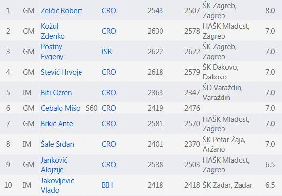

Iza nas je trideseto izdanje međunarodnog šahovskog turnira *Zagreb Open 2013*,  u organizaciji ZŠS na kojem je sudjelovalo 194 šahista iz ukupno 9 zemalja (HR, BIH, FRA, GER, ISR, SLO, SRB, TUR, WLS). Igralo se 9 kola po švicarskom sistemu. Pobjednik je [**Zelčić Robert**](http://hr.wikipedia.org/wiki/Robert_Zel%C4%8Di%C4%87 "Wiki: Zelčić Robert") (2543) sa 8 bodova iz devet partija.

