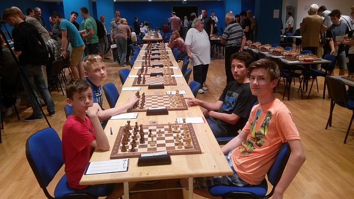
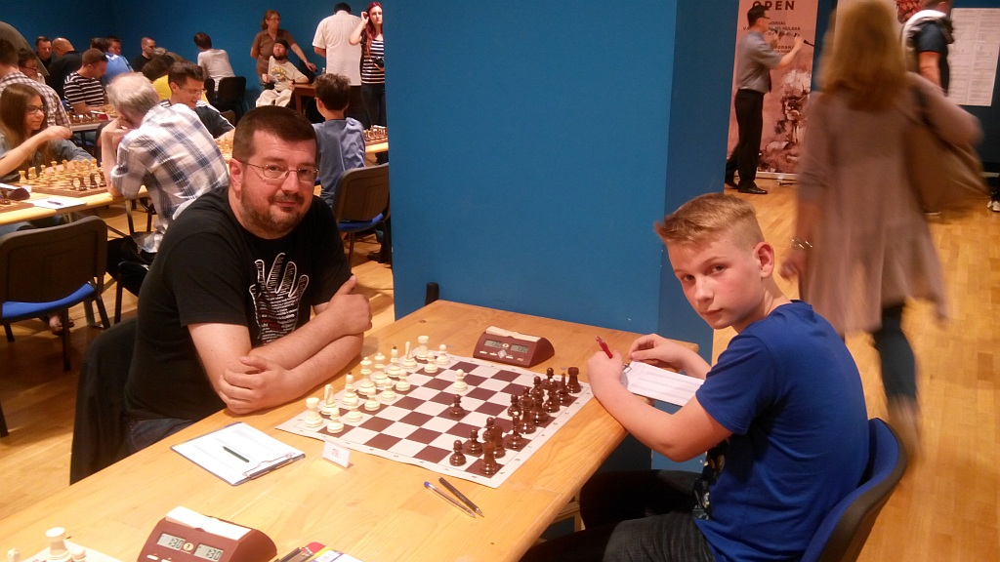

U Zagrebu se, u organizaciji Hrvatskoga šahovskog saveza, od 10. do 17. lipnja igra tradicionalni Zagreb Open. Nakon šest kola vodstvo je, pobjedom nad velemajstorom Zdenkom Kožulom, preuzeo velemajstor Mladen Palac. Rezultati se mogu pratiti na ovoj [poveznici.](http://chess-results.com/tnr220440.aspx?lan=1&art=1&rd=6&flag=30&wi=821)  Od naših članova, na turniru nastupaju kadeti Božo, Vraneša, Kljujev i Ivan. Na ovom turniru dečki su već imali priliku suprotstaviti se mnogo iskusnijim šahistima, polako ulaze u osnove šahovskih otvaranja, pokušavaju i kombinirati, uglavnom bez uspjeha, ali u svakom slučaju mislim da će imati dosta koristi od nastupa na ovom turniru. Dečki su se odrekli mnogih utakmica s Europskoga nogometnog prvenstva i zaslužuju čestitke na uloženom trudu i odricanju. U nastavku donosimo nekoliko partija s turnira.

---

```pgn
[Event "Open Zagreb 2016 2016"]
[Site "Zagreb"]
[Date "2016.06.11"]
[Round "2.1"]
[White "Kostanjsek, Zorko 2143"]
[Black "Stevic, Hrvoje 2610"]
[Result "1-0"]
[ECO "B30"]
[WhiteElo "2143"]
[BlackElo "2610"]
[PlyCount "85"]

1. e4 c5 2. c3 d5 3. d3 Nc6 4. Be2 Nf6 5. Nd2 g6 6. Ngf3 Bg7 7. O-O O-O 8. Qc2
Qc7 9. Re1 h6 10. a4 Be6 11. Nf1 Rac8 12. Ng3 Rfd8 13. Bf1 dxe4 14. dxe4 Na5
15. Ra3 Qb6 16. e5 Nd5 17. h3 a6 18. Qe4 Nb3 19. a5 Nxa5 20. Qh4 h5 21. Nxh5
gxh5 22. Qxh5 f6 23. Bd3 Nc7 24. Bg6 Kf8 25. Bh6 Bg8 26. Nh4 Ne6 27. Nf5 Rc7
28. Bxg7+ Nxg7 29. Qh6 e6 30. Nxg7 Ke7 31. exf6+ Kd7 32. f7 Kc8 33. fxg8=Q Rxg8
34. Nxe6 Re7 35. Bf5 Kb8 36. Qf4+ Ka7 37. b4 cxb4 38. cxb4 Nc6 39. Rb1 Qb5 40.
Qe3+ Kb8 41. Qc5 Qe2 42. Qd6+ Ka7 43. b5 1-0
```

---

```pgn
[Event "Open Zagreb 2016"]
[Site "Zagreb"]
[Date "2016.06.13"]
[Round "5.8"]
[White "Zaja, Ivan 2448"]
[Black "Vidic, Teja 2179"]
[Result "0-1"]
[ECO "D17"]
[WhiteElo "2448"]
[BlackElo "2179"]
[PlyCount "56"]

1. d4 d5 2. c4 c6 3. Nf3 Nf6 4. Nc3 dxc4 5. a4 Bf5 6. Ne5 Nbd7 7. Nxc4 Qc7 8.
g3 e5 9. dxe5 Nxe5 10. Bf4 Nfd7 11. a5 g5 12. Nxe5 gxf4 13. Nxd7 O-O-O 14. Qd4
Qxd7 15. Qxf4 Bd6 16. Qc1 h5 17. a6 b6 18. Bg2 Bh3 19. Bf3 Kb8 20. Ra4 Be5 21.
Rc4 Rh6 22. Re4 Re6 23. Rh4 Rd6 24. e3 Bxc3+ 25. bxc3 Bg2 26. Bxg2 Rd1+ 27. Ke2
Rxc1 28. Rd4 Rc2+ 0-1
```

---

```pgn
[Event "Open Zagreb 2016"]
[Site "Zagreb"]
[Date "2016.06.13"]
[Round "5.2"]
[White "Kozul, Zdenko 2594"]
[Black "Saric, Ante 2587"]
[Result "1-0"]
[ECO "E04"]
[WhiteElo "2594"]
[BlackElo "2587"]
[PlyCount "77"]

1. d4 Nf6 2. c4 e6 3. g3 d5 4. Bg2 dxc4 5. Nf3 Nc6 6. O-O Rb8 7. Nc3 b5 8. Ne5
Nxe5 9. dxe5 Nd7 10. Qc2 Bb7 11. Bxb7 Rxb7 12. Rd1 Qc8 13. Ne4 Nxe5 14. b3 f5
15. Bb2 Nc6 16. Nd2 Nb4 17. Qc1 cxb3 18. axb3 c5 19. Nf3 Nd5 20. Qg5 Be7 21.
Qh5+ g6 22. Qh6 Bf8 23. Qc1 Bg7 24. Bxg7 Rxg7 25. Ra5 a6 26. Qa1 O-O 27. Rxa6
Nc3 28. Rdd6 Nxe2+ 29. Kf1 Qb7 30. Rac6 Nd4 31. Nxd4 cxd4 32. Qxd4 Re7 33. Qe5
Rfe8 34. h4 Kf7 35. h5 Rd8 36. hxg6+ hxg6 37. Rxe6 Rd1+ 38. Ke2 Qd7 39. Rxe7+
1-0
```

---

```pgn
[Event "Open Zagreb 2016"]
[Site "Zagreb"]
[Date "2016.06.13"]
[Round "5.5"]
[White "Tratar, Marko 2444"]
[Black "Loncar, Robert 2385"]
[Result "1-0"]
[ECO "E91"]
[WhiteElo "2444"]
[BlackElo "2385"]
[PlyCount "113"]

1. Nf3 g6 2. d4 Bg7 3. c4 Nf6 4. Nc3 O-O 5. e4 d6 6. Be2 c5 7. O-O Nc6 8. d5
Na5 9. Bd2 e5 10. Rc1 Bg4 11. b3 b6 12. Ne1 Bxe2 13. Qxe2 Nd7 14. Nd3 Qe7 15.
g3 Rae8 16. Rce1 Qd8 17. Qd1 a6 18. Qc2 Nb7 19. Kg2 f5 20. f4 Qc8 21. Re2 b5
22. cxb5 axb5 23. Nxb5 fxe4 24. Nf2 e3 25. Bxe3 exf4 26. Bxf4 Ne5 27. Ne4 Qd7
28. a4 Rf5 29. Ng5 Nd8 30. Ree1 Ref8 31. Ne4 Nb7 32. Qd1 Rh5 33. h4 Rhf5 34.
Ng5 Nd8 35. Ne4 Nb7 36. Qe2 h6 37. Qd1 Nf7 38. g4 Rxf4 39. Rxf4 Ne5 40. Rxf8+
Kxf8 41. Rf1+ Kg8 42. Rf4 g5 43. hxg5 hxg5 44. Nxg5 Bh6 45. Rf5 Qe7 46. Ne6 Qh4
47. Rh5 Qf6 48. Qf1 Qxf1+ 49. Kxf1 Nxg4 50. Rh4 Ne3+ 51. Kf2 Kf7 52. Rh3 Nf5
53. Na3 Be3+ 54. Rxe3 Nxe3 55. Kxe3 Na5 56. Nc4 Nxb3 57. a5 1-0
```

---

```pgn
[Event "Open Zagreb 2016"]
[Site "Zagreb"]
[Date "2016.06.10"]
[Round "1.12"]
[White "Deris, Antun 1966"]
[Black "Lalic, Bogdan 2440"]
[Result "0-1"]
[ECO "B51"]
[WhiteElo "1966"]
[BlackElo "2440"]
[PlyCount "74"]

1. e4 c5 2. Nf3 Nc6 3. Nc3 d6 4. Bb5 e5 5. h3 Nf6 6. O-O Be7 7. d3 O-O 8. Bxc6
bxc6 9. b3 Ne8 10. Nh2 f5 11. exf5 Bxf5 12. f4 Bf6 13. Bb2 exf4 14. Rxf4 Nc7
15. Na4 Bxb2 16. Nxb2 Qg5 17. Qd2 Ne6 18. Rf2 Qg3 19. Rf3 Qg6 20. Nf1 Nd4 21.
Rg3 Qf6 22. c3 Ne6 23. Nc4 d5 24. Nce3 d4 25. cxd4 Qxd4 26. Rd1 Nf4 27. Kh2
Bxd3 28. Ng4 Bxf1 29. Qxd4 cxd4 30. Rxf1 Rae8 31. Rd1 c5 32. b4 h5 33. Nf2 Ne2
34. Rf3 Rxf3 35. gxf3 c4 36. Ne4 c3 37. Re1 c2 0-1
```

---

```pgn
[Event "Open Zagreb 2016"]
[Site "Zagreb"]
[Date "2016.06.10"]
[Round "1.20"]
[White "Veljacic, Elvis 1917"]
[Black "Kokol, Peter 2345"]
[Result "0-1"]
[ECO "A38"]
[WhiteElo "1917"]
[BlackElo "2345"]
[PlyCount "82"]

1. c4 Nf6 2. Nc3 g6 3. g3 Bg7 4. Bg2 O-O 5. Nf3 c5 6. O-O d5 7. cxd5 Nxd5 8.
Nxd5 Qxd5 9. d3 Nc6 10. a3 Qd7 11. Qc2 b6 12. Rb1 Bb7 13. b3 Rac8 14. Bb2 Nd4
15. Bxd4 cxd4 16. Qd2 Rc3 17. Rfc1 Rfc8 18. Rxc3 Rxc3 19. Qd1 Qd6 20. a4 Bh6
21. Ne1 Bc8 22. b4 Be6 23. b5 Ba2 24. Ra1 Bb3 25. Qb1 Rc1 26. Qb2 Rxa1 27. Qxa1
Qb4 28. Bc6 Bxa4 29. Nf3 Bg7 30. Qa2 e6 31. Qc4 a5 32. Bd7 Qxc4 33. dxc4 Bc2
34. c5 bxc5 35. Bc6 a4 36. b6 Bf8 37. b7 Bd6 38. Ne1 Bb3 39. Nd3 c4 40. Nc5 a3
41. Ne4 Bb8 0-1
```

---

```pgn
[Event "Open Zagreb 2016"]
[Site "Zagreb"]
[Date "2016.06.14"]
[Round "6.7"]
[White "Vidic, Teja 2179"]
[Black "Saric, Ante 2587"]
[Result "0-1"]
[ECO "B22"]
[WhiteElo "2179"]
[BlackElo "2587"]
[PlyCount "122"]

1. e4 c5 2. c3 Nf6 3. e5 Nd5 4. d4 cxd4 5. Nf3 e6 6. cxd4 d6 7. Bc4 Be7 8. O-O
O-O 9. Bd2 dxe5 10. dxe5 b6 11. Qe2 Bb7 12. Nc3 Nxc3 13. Bxc3 Nd7 14. Rad1 Qc7
15. Bd3 Nc5 16. Bb1 Ba6 17. Qc2 g6 18. Rfe1 Rfd8 19. Bd4 Rac8 20. b4 Bd3 21.
Qc1 Bxb1 22. Qxb1 Na4 23. Rc1 Qb7 24. Qb3 b5 25. a3 a6 26. Qe3 Rc4 27. Rxc4
bxc4 28. h3 Qb5 29. Rc1 Qd5 30. Kh2 Kg7 31. Qe2 Rc8 32. Qc2 Qb5 33. Nd2 Rd8 34.
Qxc4 Bg5 35. Rd1 Bxd2 36. Qxb5 Bf4+ 37. g3 axb5 38. gxf4 Nb2 39. Rd2 Nc4 40.
Rd3 Nxa3 41. Rd2 Nb1 42. Rd3 Nc3 43. Rd2 Ne4 44. Rd3 Nxf2 45. Rd2 Ne4 46. Rd3
Rd5 47. Kg2 Nc3 48. f5 exf5 49. e6+ f6 50. Rxc3 Rxd4 51. Rc8 Re4 52. Rb8 Rxe6
53. Rxb5 Re4 54. Rb7+ Kh6 55. b5 Rb4 56. Kg3 g5 57. b6 f4+ 58. Kg4 Kg6 59. Kf3
h5 60. Rb8 Kf5 61. b7 Rb2 0-1
```

---

```pgn
[Event "Open Zagreb 2016"]
[Site "Zagreb"]
[Date "2016.06.14"]
[Round "6.5"]
[White "Tomerlin, Sinisa 2260"]
[Black "Stevic, Hrvoje 2610"]
[Result "1-0"]
[ECO "A11"]
[WhiteElo "2260"]
[BlackElo "2610"]
[PlyCount "97"]

1. Nf3 d5 2. g3 Bg4 3. Bg2 Nd7 4. O-O e6 5. d3 c6 6. c4 Bxf3 7. Bxf3 Ne5 8. Bg2
dxc4 9. d4 Nd7 10. a4 a5 11. Qc2 Nb6 12. Rd1 Nf6 13. e4 Bb4 14. Be3 O-O 15. Na3
Bxa3 16. Rxa3 Nfd7 17. Bf1 Qf6 18. b3 Qe7 19. Rda1 c5 20. bxc4 cxd4 21. Bxd4 e5
22. Bxb6 Nxb6 23. Rb3 Qc5 24. Rb5 Qc6 25. Rab1 Nd7 26. Rxb7 Nc5 27. R7b5 Qc7
28. Rd1 Ne6 29. Qb2 Nd4 30. Rd5 Rfb8 31. Qc1 Rb4 32. c5 Rxa4 33. c6 h6 34. Rd7
Qb6 35. c7 Rc8 36. Qb1 Rb4 37. Qa2 Ne6 38. Bc4 Rb2 39. Qxb2 Qxb2 40. Bxe6 fxe6
41. Rd8+ Kh7 42. Rxc8 Qb7 43. Rh8+ Kxh8 44. Rd8+ Kh7 45. c8=Q Qb1+ 46. Kg2
Qxe4+ 47. Kf1 Qb1+ 48. Ke2 a4 49. Rh8+ 1-0
```

---

```pgn
[Event "Open Zagreb 2016"]
[Site "Zagreb"]
[Date "2016.06.14"]
[Round "6.2"]
[White "Martinovic, Sasa 2540"]
[Black "Tratar, Marko 2454"]
[Result "1-0"]
[ECO "E20"]
[WhiteElo "2540"]
[BlackElo "2454"]
[PlyCount "54"]

1. d4 e6 2. c4 Nf6 3. Nc3 Bb4 4. g3 O-O 5. Bg2 d5 6. a3 Bxc3+ 7. bxc3 c6 8. Nf3
Nbd7 9. O-O b6 10. Nd2 Ba6 11. Re1 Rc8 12. e4 Nxe4 13. Nxe4 dxe4 14. Qa4 Nb8
15. Bxe4 c5 16. d5 Qd7 17. Qc2 h6 18. dxe6 fxe6 19. Qe2 Nc6 20. Bf4 Qf7 21.
Rad1 Na5 22. Qg4 Bxc4 23. Bxh6 Bd5 24. Bf4 Bxe4 25. Rxe4 Rfe8 26. Rde1 Rc6 27.
Be5 Qf5 1-0
```

---

```pgn
[Event "Open Zagreb 2016"]
[Site "Zagreb"]
[Date "2016.06.14"]
[Round "6.1"]
[White "Palac, Mladen 2596"]
[Black "Kozul, Zdenko 2594"]
[Result "1-0"]
[ECO "B90"]
[WhiteElo "2596"]
[BlackElo "2594"]
[PlyCount "49"]

1. e4 c5 2. Nf3 d6 3. d4 cxd4 4. Nxd4 Nf6 5. Nc3 a6 6. h3 g6 7. g4 Bg7 8. Bg2
O-O 9. Be3 Nfd7 10. Qd2 Nc6 11. O-O-O Rb8 12. f4 Na5 13. b3 Re8 14. g5 b5 15.
h4 e5 16. Nde2 exf4 17. Nxf4 Nb7 18. h5 Nbc5 19. hxg6 hxg6 20. Bd4 Re5 21. Bxe5
dxe5 22. Nxg6 b4 23. Nd5 fxg6 24. Nf6+ Bxf6 25. Qd5+ 1-0
```
