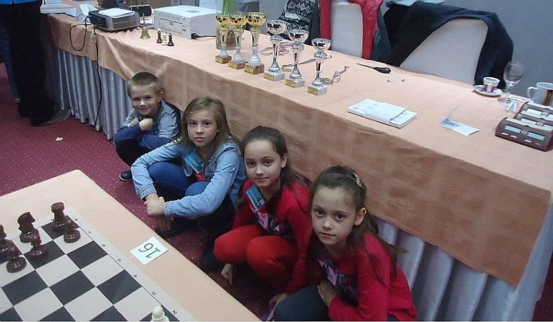

## 

Prošlog vikenda završeno je 12. pojedinačno prvenstvo Hrvatske do 8 godina.  Nastupili su Monika, Lucija, Luka i Franka. Mogu reći da su ugodno iznenadili, posebno Monika, koja je upisala pet pobjeda! Još nedostaju neke sitnice za ozbiljniji napredak, a to su zapisivanje partija,  sporija igra i više nastupa na turnirima. Već na sljedećem treningu nakon turnira vidjelo se da su zreliji igrači, a Lucija je naučila i mat po osnovnom redu. 🙂 Franka je skupila nekoliko pobjeda, a Luka je mrvicu popustio u posljednje tri partije. Za prvi nastup na ovako velikom i važnom turniru, i više nego super!

Nasreću, ubrzo im se pruža prilika za vježbanje pisanja (zapisivanje partija), koje će i za njih uskoro biti obvezatno. U sljedeći petak proslavit ćemo ovaj uspješan nastup pizzom!

U nastavku ovog posta dodane su tablice s rezultatima, tek za uspomenu.

Slike s turnira mogu se vidjeti [ovdje](http://chess-results.com/Fotos.aspx?lan=13&key1=1814 "slike sa turnira").

Također, slike s ovogodišnjega ekipnog  natjecanja za osnovne škole mogu se naći [ovdje](http://www.skolski-sport-zg.hr/osnovne/sah/pics-z2/images/IMG_5651.jpg "ekipa sa voditeljem"), a sve ostale  [ovdje](http://www.skolski-sport-zg.hr/osnovne/sah/pics-z2/ "prvenstvo osnovnih škola 2014.").

## Konačni poredak s partijama nakon 9. kola

**dječaci**

| Mj. |   | Ime |   | 1.Rd | 2.Rd | 3.Rd | 4.Rd | 5.Rd | 6.Rd | 7.Rd | 8.Rd | 9.Rd | Bod. |
| --- | --- | --- | --- | --- | --- | --- | --- | --- | --- | --- | --- | --- | --- |
| 1 |  | Vučenović Damian |  | 30w1 | 6b0 | 39w1 | 29b1 | 38w1 | 2b1 | 3w1 | 5w1 | 4b1 | 8.0 |
| 2 |  | Jakšić Josip |  | 29b1 | 34w1 | 38b1 | 16w1 | 14b1 | 1w0 | 5b0 | 10w1 | 12b1 | 7.0 |
| 3 |  | Colev Ivor |  | 6w0 | 47b1 | 46w1 | 24b1 | 15b1 | 10w1 | 1b0 | 11w1 | 5b1 | 7.0 |
| 4 |  | Lešić Damir |  | 26b1 | 9w1 | 15b½ | 12w1 | 5b0 | 14w1 | 8b1 | 7w1 | 1w0 | 6.5 |
| 5 | IV | Vasilijević Vili |  | 39w1 | 24b1 | 6w1 | 14b0 | 4w1 | 22b1 | 2w1 | 1b0 | 3w0 | 6.0 |
| 6 |  | Jakrlin Antonio |  | 3b1 | 1w1 | 5b0 | 22w0 | 31w1 | 16b1 | 12b0 | 14w1 | 19b1 | 6.0 |
| 7 |  | Brčić Karlo |  | 41b1 | 15w0 | 8b1 | 11w1 | 10b0 | 19w1 | 14b1 | 4b0 | 16w1 | 6.0 |
| 8 |  | Dragić Hrvoje |  | 17w½ | 23b1 | 7w0 | 13b1 | 16b1 | 18w1 | 4w0 | 15b1 | 9w½ | 6.0 |
| 9 |  | Kajganić Tin |  | 25w1 | 4b0 | 18w1 | 31b1 | 22b0 | 12w½ | 34b1 | 17w1 | 8b½ | 6.0 |
| 10 |  | Vlahov Andrija |  | 13w0 | 43b1 | 40w1 | 30b1 | 7w1 | 3b0 | 23w1 | 2b0 | 20w1 | 6.0 |
| 11 |  | Car Jura |  | 40w1 | 18b1 | 14w0 | 7b0 | 30w1 | 13b1 | 22w1 | 3b0 | 23w1 | 6.0 |
| 12 | IV | Gulija Marin |  | 21w1 | 46b1 | 16w0 | 4b0 | 29w1 | 9b½ | 6w1 | 23b1 | 2w0 | 5.5 |
| 13 |  | Marković Patrik |  | 10b1 | 38w0 | 34b½ | 8w0 | 27b1 | 11w0 | 44b1 | 39w1 | 24b1 | 5.5 |
| 14 |  | Hatvalić Lovro |  | 35b1 | 33w1 | 11b1 | 5w1 | 2w0 | 4b0 | 7w0 | 6b0 | 32b1 | 5.0 |
| 15 |  | Baturina Marin |  | 20w1 | 7b1 | 4w½ | 17b1 | 3w0 | 23b0 | 25w1 | 8w0 | 22b½ | 5.0 |
| 16 |  | Kovačić Nikola |  | 22b1 | 45w1 | 12b1 | 2b0 | 8w0 | 6w0 | 29b1 | 34w1 | 7b0 | 5.0 |
| 17 |  | Zadro Matej |  | 8b½ | 28w1 | 19b1 | 15w0 | 23w0 | 24b1 | 31w1 | 9b0 | 21w½ | 5.0 |
| 18 |  | Skoblar Jure |  | 27b1 | 11w0 | 9b0 | 32w1 | 41w1 | 8b0 | 30b1 | 19w0 | 29b1 | 5.0 |
| 19 |  | Rukavina David |  | 36w1 | 31b1 | 17w0 | 38w0 | 39b1 | 7b0 | 45w1 | 18b1 | 6w0 | 5.0 |
| 20 |  | Rašan Josip |  | 15b0 | 29w0 | 35b0 | 42w1 | 32b1 | 27w1 | 39b1 | 22w1 | 10b0 | 5.0 |
| 21 |  | Frouth Vibor |  | 12b0 | 44w1 | 22b0 | 33w½ | 26b1 | 34w0 | 37b1 | 35w1 | 17b½ | 5.0 |
| 22 |  | Vulić Marul |  | 16w0 | 42b1 | 21w1 | 6b1 | 9w1 | 5w0 | 11b0 | 20b0 | 15w½ | 4.5 |
| 23 |  | Borzan Matej |  | 28b½ | 8w0 | 33b1 | 34w1 | 17b1 | 15w1 | 10b0 | 12w0 | 11b0 | 4.5 |
| 24 |  | Basrak Leo |  | 44b1 | 5w0 | 32b1 | 3w0 | 35b½ | 17w0 | 28w1 | 25b1 | 13w0 | 4.5 |
| 25 |  | Badrov Leon |  | 9b0 | 27w1 | 29b0 | 26w½ | 28b1 | 35w1 | 15b0 | 24w0 | 30b1 | 4.5 |
| 26 |  | Križanić Petar |  | 4w0 | 36b1 | 31w0 | 25b½ | 21w0 | 28b0 | 33b1 | 37w1 | 34b1 | 4.5 |
| 27 |  | Kos Nikola |  | 18w0 | 25b0 | 43w1 | 36b½ | 13w0 | 20b0 | 47b1 | 44w1 | 35b1 | 4.5 |
| 28 |  | Pisker Ivano |  | 23w½ | 17b0 | 36w0 | 48b1 | 25w0 | 26w1 | 24b0 | 45b1 | 41w1 | 4.5 |
| 29 |  | Franc Borna |  | 2w0 | 20b1 | 25w1 | 1w0 | 12b0 | 40b1 | 16w0 | 41b1 | 18w0 | 4.0 |
| 30 |  | Klarić Dinko |  | 1b0 | 37w1 | 45b1 | 10w0 | 11b0 | 38b+ | 18w0 | 31b1 | 25w0 | 4.0 |
| 31 |  | Mesić Petar |  | 32b1 | 19w0 | 26b1 | 9w0 | 6b0 | 33w1 | 17b0 | 30w0 | 39b1 | 4.0 |
| 32 |  | Lozančić Lovre |  | 31w0 | 48b1 | 24w0 | 18b0 | 20w0 | 43b1 | 40w1 | 36b1 | 14w0 | 4.0 |
| 33 |  | Vukojević Roko |  | 48w1 | 14b0 | 23w0 | 21b½ | 36w½ | 31b0 | 26w0 | 43b1 | 40w1 | 4.0 |
| 34 |  | Arapović Filip |  | 43w1 | 2b0 | 13w½ | 23b0 | 40w1 | 21b1 | 9w0 | 16b0 | 26w0 | 3.5 |
| 35 |  | Maršanić Filip |  | 14w0 | 39b0 | 20w1 | 46b1 | 24w½ | 25b0 | 36w1 | 21b0 | 27w0 | 3.5 |
| 36 |  | Bušić Ante |  | 19b0 | 26w0 | 28b1 | 27w½ | 33b½ | 37w½ | 35b0 | 32w0 | 44b1 | 3.5 |
| 37 |  | Šafran Matej |  | 46w0 | 30b0 | 47w1 | 41b0 | 48w1 | 36b½ | 21w0 | 26b0 | 45w1 | 3.5 |
| 38 |  | Obućina Nikola |  | 42w1 | 13b1 | 2w0 | 19b1 | 1b0 | 30w- | 0 | 0 | 0 | 3.0 |
| 39 |  | **Fiolić Luka** |  | 5b0 | 35w1 | 1b0 | 44w1 | 19w0 | 41b1 | 20w0 | 13b0 | 31w0 | 3.0 |
| 40 |  | Surać Frane |  | 11b0 | 41w1 | 10b0 | 45w1 | 34b0 | 29w0 | 32b0 | 42w1 | 33b0 | 3.0 |
| 41 |  | Grgurić Noel |  | 7w0 | 40b0 | 42w+ | 37w1 | 18b0 | 39w0 | 42b1 | 29w0 | 28b0 | 3.0 |
| 42 |  | Pavlović Borna |  | 38b0 | 22w0 | 41b- | 20b0 | 47w1 | 46b1 | 41w0 | 40b0 | 48w1 | 3.0 |
| 43 |  | Portada Marko |  | 34b0 | 10w0 | 27b0 | 47b1 | 45w0 | 32w0 | 46b1 | 33w0 | \-1 | 3.0 |
| 44 |  | Pucko Martin |  | 24w0 | 21b0 | 48w1 | 39b0 | 46w1 | 45b½ | 13w0 | 27b0 | 36w0 | 2.5 |
| 45 |  | Mihalj Matej |  | 47w1 | 16b0 | 30w0 | 40b0 | 43b1 | 44w½ | 19b0 | 28w0 | 37b0 | 2.5 |
| 46 |  | Dujmović Anton |  | 37b1 | 12w0 | 3b0 | 35w0 | 44b0 | 42w0 | 43w0 | 48b1 | 47b½ | 2.5 |
| 47 |  | Lisjak Dražen |  | 45b0 | 3w0 | 37b0 | 43w0 | 42b0 | 48b1 | 27w0 | \-1 | 46w½ | 2.5 |
| 48 |  | Došen Juraj |  | 33b0 | 32w0 | 44b0 | 28w0 | 37b0 | 47w0 | \-1 | 46w0 | 42b0 | 1.0 |

## djevojčice

| Mj. |   | Ime | 1.Rd | 2.Rd | 3.Rd | 4.Rd | 5.Rd | 6.Rd | 7.Rd | 8.Rd | 9.Rd | Bod. |
| --- | --- | --- | --- | --- | --- | --- | --- | --- | --- | --- | --- | --- |
| 1 | II | Putar Lara | 9b1 | 8w1 | 4b1 | 2w1 | 6b1 | 7w1 | 3b0 | 5b1 | 11w1 | 8.0 |
| 2 | III | Trgovac Marta | 12b1 | 18w1 | 14b1 | 1b0 | 4w1 | 9w1 | 6b1 | 3w1 | 5b0 | 7.0 |
| 3 | II | Smetiško Renata | 4w0 | 13b1 | 8b1 | 10w1 | 14b1 | 6w1 | 1w1 | 2b0 | 7w1 | 7.0 |
| 4 |  | Kovač Petra | 3b1 | 17w1 | 1w0 | 18b1 | 2b0 | 5w0 | 12b1 | 14w1 | 9b1 | 6.0 |
| 5 |  | Dokoza Nikolina | 11w1 | 7b0 | 16w1 | 6b0 | 8w1 | 4b1 | 10b1 | 1w0 | 2w1 | 6.0 |
| 6 |  | Bradbury Hannah Stephanie | 10b1 | 16w1 | 7b1 | 5w1 | 1w0 | 3b0 | 2w0 | 15b½ | 12b½ | 5.0 |
| 7 |  | Trglavčnik Lana | 13b1 | 5w1 | 6w0 | 15b1 | 20w1 | 1b0 | 14b1 | 9w0 | 3b0 | 5.0 |
| 8 |  | Medić Nika Ivana | 19b1 | 1b0 | 3w0 | 21w1 | 5b0 | 13w1 | 9b0 | 16w1 | 15b1 | 5.0 |
| 9 |  | **Kolovrat Monika** | 1w0 | 23b1 | 11w0 | 22b1 | 18w1 | 2b0 | 8w1 | 7b1 | 4w0 | 5.0 |
| 10 |  | Lukić Mia | 6w0 | \-1 | 22b1 | 3b0 | 15w½ | 11b1 | 5w0 | 18b½ | 14w1 | 5.0 |
| 11 |  | Serapiglia Marta | 5b0 | 19w1 | 9b1 | 14w0 | 13b½ | 10w0 | 16b1 | 20w1 | 1b0 | 4.5 |
| 12 |  | Ladan Paula | 2w0 | 15b0 | 23w1 | 20b0 | 19w1 | 18b1 | 4w0 | 17b1 | 6w½ | 4.5 |
| 13 |  | **Kolovrat Franka** | 7w0 | 3w0 | 19b1 | 16b1 | 11w½ | 8b0 | 15w0 | 21w1 | 20b1 | 4.5 |
| 14 |  | Lončar Dorotea | 21b1 | 22w1 | 2w0 | 11b1 | 3w0 | 15b1 | 7w0 | 4b0 | 10b0 | 4.0 |
| 15 |  | Dolenec Klara | 16b0 | 12w1 | 17b1 | 7w0 | 10b½ | 14w0 | 13b1 | 6w½ | 8w0 | 4.0 |
| 16 |  | Smetiško Ana | 15w1 | 6b0 | 5b0 | 13w0 | 17b1 | 21w1 | 11w0 | 8b0 | 22w1 | 4.0 |
| 17 |  | Vučenović Diara | 20w1 | 4b0 | 15w0 | 19b0 | 16w0 | 22b1 | 21b1 | 12w0 | 18w1 | 4.0 |
| 18 |  | Pedišić Nuša | 23w1 | 2b0 | 21b1 | 4w0 | 9b0 | 12w0 | 19b1 | 10w½ | 17b0 | 3.5 |
| 19 |  | Bradbury Taliah Petra | 8w0 | 11b0 | 13w0 | 17w1 | 12b0 | 20b1 | 18w0 | 22w1 | 21b½ | 3.5 |
| 20 |  | **Kolovrat Lucija** | 17b0 | 21w0 | \-1 | 12w1 | 7b0 | 19w0 | 22b1 | 11b0 | 13w0 | 3.0 |
| 21 |  | Barić Nola | 14w0 | 20b1 | 18w0 | 8b0 | 22w1 | 16b0 | 17w0 | 13b0 | 19w½ | 2.5 |
| 22 |  | Zanki Ira | \-1 | 14b0 | 10w0 | 9w0 | 21b0 | 17w0 | 20w0 | 19b0 | 16b0 | 1.0 |
| 23 |  | Denić Magdalena | 18b0 | 9w0 | 12b0 | 0 | 0 | 0 | 0 | 0 | 0 | 0.0 |
