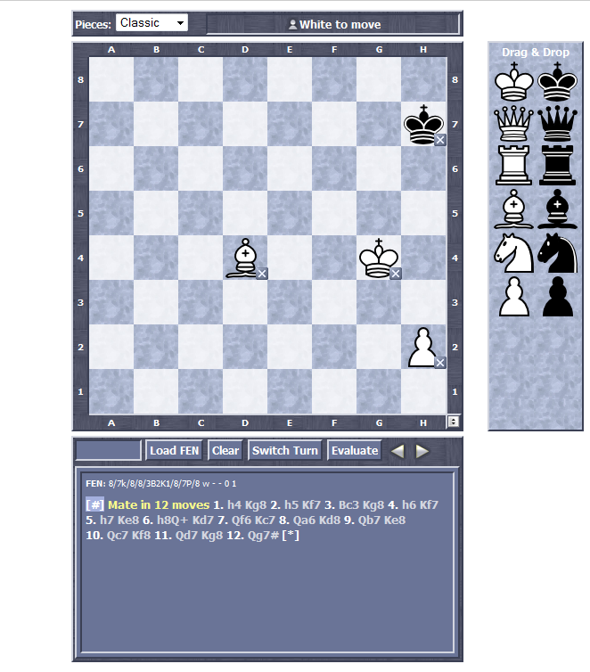

Isprobano na par primjera (npr. mat lovcem i skakačem ili zanimljiv dobitak: dva lovca protiv skakača). U slučaju da dobitak postoji – algoritam će ga pronaći. Kad je pozicija remi – algoritam je dobro ocijeni, ali ne baš tako kvalitetno objasni. Svakako isprobati.

Link je postavljen i u sidebar (*Korisni linkovi*).

