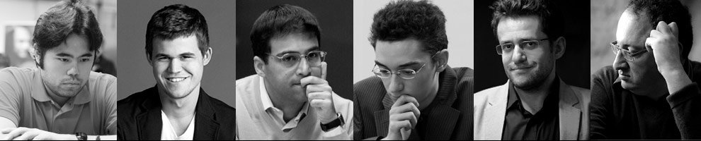

U tijeku je drugo kolo *Zurich Chess Challenge 2014.* Ove godine to je turnir šestorice, a od prošlogodišnje četvorke nedostaje samo Kramnik. Uz **Caruanu**, **Gelfanda** i **Ananda** tu su i **Carlsen**, **Aronian** i **Nakamura**, prosječni rejting je 2801 čime je *ZCC2014* postao najjači turnir u povijesti. Carlsenu i Anandu je to prvi nastup nakon sudara za titulu prvaka svijeta.

Uvodni brzopotezni turnir osvojio je s 3/5 Carlsen koji je bio bolji od Aroniana po dodatnom kriteriju.

<table><tbody><tr><td>1</td><td>Magnus Carlsen</td><td>2872</td><td>3</td></tr><tr><td>2</td><td>Levon Aronian</td><td>2812</td><td>3</td></tr><tr><td>3</td><td>Hikaru Nakamura</td><td>2789</td><td>2.5</td></tr><tr><td>4</td><td>Fabiano Caruana</td><td>2782</td><td>2.5</td></tr><tr><td>5</td><td>Viswanathan Anand</td><td>2773</td><td>2.5</td></tr><tr><td>6</td><td>Boris Gelfand</td><td>2777</td><td>1.5</td></tr></tbody></table>

Rezultati prvog kola:

Magnus Carlsen – Boris Gelfand: 1 : 0  
Levon Aronian – Viswanathan Anand: 1 : 0  
Fabiano Caruana – Hikaru Nakamura: ½ : ½

**Gelfand** zasad potvruđuje svoju, u zadnje vrijeme, lošiju formu ili mu Carlsen jednostavno ne leži, jer za pobjedu protiv njega ne zna od 2011. godine, odnosno desetak zadnjih mečeva. **Aronian** upravo obrnuto, nastavlja s uvjerljivom igrom i vrlo je blizu svog najboljeng rejtinga karijere čime bi popravio i (svoj) treći rating svih vremena! **Carlsen** i **Anand** su se dovoljno odmarali, vidjet ćemo jesu li napredovali ili su zaboravili igrati šah. **Nakamura**, nakon dužeg dobrog razdoblja ponovo u zadnje vrijeme oscilira u svojoj igri, ali to je igrač koji može pobjediti svakog. I na kraju već standarno odličan dvadesetjednogodišnji **Caruana** kojeg u budućnosti vidimo kao pretendenta za titulu. Sve u svemu vrlo zanimljiv turnir koji će zanimati svakog istinskog ljubitelja šaha.

[***Live!***](http://www.zurich-cc.com/games.html "Zurich Chess Challenge 2014")

**Iz pravila**: pobjeda nosi 2 boda, remi 1 bod. 120 minuta za 40 poteza + 60 minuta za 20 poteza + 15 minuta za ostatak partije + 30 sekundi za svaki potez poslije 61. Za svaki remi prije 40-og poteza igra se nova partija po ubrzanom tempu.
