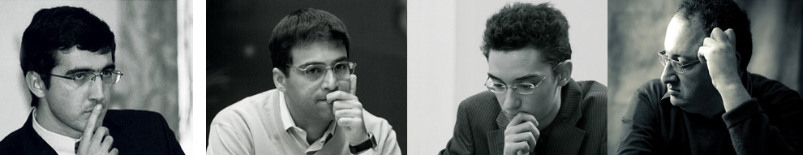
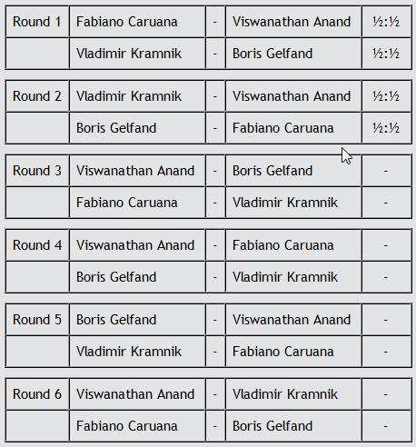

  
Vladimir Kramnik (2). Viswanathan Anand (6). Fabiano Caruana (11). Boris Gelfand (18).

Organizator ovog mini-turnira je *Zurich Chess Club*, najstarije šahovsko društvo na svijetu, koje je prije četiri godine proslavilo [200-godišnjicu postojanja](http://www.sgzurich2009.ch/pages/jubeAds/oldSociety.php?lang=en "The Schachgesellschaft Zürich's Jubilee! (1809 - 2009)")! Nakon prošlogodišnjeg prvog izdanja *Zurich Chelange* (Kramnik – Aronian), ove godine je to vrlo jak turnir četvorice (2700+).

*Uvodni brzopotezni turnir* osvojio je **Caruana** sa 5 bodova ispred Kramnika – 4 boda, te Gelfanda i Ananda sa po 1,5 bod. Dosadašnji razvoj događaja na [glavnom turniru](http://www.zurich-cc.com/ "Službena stranica: Zurich Chess Chelange 2013"):  

